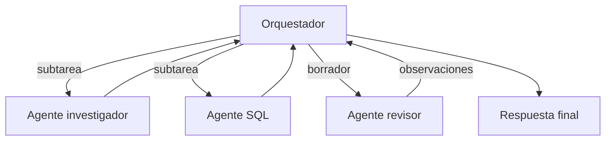

# Sistemas multi-agente y orquestación

Parte de: [[21-IA-Machine-Learning/06 Agentes de IA/_Índice Agentes de IA|Agentes de IA]]

> [!info] Cómo avanzar
> `progreso`: **pendiente** → **viendo** (estudiando) → **visto** (contestaste la autoevaluación sin abrir las respuestas) → **dominado** (hiciste el laboratorio o lo aplicaste de verdad).

## Contenido

### Qué es
Un **sistema multi-agente** reparte una tarea entre varios agentes, cada uno con su propio rol, instrucciones y herramientas (un investigador, un redactor, un revisor), coordinados por un **orquestador** o por reglas de comunicación. La idea es la misma que dividir un equipo humano por especialidades: cada agente tiene un contexto más pequeño y enfocado, y por eso suele equivocarse menos en su parte.

### Cómo funciona
Patrones de orquestación más usados (Microsoft Agent Framework los trae como flujos predefinidos; otros frameworks tienen equivalentes):

| Patrón | Cómo se coordinan | Útil para |
|---|---|---|
| **Secuencial** | La salida de A es la entrada de B, luego C | Pipelines: extraer → redactar → revisar |
| **Concurrente** | Varios agentes trabajan en paralelo y se combinan resultados | Analizar un PR desde seguridad, rendimiento y estilo a la vez |
| **Handoff** (traspaso) | Un agente transfiere el control a otro más adecuado | Triage de soporte: facturación vs. técnico |
| **Group chat** | Varios agentes conversan moderados por un administrador | Debate o refinamiento de ideas |
| **Orquestador-trabajadores** (tipo Magentic) | Un agente líder planifica, delega subtareas y consolida | Tareas abiertas y largas |



Detalles importantes:
- **Contexto aislado**: cada agente solo recibe lo que necesita; el orquestador decide qué pasar.
- **Contratos**: la comunicación entre agentes debería ser estructurada (JSON con esquema), no texto libre.
- **Estado y checkpoints**: en flujos largos, guardar el estado permite reanudar tras un fallo.
- **Protocolos**: dentro de un proceso basta el framework; entre servicios distintos existe A2A (Agent2Agent) para que agentes de diferentes plataformas se comuniquen.

### Ejemplo
Flujo secuencial "redactor → revisor" con Microsoft Agent Framework (paquete `Microsoft.Agents.AI.Workflows`). Esquema simplificado:

```csharp
using Microsoft.Agents.AI;
using Microsoft.Agents.AI.Workflows;
using Microsoft.Extensions.AI;

AIAgent redactor = chatClient.AsAIAgent(
    name: "Redactor",
    instructions: "Redacta notas de versión claras a partir de la lista de cambios.");
AIAgent revisor = chatClient.AsAIAgent(
    name: "Revisor",
    instructions: "Revisa tono y exactitud; devuelve la versión final corregida.");

// Construye un flujo secuencial: la salida del redactor entra al revisor
Workflow flujo = AgentWorkflowBuilder.BuildSequential(redactor, revisor);

List<ChatMessage> entrada = [new(ChatRole.User, "Cambios: login con PKCE; corrige error 500 en /facturas")];
await using StreamingRun run = await InProcessExecution.RunStreamingAsync(flujo, entrada);
await run.TrySendMessageAsync(new TurnToken(emitEvents: true));

await foreach (WorkflowEvent evt in run.WatchStreamAsync())
{
    if (evt is AgentResponseUpdateEvent e) Console.Write(e.Update.Text);      // texto de cada agente
    else if (evt is WorkflowOutputEvent salida)
    {
        var final = salida.As<List<ChatMessage>>()!;                         // conversación completa
        Console.WriteLine($"\n\nFINAL: {final.Last().Text}");
        break;
    }
}
```

`AgentResponseUpdateEvent.ExecutorId` te dice qué agente está hablando, útil para trazas. La API de *workflows* es más reciente que la de agentes; si actualizas el paquete, revisa la documentación de orquestaciones.

Caso real para Ocelotl.Hermes: un agente de **triage** clasifica el mensaje entrante y hace *handoff* al agente de "pedidos" (con herramientas de solo lectura sobre pedidos) o al de "facturación". Cada uno tiene herramientas y permisos distintos, lo que además reduce el impacto de un [[Prompt injection]].

### Cuándo usarlo y cuándo no
**Vale la pena** cuando:
- Hay especialidades claramente distintas con herramientas o permisos diferentes.
- La tarea se paraleliza de forma natural.
- Un agente único ya tiene demasiadas herramientas (decenas) y empieza a elegir mal.
- Quieres un revisor independiente que verifique el trabajo de otro.

**No vale la pena** cuando un solo agente con buenas herramientas lo resuelve. Empieza con uno; divide solo cuando midas que mejora.

#### El costo
- **Tokens y dinero**: cada agente hace sus propias llamadas; un sistema de 4 agentes puede costar varias veces más que uno solo.
- **Latencia**: los pasos secuenciales se suman.
- **Complejidad y depuración**: los errores se propagan entre agentes y es difícil saber quién falló; necesitas trazas por agente.
- **Más superficie de fallo**: cada traspaso es una oportunidad de perder contexto o malinterpretar.

### Errores comunes
- **Multi-agente por moda**: cinco agentes para algo que hace uno. Mide antes de complicar.
- **Pasar todo el historial a todos**: anula la ventaja del contexto aislado y dispara el costo.
- **Bucles entre agentes**: A le pide a B, B le regresa a A. Pon límites de turnos en el orquestador.
- **Sin dueño del resultado final**: define qué agente consolida y responde.
- **No evaluar por agente**: mide el desempeño de cada rol, no solo el total ([[Evaluación de agentes]]).

### Para profundizar
- [Orquestación secuencial en Microsoft Agent Framework (Microsoft Learn)](https://learn.microsoft.com/agent-framework/user-guide/workflows/orchestrations/sequential)
- [How we built our multi-agent research system (Anthropic)](https://www.anthropic.com/engineering/multi-agent-research-system)

## Autoevaluación

Contesta primero en voz alta o en papel; luego despliega la respuesta.

> [!question]- ¿Qué es un sistema multi-agente?
> Varios agentes con roles o herramientas distintas (investigador, programador, revisor) coordinados por un orquestador o por mensajes entre ellos.

> [!question]- ¿Cuándo vale la pena?
> Cuando las subtareas son independientes y se pueden paralelizar o requieren contextos/herramientas muy distintos.

> [!question]- ¿Qué costo tiene?
> Más tokens, latencia y puntos de falla; la información se pierde entre agentes si los traspasos no son claros. Empieza con un solo agente.

