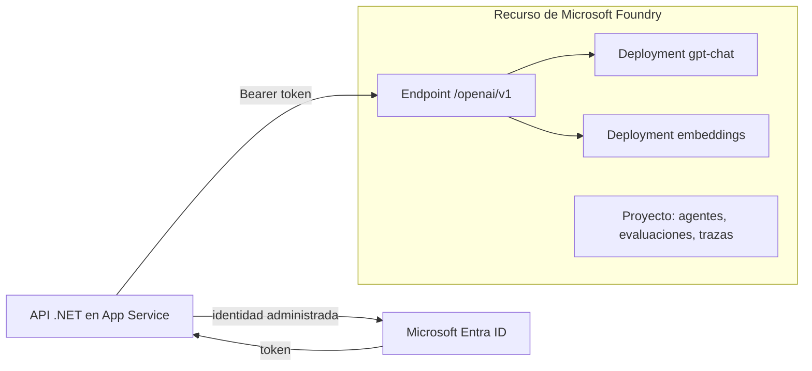

# Azure OpenAI y Azure AI Foundry

Parte de: [[21-IA-Machine-Learning/07 IA en .NET y Azure/_Índice IA en .NET y Azure|IA en .NET y Azure]]

> [!info] Cómo avanzar
> `progreso`: **pendiente** → **viendo** (estudiando) → **visto** (contestaste la autoevaluación sin abrir las respuestas) → **dominado** (hiciste el laboratorio o lo aplicaste de verdad).

## Contenido

### Qué es
**Azure OpenAI** es el servicio de Azure que te da acceso a los modelos de OpenAI (familias GPT, modelos de razonamiento, embeddings, imagen y audio) hospedados en la infraestructura de Microsoft, con lo que trae Azure: autenticación con Microsoft Entra ID, redes privadas, elección de región, filtros de contenido y facturación en tu suscripción.

**Azure AI Foundry** es el nombre que tuvo entre noviembre de 2024 y noviembre de 2025 la plataforma de Microsoft para construir aplicaciones y agentes de IA; antes se llamó Azure AI Studio y **hoy se llama Microsoft Foundry**. Vas a ver los tres nombres en tutoriales, según la fecha. Foundry agrupa:
- **Foundry Models**: catálogo de modelos de OpenAI y de otros proveedores que despliegas y consumes con un mismo endpoint.
- **Foundry Agent Service**: agentes hospedados y administrados.
- **Evaluaciones, trazas y monitoreo** de apps de IA.
- **Foundry Tools**: lo que antes eran Azure AI Services (voz, visión, lenguaje, Content Safety...).

Azure OpenAI sigue existiendo como tipo de recurso y como conjunto de modelos dentro de Foundry.

### Cómo funciona
1. **Recurso**: creas un recurso de Foundry (o uno de Azure OpenAI) en una región.
2. **Proyecto**: dentro del recurso creas proyectos para separar apps o equipos; cada uno tiene su endpoint (`https://<recurso>.services.ai.azure.com/api/projects/<proyecto>`).
3. **Despliegue**: eliges un modelo del catálogo y creas un **deployment** con un nombre; en tu código usas ese nombre. El tipo de despliegue y la cuota (tokens por minuto) determinan capacidad y costo.
4. **Consumo**: llamas al endpoint compatible con OpenAI (`https://<recurso>.openai.azure.com/openai/v1`) con el SDK oficial de OpenAI, o usas el SDK de proyectos (`Azure.AI.Projects`) para agentes y evaluaciones.
5. **Permisos**: con RBAC asignas roles como **Foundry User** para desarrollar (antes "Azure AI User"); tu app usa una **identidad administrada**.

Existe un portal "nuevo" y uno "clásico", con versiones de SDK distintas (Foundry nuevo usa `Azure.AI.Projects` 2.x); revisa a cuál corresponde la guía que sigues.



### Ejemplo
Conectar Itzamna.Dionisio a un deployment usando Entra ID (sin llaves) y exponerlo como `IChatClient` de [[Microsoft.Extensions.AI]]:

```csharp
// dotnet add package OpenAI
// dotnet add package Azure.Identity
// dotnet add package Microsoft.Extensions.AI.OpenAI
using System.ClientModel.Primitives;
using Azure.Identity;
using Microsoft.Extensions.AI;
using OpenAI;
using OpenAI.Chat;

var endpoint = new Uri(builder.Configuration["Foundry:Endpoint"]!);   // https://<recurso>.openai.azure.com/openai/v1/
var deployment = builder.Configuration["Foundry:Deployment"]!;        // nombre del deployment

// En Azure usa la identidad administrada; en tu PC, tu sesión de az login / Visual Studio
var politica = new BearerTokenPolicy(new DefaultAzureCredential(), "https://ai.azure.com/.default");
var chatOpenAI = new ChatClient(model: deployment, authenticationPolicy: politica,
                                options: new OpenAIClientOptions { Endpoint = endpoint });

builder.Services.AddChatClient(chatOpenAI.AsIChatClient())
    .UseFunctionInvocation()
    .UseOpenTelemetry();
```

En `appsettings.json` solo van el endpoint y el nombre del deployment, que no son secretos. En producción, Microsoft recomienda una credencial específica (por ejemplo `ManagedIdentityCredential`) en vez de `DefaultAzureCredential`.

### Cuándo usarlo y cuándo no
**Úsalo** cuando:
- Tu empresa ya está en Azure y necesitas cumplimiento, redes privadas, región de datos y facturación centralizada.
- Quieres varios modelos (OpenAI y otros) bajo una sola plataforma con evaluaciones y monitoreo.
- Vas a desplegar agentes administrados en Foundry Agent Service.

**Considera alternativas** cuando es un prototipo personal (Ollama local o GitHub Models son más baratos), cuando necesitas un modelo que no está en el catálogo, o cuando el costo de cuota reservada no se justifica. Revisa precios y disponibilidad por región en la página oficial antes de comprometerte (cambian con frecuencia).

### Errores comunes
- **Guardar la llave de API en el código o en `appsettings.json` del repo**: cualquiera con acceso al repositorio (o a su historial) puede usar tu cuota y tus datos. Usa Entra ID con identidad administrada; si de plano necesitas llave, guárdala en Azure Key Vault (o `dotnet user-secrets` en desarrollo), y rótala si alguna vez se expuso.
- **Confundir nombre del modelo con nombre del deployment**: en Azure llamas por el nombre del deployment que tú creaste.
- **No vigilar cuotas**: errores 429 por exceder tokens por minuto; implementa reintentos con espera y monitorea.
- **Seguir guías del portal equivocado** (clásico vs. nuevo) o con nombres viejos de roles y productos.
- **Asumir que los filtros de contenido bastan como seguridad**: ayudan, pero no sustituyen los [[Guardrails y límites de un agente]].

### Para profundizar
- [Documentación de Microsoft Foundry (Microsoft Learn)](https://learn.microsoft.com/azure/foundry/)
- [Visión general de los SDK de Foundry (Microsoft Learn)](https://learn.microsoft.com/azure/foundry/how-to/develop/sdk-overview)
- [Lenguajes compatibles con Azure OpenAI (Microsoft Learn)](https://learn.microsoft.com/azure/foundry/openai/supported-languages)

## Autoevaluación

Contesta primero en voz alta o en papel; luego despliega la respuesta.

> [!question]- ¿Qué es Azure OpenAI?
> El servicio de Azure para usar modelos de OpenAI dentro de una suscripción de Azure, con controles empresariales (redes privadas, identidad con Entra ID, cumplimiento).

> [!question]- ¿Qué papel tiene Azure AI Foundry?
> Es el portal/plataforma para catálogo de modelos, despliegues, evaluación y agentes en Azure. Nombre comercial y alcance actual: (Pendiente de confirmar; Microsoft lo ha renombrado y reorganizado).

> [!question]- Error común: guardar la llave de API en el código.
> Usa identidad administrada / Entra ID o Key Vault, y nunca subas llaves al repositorio.

