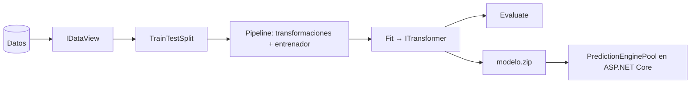

# ML.NET

Parte de: [[21-IA-Machine-Learning/07 IA en .NET y Azure/_Índice IA en .NET y Azure|IA en .NET y Azure]]

> [!info] Cómo avanzar
> `progreso`: **pendiente** → **viendo** (estudiando) → **visto** (contestaste la autoevaluación sin abrir las respuestas) → **dominado** (hiciste el laboratorio o lo aplicaste de verdad).

## Contenido

### Qué es
**ML.NET** es el framework de código abierto de Microsoft para **entrenar y usar modelos de machine learning clásico en .NET**, sin salir de C#. Cubre clasificación binaria y multiclase, regresión, *clustering*, detección de anomalías, recomendación, pronóstico de series de tiempo y clasificación de texto e imágenes. La versión estable más reciente que encontré publicada en NuGet es la 5.0 del paquete `Microsoft.ML`.

Además de la librería, existen **Model Builder** (asistente gráfico en Visual Studio) y la **ML.NET CLI**, que prueban varios algoritmos automáticamente (AutoML) y generan el código.

### Cómo funciona
El objeto central es **`MLContext`**: el punto de entrada a todo (carga de datos, transformaciones, entrenadores, evaluación, guardado) y la semilla aleatoria para resultados reproducibles. Los datos fluyen como **`IDataView`**, una vista perezosa y tabular, parecida a un DataFrame.

Flujo típico:
1. **Cargar** datos (`LoadFromTextFile`, `LoadFromEnumerable` o desde una base de datos).
2. **Dividir** en entrenamiento y prueba (`TrainTestSplit`), ver [[Datos de entrenamiento, validación y prueba]].
3. **Construir el pipeline**: transformaciones (normalizar, codificar categorías, convertir texto en características) y un **entrenador** (`SdcaLogisticRegression`, `FastTree`, `LightGbm`...).
4. **Entrenar** con `Fit` y obtener un `ITransformer` (el modelo).
5. **Evaluar** con las métricas del tipo de tarea ([[Métricas de clasificación y regresión]]).
6. **Guardar** en `.zip` y **consumir** con `PredictionEngine` o, en ASP.NET Core, con `PredictionEnginePool` (paquete `Microsoft.Extensions.ML`), que es seguro para uso concurrente.



### Ejemplo
Predecir si un cliente de Itzamna.Dionisio va a pagar tarde, con datos históricos exportados a CSV:

```csharp
// dotnet add package Microsoft.ML
using Microsoft.ML;
using Microsoft.ML.Data;

var ml = new MLContext(seed: 42);
IDataView datos = ml.Data.LoadFromTextFile<Cliente>("clientes.csv", hasHeader: true, separatorChar: ',');
var split = ml.Data.TrainTestSplit(datos, testFraction: 0.2);

var pipeline = ml.Transforms.Categorical.OneHotEncoding("RegimenCod", nameof(Cliente.Regimen))
    .Append(ml.Transforms.Concatenate("Features",
        nameof(Cliente.DiasPromedioPago), nameof(Cliente.Facturas12m), nameof(Cliente.SaldoVencido), "RegimenCod"))
    .Append(ml.Transforms.NormalizeMinMax("Features"))
    .Append(ml.BinaryClassification.Trainers.SdcaLogisticRegression(labelColumnName: nameof(Cliente.PagoTarde)));

ITransformer modelo = pipeline.Fit(split.TrainSet);
var metricas = ml.BinaryClassification.Evaluate(modelo.Transform(split.TestSet), labelColumnName: nameof(Cliente.PagoTarde));
Console.WriteLine($"AUC: {metricas.AreaUnderRocCurve:F3}  F1: {metricas.F1Score:F3}");

ml.Model.Save(modelo, datos.Schema, "modelo-pago.zip");   // se guarda el pipeline completo

public sealed class Cliente
{
    [LoadColumn(0)] public float DiasPromedioPago { get; set; }
    [LoadColumn(1)] public float Facturas12m { get; set; }
    [LoadColumn(2)] public float SaldoVencido { get; set; }
    [LoadColumn(3)] public string Regimen { get; set; } = "";
    [LoadColumn(4)] public bool PagoTarde { get; set; }
}
```

En la API registras `builder.Services.AddPredictionEnginePool<Cliente, Prediccion>().FromFile("modelo-pago.zip");` e inyectas `PredictionEnginePool<Cliente, Prediccion>` en el controller (`Prediccion` es una clase con `[ColumnName("PredictedLabel")] public bool PagoTarde` y `Probability`).

### Cuándo usarlo y cuándo no
**Prefiere ML.NET** cuando:
- Tu equipo y tu sistema son .NET y el problema es ML clásico con datos tabulares (pronósticos, clasificación, anomalías).
- Quieres entrenar y servir en el mismo stack, sin mantener un servicio de Python aparte.
- Necesitas inferencia local, rápida y sin dependencias externas.

**Prefiere Python** (scikit-learn, PyTorch) cuando necesitas deep learning moderno, investigación, el ecosistema de notebooks y librerías más amplio, o modelos de Hugging Face. Un camino intermedio: entrenas en Python y ejecutas en .NET con [[ONNX Runtime]]. Para LLMs no uses ML.NET: usa [[Microsoft.Extensions.AI]].

### Errores comunes
- **Usar `PredictionEngine` como *singleton* en una API**: no es seguro para hilos; usa `PredictionEnginePool`.
- **Crear el `PredictionEngine` en cada petición**: es costoso; el pool lo reutiliza.
- **No fijar la semilla** del `MLContext`: resultados distintos en cada entrenamiento y difícil comparar.
- **Evaluar con los mismos datos de entrenamiento**: métricas infladas; separa un conjunto de prueba.
- **Columnas desalineadas** entre la clase de entrada y el archivo (`LoadColumn` mal numerado): el modelo entrena con datos equivocados sin dar error.

### Para profundizar
- [ML.NET (Microsoft Learn)](https://learn.microsoft.com/dotnet/machine-learning/)
- [Tutoriales de ML.NET (Microsoft Learn)](https://learn.microsoft.com/dotnet/machine-learning/tutorials/)
- [Repositorio dotnet/machinelearning (GitHub)](https://github.com/dotnet/machinelearning)

## Autoevaluación

Contesta primero en voz alta o en papel; luego despliega la respuesta.

> [!question]- ¿Qué es ML.NET?
> Una librería de Microsoft para entrenar y usar modelos de ML clásico (clasificación, regresión, recomendación, detección de anomalías) en C#.

> [!question]- ¿Cuál es el objeto central?
> `MLContext`: desde él se cargan datos, se arma el pipeline de transformaciones y se entrena (`Fit`) y predice.

> [!question]- ¿Cuándo preferirías ML.NET a Python?
> Cuando el equipo y la aplicación son .NET y el modelo es clásico/tabular; para deep learning o investigación, el ecosistema de Python es más amplio.

