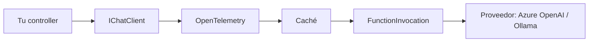

# Microsoft.Extensions.AI

Parte de: [[21-IA-Machine-Learning/07 IA en .NET y Azure/_Índice IA en .NET y Azure|IA en .NET y Azure]]

> [!info] Cómo avanzar
> `progreso`: **pendiente** → **viendo** (estudiando) → **visto** (contestaste la autoevaluación sin abrir las respuestas) → **dominado** (hiciste el laboratorio o lo aplicaste de verdad).

## Contenido

### Qué es
**Microsoft.Extensions.AI** (MEAI) es un conjunto de librerías de .NET que define **abstracciones comunes para trabajar con modelos de IA**, igual que `ILogger` lo hace para logging o `IDistributedCache` para caché. Su pieza central es la interfaz `IChatClient`, con la que hablas con cualquier LLM (Azure OpenAI, OpenAI, Ollama local, modelos de Microsoft Foundry) sin atar tu código a un SDK específico. También incluye `IEmbeddingGenerator<TInput, TEmbedding>` para generar embeddings.

Paquetes principales:
- `Microsoft.Extensions.AI.Abstractions`: las interfaces y tipos (`IChatClient`, `ChatMessage`, `ChatOptions`, `FunctionCallContent`...). Los proveedores implementan esto.
- `Microsoft.Extensions.AI`: utilidades y *middleware*: `ChatClientBuilder`, `AIFunctionFactory`, invocación automática de funciones, caché, telemetría.
- Adaptadores por proveedor, como `Microsoft.Extensions.AI.OpenAI` (método `AsIChatClient()` sobre clientes del SDK de OpenAI, que también sirve para Azure OpenAI) u `OllamaSharp` (su `OllamaApiClient` ya implementa `IChatClient`).

Es la base sobre la que se construye Microsoft Agent Framework (ver [[Semantic Kernel y Microsoft Agent Framework]]).

### Cómo funciona
1. **Un cliente base** del proveedor que implementa `IChatClient`.
2. **Un pipeline de middleware** con `ChatClientBuilder`, igual que el pipeline de ASP.NET Core: cada capa envuelve a la anterior. Ejemplos: `UseFunctionInvocation()` (ejecuta el ciclo de *tool calling* por ti), `UseDistributedCache()`, `UseOpenTelemetry()`, `UseLogging()`.
3. **Registro en DI** con `services.AddChatClient(...)` para inyectar `IChatClient` en tus controllers o handlers.
4. **Llamadas**: `GetResponseAsync` (respuesta completa), `GetStreamingResponseAsync` (token por token), y `GetResponseAsync<T>` para salida estructurada.



#### Por qué programar contra la interfaz
- **Cambiar de proveedor** es cambiar una línea en `Program.cs`, no reescribir la app: desarrollas con Ollama local y produces con Azure OpenAI.
- **Pruebas**: puedes inyectar un `IChatClient` falso con respuestas fijas en pruebas unitarias.
- **Middleware reutilizable**: caché, telemetría, límites y *tool calling* funcionan igual para todos los proveedores.
- **Ecosistema**: librerías como Agent Framework, el SDK de MCP o las de evaluación aceptan `IChatClient`.

### Ejemplo
Endpoint en Itzamna.Dionisio que resume una incidencia, con herramientas y probado localmente con Ollama (gratis, en tu PC):

```csharp
// dotnet add package Microsoft.Extensions.AI
// dotnet add package OllamaSharp
using Microsoft.Extensions.AI;
using OllamaSharp;

var builder = WebApplication.CreateBuilder(args);
builder.Services.AddControllers();

// Desarrollo: modelo local. Producción: cambia solo esta línea por Azure OpenAI.
IChatClient baseClient = new OllamaApiClient(new Uri("http://localhost:11434"), "llama3.1");
builder.Services.AddChatClient(baseClient)
    .UseFunctionInvocation()
    .UseLogging();

var app = builder.Build();
app.MapControllers();
app.Run();

[ApiController, Route("api/incidencias")]
public sealed class IncidenciasController(IChatClient chat) : ControllerBase
{
    [HttpPost("resumen")]
    public async Task<IActionResult> Resumir([FromBody] string texto, CancellationToken ct)
    {
        List<ChatMessage> mensajes =
        [
            new(ChatRole.System, "Resume en 3 viñetas, en español, sin inventar datos."),
            new(ChatRole.User, texto)
        ];
        ChatResponse r = await chat.GetResponseAsync(mensajes, cancellationToken: ct);
        return Ok(new { resumen = r.Text, tokens = r.Usage?.TotalTokenCount });
    }
}
```

Para herramientas, agrega `ChatOptions { Tools = [AIFunctionFactory.Create(MiMetodo)] }`; con `UseFunctionInvocation()` el pipeline ejecuta la función y vuelve a llamar al modelo automáticamente (ver [[Tool calling (llamadas a herramientas)]]).

#### Probar sin gastar
- **Ollama** en tu PC: con la GTX 1660 Ti de 6 GB corren bien modelos pequeños cuantizados (del orden de 3 a 8 mil millones de parámetros); más grandes caen a CPU y se vuelven lentos.
- **GitHub Models**: catálogo de modelos con uso gratuito limitado para prototipos (límites exactos: Pendiente de confirmar).
- **Pruebas unitarias**: implementa un `IChatClient` falso que devuelva respuestas fijas; así tus pruebas no dependen de red ni de costo.

### Cuándo usarlo y cuándo no
- **Úsalo** como capa por defecto en cualquier app .NET que llame a LLMs: es ligero y no te amarra.
- Si necesitas **agentes con sesiones, multi-agente o aprobaciones**, usa Microsoft Agent Framework encima de MEAI.
- Si necesitas una función muy específica de un proveedor que la abstracción no expone, puedes usar el SDK nativo en ese punto (y mantener MEAI en el resto).

### Errores comunes
- **Acoplarte al SDK del proveedor** en toda la app: luego cambiar de modelo cuesta semanas.
- **Olvidar `UseFunctionInvocation()`**: el modelo pide la herramienta pero nadie la ejecuta; recibes un `FunctionCallContent` y no la respuesta.
- **Orden del middleware**: el orden importa (por ejemplo, caché antes o después de invocar funciones cambia lo que se guarda).
- **Registrar datos sensibles en telemetría**: `EnableSensitiveData` manda prompts completos a tus trazas; úsalo solo en desarrollo.
- **No pasar `CancellationToken`**: peticiones canceladas siguen consumiendo tokens.

### Para profundizar
- [Microsoft.Extensions.AI (Microsoft Learn)](https://learn.microsoft.com/dotnet/ai/microsoft-extensions-ai)
- [Usar la interfaz IChatClient (Microsoft Learn)](https://learn.microsoft.com/dotnet/ai/ichatclient)
- [Llamadas a funciones con .NET (Microsoft Learn)](https://learn.microsoft.com/dotnet/ai/quickstarts/use-function-calling)

## Autoevaluación

Contesta primero en voz alta o en papel; luego despliega la respuesta.

> [!question]- ¿Qué ofrece Microsoft.Extensions.AI?
> Abstracciones comunes para .NET (como `IChatClient` y `IEmbeddingGenerator`) para usar distintos proveedores de modelos con la misma interfaz, integradas con inyección de dependencias y middleware (logging, caché, telemetría).

> [!question]- ¿Qué ventaja da programar contra la interfaz en vez del SDK del proveedor?
> Cambiar de proveedor o usar uno local en pruebas sin reescribir la lógica, y añadir comportamientos transversales como decoradores.

> [!question]- ¿Cómo lo probarías sin gastar en un servicio de pago?
> Con un modelo local (p. ej. vía Ollama) o un `IChatClient` falso en pruebas unitarias. Paquetes y nombres exactos de los adaptadores: (Pendiente de confirmar).

