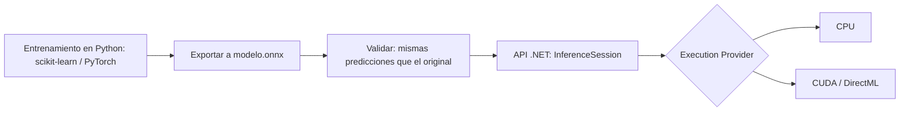

# ONNX Runtime

Parte de: [[21-IA-Machine-Learning/07 IA en .NET y Azure/_Índice IA en .NET y Azure|IA en .NET y Azure]]

> [!info] Cómo avanzar
> `progreso`: **pendiente** → **viendo** (estudiando) → **visto** (contestaste la autoevaluación sin abrir las respuestas) → **dominado** (hiciste el laboratorio o lo aplicaste de verdad).

## Contenido

### Qué es
**ONNX** (*Open Neural Network Exchange*) es un **formato abierto para representar modelos de machine learning**: un archivo `.onnx` describe el grafo de operaciones del modelo y sus pesos, independiente del framework con que se entrenó. Puedes exportar a ONNX desde PyTorch, scikit-learn, TensorFlow y otros.

**ONNX Runtime** es el motor de Microsoft, de código abierto y multiplataforma, que **ejecuta modelos ONNX** de forma optimizada en C#, Python, C++, Java, JavaScript y más, sobre CPU o GPU. Separa el "dónde entrenas" del "dónde ejecutas": entrenas en Python y haces inferencia en tu API .NET, en un navegador o en un dispositivo.

### Cómo funciona
1. **Entrenas** en tu framework favorito.
2. **Exportas** a `.onnx`: `torch.onnx.export` para PyTorch, `skl2onnx` para scikit-learn. Defines nombre, tipo y forma de las entradas.
3. **Cargas** el modelo con una `InferenceSession`, que optimiza el grafo (fusiona operaciones, elimina nodos innecesarios).
4. **Ejecutas** pasando tensores con los nombres de entrada esperados y lees las salidas.
5. Eliges un **Execution Provider** según el hardware: CPU (por defecto), CUDA o TensorRT (NVIDIA), DirectML (GPU en Windows), entre otros. Cada uno se instala con su paquete.

Para modelos generativos existe una extensión, **ONNX Runtime GenAI**, que agrega el ciclo de generación de texto (tokenización, búsqueda, caché KV) para correr LLMs pequeños localmente.



### Ejemplo
Caso típico: el equipo de datos entrenó en Python un clasificador para Wee.Reporteria y la app es .NET.

**1. Exportar desde Python** (scikit-learn):

```python
# pip install scikit-learn skl2onnx
from skl2onnx import convert_sklearn
from skl2onnx.common.data_types import FloatTensorType

# pipe = Pipeline([("escala", StandardScaler()), ("modelo", LogisticRegression())]).fit(X, y)
onx = convert_sklearn(pipe, initial_types=[("float_input", FloatTensorType([None, 4]))])
with open("modelo.onnx", "wb") as f:
    f.write(onx.SerializeToString())
```

Exportar el **pipeline completo** (escalado incluido) evita tener que reimplementar el preprocesamiento en C#.

**2. Ejecutar en .NET**:

```csharp
// dotnet add package Microsoft.ML.OnnxRuntime
using Microsoft.ML.OnnxRuntime;
using Microsoft.ML.OnnxRuntime.Tensors;

// Crear la sesión una vez (singleton en DI): cargarla en cada petición es lento
using var sesion = new InferenceSession("modelo.onnx");

var entrada = new DenseTensor<float>(new float[] { 12f, 3f, 4500f, 1f }, new[] { 1, 4 });
var inputs = new List<NamedOnnxValue> { NamedOnnxValue.CreateFromTensor("float_input", entrada) };

using var resultados = sesion.Run(inputs);
long etiqueta = resultados.First(r => r.Name == "output_label").AsEnumerable<long>().First();
Console.WriteLine($"Clase predicha: {etiqueta}");
```

Revisa los nombres reales de entradas y salidas con `sesion.InputMetadata` y `sesion.OutputMetadata`, o abriendo el archivo en Netron.

### Cuándo usarlo y cuándo no
**Úsalo** cuando:
- Entrenaste en Python y la aplicación es .NET (u otro lenguaje): no necesitas un microservicio de Python solo para predecir.
- Necesitas inferencia rápida, local o sin conexión (escritorio, dispositivos, navegador).
- Quieres aprovechar GPU o aceleradores con el mismo modelo.

**No lo necesitas** cuando entrenas y sirves en el mismo stack (por ejemplo, todo con [[ML.NET]]), cuando consumes un LLM grande por API ([[Azure OpenAI y Azure AI Foundry]]), o cuando el modelo usa operaciones que el convertidor no soporta (tendrías que reescribir partes o servir en Python, ver [[Desplegar un modelo como API]]).

### Errores comunes
- **No validar la conversión**: compara predicciones del modelo original y del ONNX con los mismos datos; diferencias de preprocesamiento o tipos (`float32` vs `float64`) cambian resultados.
- **Exportar solo el modelo sin el preprocesamiento**: luego el escalado en C# no coincide con el de Python.
- **Crear una `InferenceSession` por petición**: es cara; créala una vez y reutilízala (es segura para llamadas concurrentes a `Run`).
- **Formas de entrada incorrectas**: `[4]` en vez de `[1, 4]` produce error de dimensiones.
- **Esperar GPU sin instalar el paquete y drivers del Execution Provider**: sin ellos corre en CPU.

### Para profundizar
- [Documentación de ONNX Runtime](https://onnxruntime.ai/docs/)
- [Formato ONNX](https://onnx.ai/)
- [sklearn-onnx (convertidor de scikit-learn)](https://onnx.ai/sklearn-onnx/)

## Autoevaluación

Contesta primero en voz alta o en papel; luego despliega la respuesta.

> [!question]- ¿Qué es ONNX?
> Un formato abierto para representar modelos entrenados, exportables desde PyTorch, scikit-learn y otros.

> [!question]- ¿Para qué sirve ONNX Runtime?
> Para ejecutar modelos ONNX de forma eficiente en distintos lenguajes (C#, Python, JS) y hardware (CPU, GPU).

> [!question]- Caso: entrenaste en Python y la app es .NET. ¿Qué haces?
> Exportas a ONNX y cargas el modelo con `InferenceSession` desde C#, cuidando que el preprocesamiento sea idéntico.

