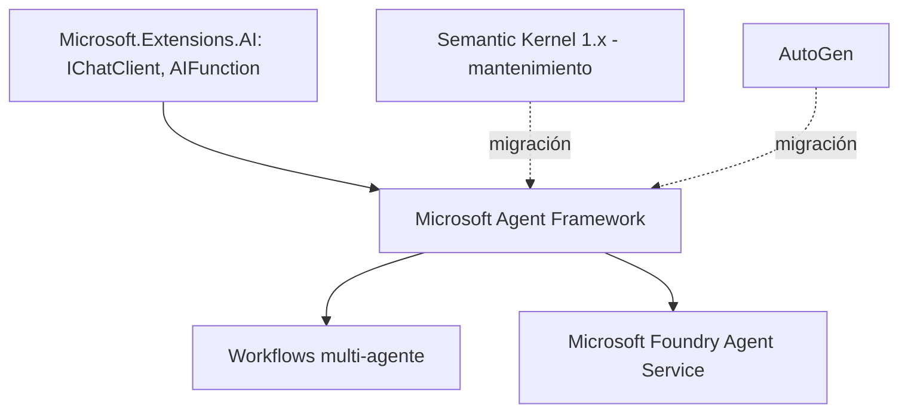

# Semantic Kernel y Microsoft Agent Framework

Parte de: [[21-IA-Machine-Learning/07 IA en .NET y Azure/_Índice IA en .NET y Azure|IA en .NET y Azure]]

> [!info] Cómo avanzar
> `progreso`: **pendiente** → **viendo** (estudiando) → **visto** (contestaste la autoevaluación sin abrir las respuestas) → **dominado** (hiciste el laboratorio o lo aplicaste de verdad).

## Contenido

### Qué es
**Semantic Kernel (SK)** es un SDK de código abierto de Microsoft (C#, Python y Java) para integrar LLMs en aplicaciones: organiza funciones en **plugins** que el modelo puede invocar, conecta con varios proveedores de modelos y bases vectoriales, y en sus versiones más recientes incluye un marco de agentes. Su objeto central es el `Kernel`, un contenedor de servicios y plugins.

**Microsoft Agent Framework (MAF)** es el SDK de código abierto para construir agentes y flujos multi-agente en .NET y Python. Microsoft lo creó para **unificar** las bases empresariales de Semantic Kernel con las orquestaciones de AutoGen (su proyecto de investigación multi-agente). La versión **1.0 estable** se anunció el 3 de abril de 2026. Paquetes: `Microsoft.Agents.AI` en NuGet y `agent-framework` en PyPI.

### Cómo funciona
#### Relación entre ambos
- MAF es el **sucesor** recomendado: Microsoft publica guías de migración desde Semantic Kernel y desde AutoGen, y la mayoría de las funciones nuevas se construyen en MAF.
- Semantic Kernel 1.x **sigue soportado**: Microsoft se comprometió a corregir errores críticos y de seguridad mientras haya una base importante de usuarios y al menos un año después de la disponibilidad general de MAF.
- MAF está construido sobre [[Microsoft.Extensions.AI]]: un agente se crea a partir de cualquier `IChatClient`, y las herramientas son `AIFunction`.

| Concepto | Semantic Kernel | Microsoft Agent Framework |
|---|---|---|
| Objeto central | `Kernel` | `AIAgent` |
| Herramientas | Plugins con `[KernelFunction]` | Métodos con `AIFunctionFactory.Create` y `[Description]` |
| Conversación | `AgentThread` / `ChatHistory` | `AgentSession` (serializable) |
| Multi-agente | Orquestaciones de agentes | *Workflows* (secuencial, concurrente, *handoff*, *group chat*, Magentic) |
| Aprobaciones | Filtros | `ApprovalRequiredAIFunction` |
| MCP | Integración disponible | Soporte para herramientas MCP |



### Ejemplo
El mismo agente con herramienta en ambos estilos.

**Semantic Kernel** (proyectos existentes):

```csharp
using System.ComponentModel;
using Microsoft.SemanticKernel;

public sealed class PedidosPlugin
{
    [KernelFunction, Description("Obtiene el estado de un pedido.")]
    public string Estado(int pedidoId) => pedidoId == 77 ? "En tránsito" : "No existe";
}

// var kernel = Kernel.CreateBuilder().AddAzureOpenAIChatCompletion(...).Build();
// kernel.Plugins.AddFromType<PedidosPlugin>();
```

**Microsoft Agent Framework** (proyectos nuevos):

```csharp
// dotnet add package Microsoft.Agents.AI
using System.ComponentModel;
using Microsoft.Agents.AI;
using Microsoft.Extensions.AI;

[Description("Obtiene el estado de un pedido.")]
static string Estado([Description("Id del pedido")] int pedidoId)
    => pedidoId == 77 ? "En tránsito" : "No existe";

AIAgent agente = chatClient.AsAIAgent(                 // chatClient: cualquier IChatClient
    name: "SoportePedidos",
    instructions: "Responde dudas de pedidos. Solo lectura.",
    tools: [AIFunctionFactory.Create(Estado)]);

AgentSession sesion = await agente.CreateSessionAsync();
Console.WriteLine(await agente.RunAsync("¿Cómo va el pedido 77?", sesion));
await foreach (var u in agente.RunStreamingAsync("¿Y cuándo llega?", sesion))
    Console.Write(u);
```

Fíjate que en MAF la herramienta es un método normal: fácil de probar con xUnit sin el framework.

### Cuándo usarlo y cuándo no
- **Proyecto nuevo en .NET con agentes**: Microsoft Agent Framework.
- **Proyecto existente en Semantic Kernel que funciona**: no hay prisa por migrar; planifica la migración con la guía oficial cuando necesites funciones nuevas.
- **Solo llamadas simples al LLM** (resumir, clasificar, extraer): basta con Microsoft.Extensions.AI, sin framework de agentes.

#### Qué revisar antes de elegir
1. Estado de soporte de la versión (GA o *preview*); algunas partes de MAF, como integraciones específicas, pueden seguir en *preview* aunque el núcleo sea 1.0.
2. Guía de migración y cambios de API entre versiones.
3. Compatibilidad con tu proveedor de modelos, con MCP y con Microsoft.Extensions.AI.
4. Que la documentación oficial que sigues corresponda a la versión que instalas: hay muchos ejemplos en internet de versiones *preview* con nombres de métodos que ya cambiaron.

### Errores comunes
- **Seguir tutoriales viejos**: SK cambió mucho antes de la 1.0 (por ejemplo, "planners" que se retiraron), y MAF cambió nombres de métodos durante su *preview*. Revisa la fecha y la versión del ejemplo.
- **Mezclar SK y MAF sin razón** en el mismo servicio.
- **Poner lógica de negocio dentro de los plugins**: mantenla en tus servicios del slice y que la herramienta solo sea un adaptador delgado.
- **Instalar paquetes *prerelease* sin fijar versión**: una actualización puede romper el build.

### Para profundizar
- [Microsoft Agent Framework (Microsoft Learn)](https://learn.microsoft.com/agent-framework/)
- [Migrar de Semantic Kernel a Agent Framework (Microsoft Learn)](https://learn.microsoft.com/agent-framework/migration-guide/from-semantic-kernel/)
- [Semantic Kernel y Microsoft Agent Framework (blog oficial)](https://devblogs.microsoft.com/semantic-kernel/semantic-kernel-and-microsoft-agent-framework/)

## Autoevaluación

Contesta primero en voz alta o en papel; luego despliega la respuesta.

> [!question]- ¿Qué es Semantic Kernel?
> Un SDK de Microsoft (C#, Python, Java) para orquestar LLMs con plugins/funciones, memoria y planificación dentro de aplicaciones.

> [!question]- ¿Qué relación tiene con Microsoft Agent Framework?
> Microsoft anunció Agent Framework como evolución para construir agentes, retomando ideas de Semantic Kernel y AutoGen. Estado actual, versión y si reemplaza a Semantic Kernel: (Pendiente de confirmar).

> [!question]- ¿Qué revisarías antes de elegir uno para un proyecto nuevo?
> Estado de soporte (preview o GA), guía de migración, compatibilidad con Microsoft.Extensions.AI y MCP, y la documentación oficial vigente.

