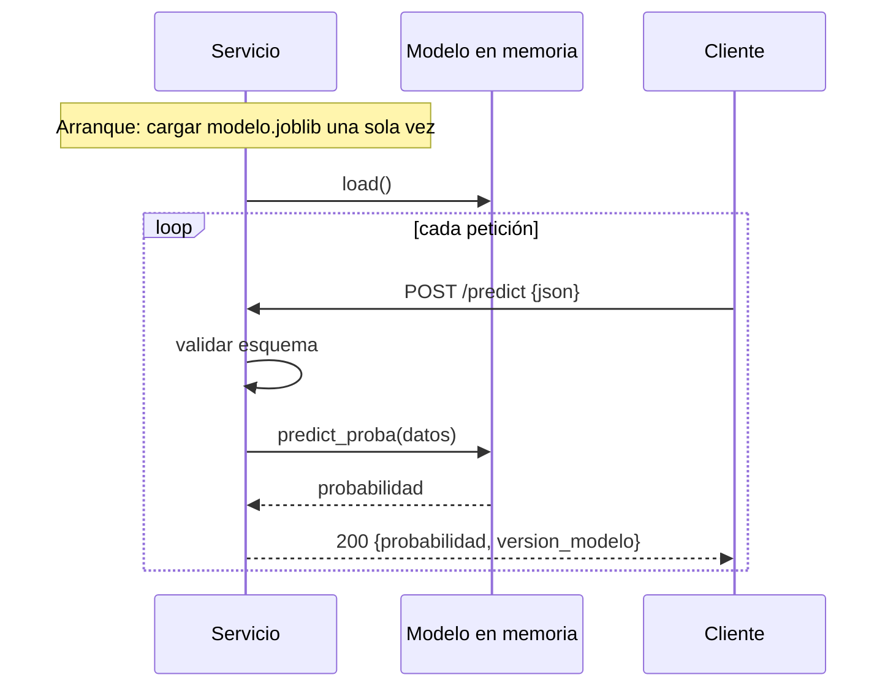

# Desplegar un modelo como API

Parte de: [[21-IA-Machine-Learning/08 MLOps y producción/_Índice MLOps y producción|MLOps y producción]]

> [!info] Cómo avanzar
> `progreso`: **pendiente** → **viendo** (estudiando) → **visto** (contestaste la autoevaluación sin abrir las respuestas) → **dominado** (hiciste el laboratorio o lo aplicaste de verdad).

## Contenido

### Qué es
**Desplegar un modelo como API** es envolver un modelo entrenado en un servicio HTTP que recibe datos de entrada (JSON) y devuelve predicciones, para que otras aplicaciones lo consuman en línea. Es la forma más común de "poner un modelo en producción" cuando se necesitan respuestas en tiempo real; la alternativa es la **inferencia por lotes** (procesar miles de registros en un job programado).

### Cómo funciona
Pasos:
1. **Serializar el modelo** entrenado junto con su preprocesamiento (el pipeline completo).
2. **Definir el contrato**: esquema de entrada y salida, con validación de tipos y rangos.
3. **Construir el servicio**: cargar el modelo **una vez al arrancar** y exponer un endpoint `POST /predict`, más un endpoint de salud.
4. **Empaquetar** en un contenedor con versiones fijas de librerías.
5. **Desplegar** (Azure Container Apps, App Service, endpoints administrados de [[Azure Machine Learning]]) con autenticación, HTTPS y escalado.
6. **Monitorear**: latencia, errores, distribución de entradas y predicciones ([[Monitoreo de modelos y drift]]).

#### Por qué guardar el pipeline completo
Si entrenas con datos escalados, codificados o con columnas derivadas y solo guardas el estimador, en producción tendrías que **reimplementar** el preprocesamiento a mano. Cualquier diferencia (otra media de escalado, otro orden de categorías) hace que el modelo reciba datos distintos a los que vio al entrenar y predice mal **sin dar error** (*training-serving skew*). Con un `Pipeline` de scikit-learn guardado entero, el preprocesamiento viaja con el modelo.

#### Cargar una vez, no en cada petición
Deserializar un modelo puede tardar de cientos de milisegundos a varios segundos y consume memoria. Si lo cargas en cada petición, la latencia se dispara y el servidor se satura. Se carga al arrancar el proceso (evento *lifespan* en FastAPI, *singleton* en .NET) y se reutiliza.



### Ejemplo
Servicio en Python con FastAPI para el modelo de "pago tarde":

```python
# pip install fastapi uvicorn scikit-learn joblib pandas
from contextlib import asynccontextmanager
import joblib, pandas as pd
from fastapi import FastAPI
from pydantic import BaseModel, Field

estado = {}

@asynccontextmanager
async def lifespan(app: FastAPI):
    estado["modelo"] = joblib.load("pipeline_pago_tarde.joblib")   # una vez al arrancar
    yield
    estado.clear()

app = FastAPI(lifespan=lifespan)

class Entrada(BaseModel):
    dias_promedio_pago: float = Field(ge=0, le=365)
    facturas_12m: int = Field(ge=0)
    saldo_vencido: float = Field(ge=0)
    regimen: str

@app.get("/health")
def health():
    return {"ok": "modelo" in estado}

@app.post("/predict")
def predict(e: Entrada):
    df = pd.DataFrame([e.model_dump()])
    p = float(estado["modelo"].predict_proba(df)[0, 1])
    return {"probabilidad_pago_tarde": p, "version_modelo": "pago-tarde-v2"}
```

```bash
uvicorn app:app --host 0.0.0.0 --port 8000
```

Itzamna.Dionisio lo consume con `HttpClient` tipado y maneja fallas con ProblemDetails (`codigo: "MODELO_NO_DISPONIBLE"`). Si prefieres no mantener Python en producción, exporta el pipeline a ONNX y ejecútalo dentro de la API .NET ([[ONNX Runtime]]). Lo practicas en [[Lab 8 - Desplegar un modelo como API con FastAPI y MLflow]].

### Cuándo usarlo y cuándo no
- **API en línea** cuando la predicción se necesita en el momento (al capturar un pedido, en una pantalla).
- **Lotes** cuando las predicciones pueden calcularse de antemano (scoring nocturno de todos los clientes y guardarlo en una tabla): más barato y simple.
- **Dentro de la app** (ML.NET u ONNX) cuando el modelo es pequeño y quieres evitar otro servicio y su latencia de red.

### Errores comunes
- **Cargar el modelo en cada petición**: latencia alta y memoria desperdiciada.
- **Guardar solo el estimador**: preprocesamiento distinto en producción.
- **Riesgo de `pickle`/`joblib`**: deserializar un archivo con `pickle` o `joblib` **puede ejecutar código arbitrario**. Un modelo descargado de una fuente no confiable o modificado en el almacenamiento puede comprometer el servidor. Carga solo artefactos propios, verifica su hash, restringe quién escribe en el almacenamiento, y considera formatos sin código ejecutable (ONNX, `safetensors` para pesos de redes).
- **Versiones de librerías distintas** entre entrenamiento y servicio: el modelo puede no cargar o comportarse diferente; fija versiones en `requirements.txt` o en la imagen.
- **Sin validación de entrada ni autenticación**: datos basura producen predicciones basura, y una API abierta es un riesgo.

### Para profundizar
- [FastAPI - documentación oficial](https://fastapi.tiangolo.com/)
- [Persistencia de modelos en scikit-learn (riesgos de pickle)](https://scikit-learn.org/stable/model_persistence.html)
- [Endpoints en línea de Azure Machine Learning (Microsoft Learn)](https://learn.microsoft.com/azure/machine-learning/concept-endpoints-online)

## Autoevaluación

Contesta primero en voz alta o en papel; luego despliega la respuesta.

> [!question]- ¿Qué pasos tiene desplegar un modelo como API?
> Serializar el pipeline completo, cargarlo una vez al iniciar el servicio, exponer un endpoint que valide la entrada, predecir y devolver JSON; empaquetar en contenedor.

> [!question]- ¿Por qué guardar el pipeline completo y no solo el modelo?
> Para aplicar exactamente el mismo preprocesamiento que en entrenamiento.

> [!question]- Error común: cargar el modelo en cada petición.
> Latencia enorme; cárgalo al arrancar.

> [!question]- ¿Qué riesgo tiene `pickle`/`joblib`?
> Cargar un archivo de origen no confiable puede ejecutar código. Carga solo artefactos propios o considera formatos como ONNX.

## Práctica

- [[Lab 8 - Desplegar un modelo como API con FastAPI y MLflow]]

