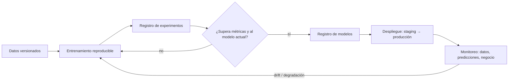

# MLOps - conceptos

Parte de: [[21-IA-Machine-Learning/08 MLOps y producción/_Índice MLOps y producción|MLOps y producción]]

> [!info] Cómo avanzar
> `progreso`: **pendiente** → **viendo** (estudiando) → **visto** (contestaste la autoevaluación sin abrir las respuestas) → **dominado** (hiciste el laboratorio o lo aplicaste de verdad).

## Contenido

### Qué es
**MLOps** es la aplicación de prácticas de DevOps al ciclo de vida de los modelos de machine learning: cómo pasar de un notebook que "funciona en mi máquina" a un modelo en producción que se entrena de forma reproducible, se despliega con control, se monitorea y se reentrena cuando se degrada. Combina ingeniería de software, ingeniería de datos y ciencia de datos.

### Cómo funciona
#### Por qué no basta el CI/CD de software normal
En software tradicional, el comportamiento lo define **el código**: si el código no cambia, el sistema hace lo mismo. En ML, el comportamiento depende de **tres cosas**: código, **datos** y **modelo entrenado** (pesos e hiperparámetros). Eso trae diferencias:
- **Los datos cambian solos**: el mundo cambia y el modelo se degrada sin que nadie toque el código (ver [[Monitoreo de modelos y drift]]).
- **El artefacto es pesado y opaco**: un archivo de pesos no se revisa en un *pull request* como el código.
- **Las pruebas son estadísticas**: no basta "compila y pasan los unit tests"; hay que validar métricas (precisión, recall, error) contra un umbral y contra el modelo anterior.
- **Entrenar es un proceso caro y no determinista**: necesita cómputo (a veces GPU) y control de semillas y versiones.
- **Hay que registrar experimentos**: cientos de corridas con distintos parámetros, y saber cuál produjo el modelo en producción.

Por eso al CI/CD se suman **CT** (*continuous training*, reentrenar de forma automática o programada) y **CM** (*continuous monitoring*).

#### El ciclo


Piezas típicas:
- **Versionado** de datos, código y modelos ([[Versionado de datos y modelos]]).
- **Seguimiento de experimentos** y registro de modelos ([[MLflow]]).
- **Pipelines** de entrenamiento como código, ejecutados en un orquestador (Azure ML, Azure DevOps).
- **Despliegue** como API o en lote ([[Desplegar un modelo como API]]).
- **Monitoreo** y alertas.

#### Reproducibilidad
Un entrenamiento es **reproducible** cuando, dado el mismo código, los mismos datos y la misma configuración, puedes volver a obtener el mismo modelo (o uno equivalente en métricas) y saber exactamente de dónde salió el que está en producción. Para lograrlo registras: commit del código, versión exacta de los datos, versiones de librerías (archivo de dependencias o imagen de contenedor), hiperparámetros, semillas aleatorias y el entorno de cómputo.

#### Niveles de madurez
Una forma simple de verlo: **nivel 0**, todo manual desde notebooks; **nivel 1**, pipeline de entrenamiento automatizado y registro de modelos; **nivel 2**, CI/CD del propio pipeline, reentrenamiento automático disparado por monitoreo.

### Ejemplo
Para el modelo de "pago tarde" de Itzamna.Dionisio, un MLOps mínimo pero sano en Azure DevOps:
1. El código de entrenamiento vive en el repo (no en notebooks sueltos) y los datos de entrenamiento se exportan con una consulta `.sql` versionada a un almacenamiento con versión y fecha.
2. Un pipeline YAML corre el entrenamiento, registra métricas en MLflow y **falla** si el AUC baja del umbral o es peor que el del modelo actual.
3. Si pasa, registra el modelo con versión y lo despliega a *staging*; con aprobación manual, a producción.
4. Un job semanal compara la distribución de las entradas recientes contra la de entrenamiento y alerta si hay drift.

```yaml
# azure-pipelines.yml (fragmento)
stages:
- stage: Entrenar
  jobs:
  - job: train
    steps:
    - script: pip install -r requirements.txt
    - script: python train.py --datos $(VERSION_DATOS) --umbral-auc 0.80
      displayName: Entrenar y validar (falla si no supera el umbral)
- stage: Produccion
  dependsOn: Entrenar
  jobs:
  - deployment: deploy
    environment: modelos-produccion   # el environment tiene aprobación manual
    strategy:
      runOnce:
        deploy:
          steps:
          - script: python deploy.py --modelo pago-tarde --alias produccion
```

### Cuándo usarlo y cuándo no
- **Úsalo** en cuanto un modelo afecte decisiones reales o se vaya a reentrenar más de una vez.
- **No sobre-ingenierices**: para un experimento o un modelo que se usa una vez basta con un notebook bien documentado. Empieza por versionado y registro de experimentos; automatiza después.
- Para LLMs consumidos por API (sin entrenar), muchas prácticas se trasladan como "LLMOps": versionar prompts, evaluar respuestas, monitorear costo y calidad ([[Evaluación de respuestas de LLMs]]).

### Errores comunes
- **Entrenar desde notebooks con datos locales**: nadie puede reproducir el modelo de producción.
- **No guardar el preprocesamiento junto con el modelo**: en producción se transforma distinto (*training-serving skew*).
- **Desplegar sin comparar contra el modelo actual**: un modelo "nuevo" no siempre es mejor.
- **No monitorear después del despliegue**: el modelo se degrada en silencio.
- **Secretos y cadenas de conexión en notebooks** o en el repositorio.

### Para profundizar
- [MLOps: entrega continua y automatización en ML (Google Cloud)](https://cloud.google.com/architecture/mlops-continuous-delivery-and-automation-pipelines-in-machine-learning)
- [MLOps con Azure Machine Learning (Microsoft Learn)](https://learn.microsoft.com/azure/machine-learning/concept-model-management-and-deployment)
- [Documentación de MLflow](https://mlflow.org/docs/latest/)

## Autoevaluación

Contesta primero en voz alta o en papel; luego despliega la respuesta.

> [!question]- ¿Qué es MLOps?
> Prácticas para llevar modelos a producción y mantenerlos: versionado de datos y modelos, entrenamiento reproducible, CI/CD, despliegue, monitoreo y reentrenamiento.

> [!question]- ¿Por qué un modelo necesita más que el CI/CD de software normal?
> Depende de datos que cambian: puede degradarse sin que cambie el código. Hay que versionar y monitorear datos y desempeño.

> [!question]- ¿Qué es reproducibilidad en ML?
> Poder volver a obtener el mismo modelo: mismo código, datos, versiones de librerías, hiperparámetros y semillas.

## Práctica

- [[Lab 8 - Desplegar un modelo como API con FastAPI y MLflow]]

