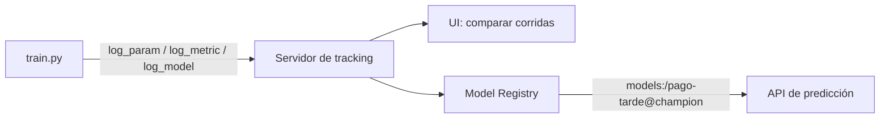

# MLflow

Parte de: [[21-IA-Machine-Learning/08 MLOps y producción/_Índice MLOps y producción|MLOps y producción]]

> [!info] Cómo avanzar
> `progreso`: **pendiente** → **viendo** (estudiando) → **visto** (contestaste la autoevaluación sin abrir las respuestas) → **dominado** (hiciste el laboratorio o lo aplicaste de verdad).

## Contenido

### Qué es
**MLflow** es una plataforma de código abierto para gestionar el ciclo de vida de modelos de machine learning. Resuelve el problema de "¿qué parámetros usé en la corrida que dio mejor resultado y dónde quedó ese modelo?". La línea actual es MLflow 3, que además de ML clásico agrega funciones para aplicaciones de IA generativa (trazas de llamadas a LLMs y evaluación). Es gratuito, corre en tu PC y está integrado en Azure Machine Learning y Databricks.

Componentes principales:
- **Tracking**: registra parámetros, métricas, artefactos y etiquetas de cada corrida (*run*), agrupadas en **experimentos**.
- **Models**: un formato estándar para empaquetar modelos con su firma y dependencias ("flavors" para scikit-learn, PyTorch, etc.).
- **Model Registry**: catálogo de modelos con versiones, alias (por ejemplo `champion`) y linaje.
- **Serving**: servir un modelo registrado como API REST local o construir una imagen.
- **Tracing y evaluación de GenAI**: registrar cada paso de una app con LLMs y evaluarla.

### Cómo funciona
1. Levantas un servidor de tracking (o usas el local por defecto, que guarda en una carpeta).
2. En tu código de entrenamiento abres una corrida y registras lo que importa; con **autolog** muchas librerías registran parámetros, métricas y el modelo automáticamente.
3. Comparas corridas en la interfaz web: tablas, gráficas, filtros por métrica.
4. Registras la mejor como versión en el Model Registry y le asignas un alias.
5. El despliegue carga el modelo **por nombre y alias**, no por una ruta de archivo.



### Ejemplo
```bash
pip install mlflow scikit-learn
mlflow ui --port 5000        # UI local en http://localhost:5000
```

```python
import mlflow
import mlflow.sklearn
from sklearn.datasets import load_breast_cancer
from sklearn.ensemble import RandomForestClassifier
from sklearn.metrics import roc_auc_score
from sklearn.model_selection import train_test_split

mlflow.set_tracking_uri("http://localhost:5000")
mlflow.set_experiment("pago-tarde")

X, y = load_breast_cancer(return_X_y=True)          # datos de ejemplo
X_tr, X_te, y_tr, y_te = train_test_split(X, y, test_size=0.2, random_state=42)

for n in (50, 200):
    with mlflow.start_run(run_name=f"rf-{n}"):
        mlflow.log_param("n_estimators", n)
        mlflow.set_tag("version_datos", "2026-11-01")     # linaje de datos
        modelo = RandomForestClassifier(n_estimators=n, random_state=42).fit(X_tr, y_tr)
        auc = roc_auc_score(y_te, modelo.predict_proba(X_te)[:, 1])
        mlflow.log_metric("auc", auc)
        mlflow.sklearn.log_model(modelo, name="modelo",
                                 input_example=X_te[:2],
                                 registered_model_name="pago-tarde")
```

Cada corrida aparece en la UI con su AUC; la mejor versión la marcas con alias `champion` y la cargas con `mlflow.pyfunc.load_model("models:/pago-tarde@champion")`. Lo practicas en [[Lab 8 - Desplegar un modelo como API con FastAPI y MLflow]]. (Nota: en versiones anteriores a MLflow 3 el parámetro de `log_model` se llamaba `artifact_path` en lugar de `name`.)

#### Qué resuelve frente a anotar a mano
Una hoja de Excel o un README con "corrida 7: AUC 0.91" depende de la disciplina de quien anota, se desactualiza, no guarda el modelo ni el entorno, y no se puede consultar ni comparar automáticamente. MLflow registra **automáticamente y siempre** parámetros, métricas, código, artefactos y entorno, los liga entre sí, y los hace consultables desde código y UI. Así el modelo en producción siempre se puede rastrear hasta la corrida exacta que lo produjo.

### Cuándo usarlo y cuándo no
- **Úsalo** en cuanto hagas más de un puñado de experimentos o vayas a desplegar un modelo. Es gratis y ligero en local.
- En Azure, los *workspaces* de [[Azure Machine Learning]] exponen un endpoint compatible con MLflow, así que el mismo código registra ahí.
- Para un notebook de una sola vez no hace falta, aunque `autolog()` cuesta una línea.
- Para apps de LLM puedes usar sus trazas, o la observabilidad de tu plataforma (OpenTelemetry, Microsoft Foundry).

### Errores comunes
- **Usar el almacenamiento local por defecto en equipo**: cada quien tiene su carpeta `mlruns`; monta un servidor compartido con base de datos y almacenamiento de artefactos.
- **No registrar la versión de datos**: el linaje queda incompleto ([[Versionado de datos y modelos]]).
- **Cargar modelos por ruta de archivo** en vez de por nombre y alias del registro.
- **Exponer el servidor de tracking sin autenticación** en una red compartida.
- **Registrar datos sensibles** como artefactos o parámetros.

### Para profundizar
- [Documentación de MLflow](https://mlflow.org/docs/latest/)
- [Novedades y cambios de MLflow 3](https://mlflow.org/docs/latest/ml/mlflow-3/)
- [MLflow y Azure Machine Learning (Microsoft Learn)](https://learn.microsoft.com/azure/machine-learning/concept-mlflow)

## Autoevaluación

Contesta primero en voz alta o en papel; luego despliega la respuesta.

> [!question]- ¿Qué ofrece MLflow?
> Seguimiento de experimentos (parámetros, métricas, artefactos), empaquetado de modelos y un registro de modelos.

> [!question]- ¿Cómo registras un experimento?
> ```python
> import mlflow
> with mlflow.start_run():
>     mlflow.log_param('C', 1.0)
>     mlflow.log_metric('f1', 0.82)
> ```
> Luego `mlflow ui` muestra las corridas.

> [!question]- ¿Qué problema resuelve frente a anotar resultados a mano?
> Comparar corridas sin perder qué configuración produjo qué métrica.

## Práctica

- [[Lab 8 - Desplegar un modelo como API con FastAPI y MLflow]]

