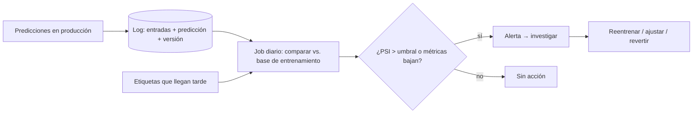

# Monitoreo de modelos y drift

Parte de: [[21-IA-Machine-Learning/08 MLOps y producción/_Índice MLOps y producción|MLOps y producción]]

> [!info] Cómo avanzar
> `progreso`: **pendiente** → **viendo** (estudiando) → **visto** (contestaste la autoevaluación sin abrir las respuestas) → **dominado** (hiciste el laboratorio o lo aplicaste de verdad).

## Contenido

### Qué es
**Monitorear un modelo** es vigilar en producción que siga funcionando bien, no solo que la API responda. Un modelo se degrada porque el mundo cambia; a ese cambio se le llama **drift** (deriva):
- **Data drift** (deriva de datos o de covariables): cambia la **distribución de las entradas**. Ejemplo: el modelo se entrenó con clientes que pagaban en promedio a 20 días y ahora el promedio es 35 porque entró un segmento nuevo.
- **Concept drift** (deriva de concepto): cambia la **relación entre entradas y resultado**. Las entradas pueden verse iguales, pero lo que significan cambió: tras una crisis económica, el mismo perfil de cliente que antes pagaba a tiempo ahora paga tarde.

También existe la deriva de la variable objetivo (*label drift*: cambia la proporción de clases) y los problemas de calidad de datos (columnas nulas, unidades distintas, un sistema que empezó a mandar ceros).

### Cómo funciona
#### Qué monitorear
1. **Salud técnica**: latencia, errores, uso de recursos (como cualquier API).
2. **Calidad de datos de entrada**: nulos, valores fuera de rango, categorías nuevas.
3. **Distribución de entradas** frente a la de entrenamiento (data drift).
4. **Distribución de predicciones**: si de pronto el modelo predice "pago tarde" al 40 % cuando históricamente era 10 %, algo cambió.
5. **Métricas de desempeño** reales (precisión, recall, error) cuando llegan las etiquetas.
6. **Métricas de negocio**: cobranza recuperada, quejas, conversiones.

#### Si las etiquetas llegan tarde
Muchas veces la verdad tarda: saber si un cliente pagó tarde toma 30–60 días. Mientras tanto, usas **indicadores adelantados**: drift de entradas, drift de predicciones, calidad de datos, confianza promedio del modelo y métricas de negocio cercanas. Cuando llegan las etiquetas, calculas el desempeño real por periodo y confirmas o descartas la alarma. Una muestra etiquetada a mano (revisión humana) también ayuda.

#### Cómo se mide el drift
- **PSI** (*Population Stability Index*): compara proporciones por intervalos entre la distribución base y la actual: PSI = Σ (actual − base) × ln(actual / base). Regla práctica muy usada: < 0.1 estable, 0.1–0.25 cambio moderado, > 0.25 cambio importante.
- **Prueba de Kolmogorov-Smirnov** para variables continuas y **chi-cuadrada** para categóricas.
- **Distancia de Wasserstein** o divergencia de Jensen-Shannon.



### Ejemplo
Variable `dias_promedio_pago` dividida en 5 intervalos. Proporciones en entrenamiento: 10 %, 20 %, 40 %, 20 %, 10 %. Proporciones del último mes: 5 %, 15 %, 35 %, 25 %, 20 %.

```python
import numpy as np

def psi(base, actual, eps=1e-6):
    base, actual = np.clip(base, eps, None), np.clip(actual, eps, None)
    return float(np.sum((actual - base) * np.log(actual / base)))

base   = np.array([0.10, 0.20, 0.40, 0.20, 0.10])
actual = np.array([0.05, 0.15, 0.35, 0.25, 0.20])
print(round(psi(base, actual), 4))   # 0.1362 → cambio moderado: investigar
```

El intervalo que más aporta es el último (clientes que pagan más tarde pasaron de 10 % a 20 %). Para que esto funcione, la API debe **registrar** cada entrada, predicción, versión del modelo y fecha (cuidando datos personales), por ejemplo en una tabla de SQL Server o en Application Insights.

#### Qué hacer si detectas drift
1. **Verificar** que no sea un problema de datos (un cambio en un sistema origen, un bug de unidades).
2. **Medir el impacto**: ¿bajó el desempeño real o solo cambió la distribución sin afectar resultados?
3. **Reentrenar** con datos recientes (y validar contra el modelo actual antes de reemplazarlo).
4. Si es concept drift fuerte, **revisar características** o el problema mismo.
5. Mientras tanto, **mitigar**: ajustar el umbral de decisión, revertir a reglas o pedir revisión humana.

### Cuándo usarlo y cuándo no
Todo modelo en producción necesita al menos monitoreo técnico y de predicciones. El monitoreo de drift por variable cobra importancia cuando las decisiones tienen impacto (crédito, precios, fraude) o el entorno cambia rápido. Para un modelo usado una sola vez en un análisis, no aplica.

### Errores comunes
- **Monitorear solo la API** (si responde 200) y no la calidad de predicciones.
- **Alarmas por cualquier drift**: algo de variación es normal; define umbrales y revisa tendencias, no puntos aislados.
- **No guardar la distribución base** de entrenamiento: no tienes contra qué comparar.
- **Reentrenar a ciegas** ante cualquier alerta sin investigar la causa: puedes "aprender" un error de datos.
- **No registrar la versión del modelo** con cada predicción: no sabes qué modelo produjo qué.

### Para profundizar
- [Monitoreo de modelos en Azure Machine Learning (Microsoft Learn)](https://learn.microsoft.com/azure/machine-learning/concept-model-monitoring)
- [Evidently AI - documentación (librería abierta de monitoreo)](https://docs.evidentlyai.com/)
- [Pruebas estadísticas en SciPy: ks_2samp](https://docs.scipy.org/doc/scipy/reference/generated/scipy.stats.ks_2samp.html)

## Autoevaluación

Contesta primero en voz alta o en papel; luego despliega la respuesta.

> [!question]- ¿Qué es data drift y concept drift?
> Data drift: cambia la distribución de las entradas. Concept drift: cambia la relación entre entradas y salida (lo que antes era fraude ya no lo es).

> [!question]- ¿Qué monitoreas si las etiquetas llegan tarde?
> Distribuciones de las entradas y de las predicciones, tasa de errores y latencia; cuando llegan etiquetas, el desempeño real.

> [!question]- ¿Qué haces si detectas drift?
> Investigar la causa, reentrenar con datos recientes y validar antes de reemplazar el modelo.

