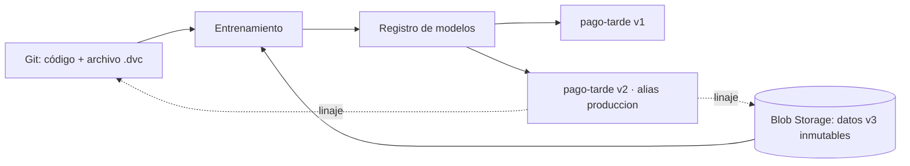

# Versionado de datos y modelos

Parte de: [[21-IA-Machine-Learning/08 MLOps y producción/_Índice MLOps y producción|MLOps y producción]]

> [!info] Cómo avanzar
> `progreso`: **pendiente** → **viendo** (estudiando) → **visto** (contestaste la autoevaluación sin abrir las respuestas) → **dominado** (hiciste el laboratorio o lo aplicaste de verdad).

## Contenido

### Qué es
**Versionar datos y modelos** es poder responder, para cualquier modelo en producción: ¿con qué datos exactos se entrenó?, ¿con qué código y parámetros?, ¿qué versión es y cuál estaba antes? Es la base de la reproducibilidad y de poder regresar a una versión anterior si algo sale mal (ver [[MLOps - conceptos]]).

### Cómo funciona
#### Por qué versionar datos
El mismo código con datos distintos produce un modelo distinto. Si los datos de entrenamiento salen de una consulta a SQL Server "de hoy", mañana la consulta devuelve otras filas y ya no puedes reproducir el modelo, ni explicar por qué su comportamiento cambió, ni auditar una decisión (por ejemplo, por qué se rechazó un crédito). Versionar datos permite:
- Reproducir un entrenamiento.
- Comparar modelos entrenados con conjuntos diferentes.
- Investigar errores y sesgos en los datos de una versión concreta.
- Cumplir auditorías.

#### Por qué no basta Git
Git está diseñado para archivos de texto pequeños y cambios línea por línea:
- Los datasets y modelos pesan cientos de MB o GB; el repositorio se vuelve enorme y lento, y servicios como GitHub o Azure Repos tienen límites de tamaño de archivo.
- Los archivos binarios (Parquet, imágenes, pesos) no se pueden comparar con *diff* de forma útil.
- Cada versión queda para siempre en el historial: borrar un archivo grande no reduce el repo.
- Los datos a veces viven en bases o *data lakes*, no en archivos.
- Datos personales en Git son un riesgo de privacidad difícil de corregir.

La solución habitual: **Git versiona el código y "punteros"** a los datos; los datos reales viven en un almacenamiento (Blob Storage, S3, un *lakehouse*) con versión inmutable.

Herramientas:
- **DVC** (Data Version Control): guarda en Git un archivo pequeño `.dvc` con el hash del dataset; el contenido va a un *remote* (Azure Blob, S3, disco).
- **Data assets de Azure Machine Learning**: datasets registrados con nombre y versión.
- **Formatos de tabla con historial** (Delta Lake, Apache Iceberg): permiten consultar una tabla "como estaba" en una versión o fecha.
- Lo más simple: carpetas inmutables con fecha y hash (`entrenamiento/2026-11-01/clientes.parquet`) y nunca sobrescribir.

#### Qué guarda un registro de modelos
Un **registro de modelos** (*model registry*), como el de [[MLflow]] o el de [[Azure Machine Learning]], es el catálogo central de modelos entrenados. Por cada versión guarda:
- El **artefacto** (archivo del modelo, idealmente con su preprocesamiento).
- **Número de versión** y nombre.
- **Linaje**: corrida/experimento de origen, commit del código, versión de datos.
- **Métricas** y parámetros de entrenamiento.
- **Firma** (*signature*): esquema de entradas y salidas.
- **Etapa o alias**: `staging`, `produccion`, `champion`.
- Descripción, etiquetas, responsable y fecha.



### Ejemplo
Versionar el dataset de clientes con DVC sobre Azure Blob Storage:

```bash
pip install "dvc[azure]"
dvc init
dvc remote add -d almacen azure://datasets-ml/dionisio
# credenciales fuera del repo: variables de entorno o configuración local
dvc remote modify --local almacen connection_string "$AZURE_STORAGE_CONNECTION_STRING"

dvc add datos/clientes.parquet          # crea datos/clientes.parquet.dvc (pequeño, va a Git)
git add datos/clientes.parquet.dvc datos/.gitignore
git commit -m "Datos de entrenamiento 2026-11"
dvc push                                 # sube el archivo real al blob

# Más tarde, para reproducir un modelo viejo:
git checkout <commit-del-modelo>
dvc pull
```

Y al registrar el modelo en MLflow, guarda como etiquetas el commit y el hash de datos, para que el linaje quede explícito.

### Cuándo usarlo y cuándo no
- **Siempre** que un modelo vaya a producción o deba auditarse.
- En experimentos rápidos basta con no sobrescribir datos y anotar su ruta en el registro de experimentos.
- Si usas Azure ML, sus *data assets* y su registro pueden ser suficientes sin DVC; si trabajas fuera de una plataforma, DVC + MLflow es una combinación gratuita y común.

### Errores comunes
- **Subir datasets o modelos grandes a Git**: repos gigantes y lentos. Usa DVC o almacenamiento externo.
- **Sobrescribir el archivo de datos** "porque es el mismo nombre": se pierde la versión anterior.
- **Versionar el modelo pero no los datos** (o al revés): el linaje queda roto.
- **Datos personales sin control**: aplica minimización y controles de acceso en el almacenamiento ([[Privacidad de datos al usar IA]]).
- **Credenciales del almacenamiento en `.dvc/config`** comprometido en Git: usa `--local` o variables de entorno.

### Para profundizar
- [Documentación de DVC](https://dvc.org/doc)
- [Registro de modelos de MLflow](https://mlflow.org/docs/latest/ml/model-registry)
- [Data assets en Azure Machine Learning (Microsoft Learn)](https://learn.microsoft.com/azure/machine-learning/concept-data)

## Autoevaluación

Contesta primero en voz alta o en papel; luego despliega la respuesta.

> [!question]- ¿Por qué versionar datos?
> Para saber con qué datos se entrenó cada modelo, reproducirlo y auditarlo.

> [!question]- ¿Por qué no basta Git?
> Git no maneja bien archivos grandes; se usan herramientas como DVC, Git LFS o registros de modelos que guardan referencias y metadatos.

> [!question]- ¿Qué guarda un registro de modelos?
> Versión, métricas, parámetros, datos usados, etapa (staging/producción) y quién lo aprobó.

## Práctica

- [[Lab 8 - Desplegar un modelo como API con FastAPI y MLflow]]

