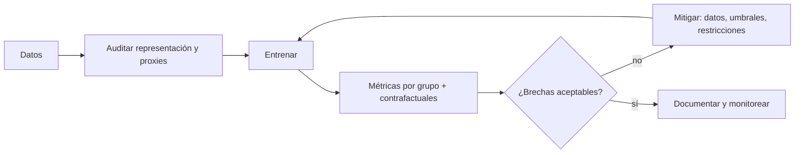

# IA responsable (sesgo, equidad y transparencia)

Parte de: [[21-IA-Machine-Learning/09 Responsabilidad y seguridad/_Índice Responsabilidad y seguridad|Responsabilidad y seguridad]]

> [!info] Cómo avanzar
> `progreso`: **pendiente** → **viendo** (estudiando) → **visto** (contestaste la autoevaluación sin abrir las respuestas) → **dominado** (hiciste el laboratorio o lo aplicaste de verdad).

## Contenido

### Qué es
**IA responsable** es el conjunto de prácticas para que los sistemas de IA sean justos, confiables, seguros, transparentes y con responsables claros. Microsoft, por ejemplo, organiza sus principios en: equidad, confiabilidad y seguridad, privacidad y seguridad, inclusión, transparencia y rendición de cuentas. Aquí nos enfocamos en tres:
- **Sesgo**: errores sistemáticos que perjudican a ciertos grupos.
- **Equidad** (*fairness*): que el sistema trate de forma comparable a grupos comparables.
- **Transparencia**: que las personas sepan que interactúan con IA, cómo se usa y por qué se tomó una decisión.

### Cómo funciona
#### De dónde viene el sesgo
Un modelo aprende patrones de sus datos; si los datos reflejan desigualdades o están incompletos, el modelo las reproduce o amplifica:
- **Datos históricos sesgados**: si en el pasado se aprobaban menos créditos a cierta zona, el modelo "aprende" a rechazarla.
- **Representación desigual**: pocos ejemplos de un grupo → peor desempeño para ese grupo.
- **Variables sustitutas** (*proxies*): aunque quites el género, el código postal o el nombre pueden correlacionar con él.
- **Etiquetas subjetivas**: quien etiquetó tenía sus propios sesgos.
- **Diseño del problema**: optimizar la métrica equivocada (por ejemplo, "probabilidad de pagar" sin considerar que cierto grupo tuvo menos acceso a crédito).
- En **LLMs**, el sesgo viene de los enormes textos de internet con que se entrenaron: estereotipos en respuestas, peor calidad en ciertos idiomas o dialectos.

#### Cómo detectar sesgo
1. **Desagregar métricas por grupo**: calcula precisión, recall, tasa de falsos positivos y tasa de aprobación para cada grupo relevante (sexo, edad, región), no solo el promedio ([[Métricas de clasificación y regresión]]).
2. **Métricas de equidad**: *paridad demográfica* (tasas de resultado positivo similares entre grupos), *igualdad de oportunidades* (recall similar), *odds igualadas* (tasas de verdaderos y falsos positivos similares). No se pueden cumplir todas a la vez: hay que elegir según el contexto.
3. **Pruebas contrafactuales**: cambia solo el atributo sensible (el nombre "María" por "José") y mira si cambia la respuesta. Muy útil con LLMs.
4. **Revisión de datos**: distribución de grupos, calidad de etiquetas, variables sustitutas.
5. Herramientas como **Fairlearn** o el *Responsible AI dashboard* de Azure Machine Learning.



#### Transparencia
Significa varias cosas:
- **Avisar** que hay IA involucrada (un chat, un contenido generado).
- **Documentar** el sistema: para qué sirve, con qué datos se entrenó, sus límites y su desempeño por grupo (*model cards*, notas de transparencia).
- **Explicar decisiones** cuando afectan a personas: qué factores pesaron (técnicas como SHAP o importancia de variables).
- **Permitir apelación**: un humano puede revisar la decisión.

### Ejemplo
Para el modelo de "pago tarde" de Itzamna.Dionisio, revisar la tasa de falsos positivos por región con Fairlearn:

```python
# pip install fairlearn scikit-learn pandas
from fairlearn.metrics import MetricFrame, false_positive_rate, selection_rate
from sklearn.metrics import recall_score

mf = MetricFrame(
    metrics={"recall": recall_score, "fpr": false_positive_rate, "tasa_alerta": selection_rate},
    y_true=y_test, y_pred=y_pred,
    sensitive_features=df_test["region"])

print(mf.by_group)        # métricas por región
print(mf.difference())    # brecha máxima entre regiones
```

Si la región sur tiene el doble de falsos positivos (clientes marcados como riesgosos que sí pagan), investigas: ¿menos datos de esa región? ¿una variable sustituta? Mitigas y documentas la decisión. Si el modelo se usa para negar crédito, además das una explicación y una vía de revisión humana.

### Cuándo usarlo y cuándo no
Es indispensable cuando el sistema **afecta a personas**: crédito, contratación, precios, salud, seguridad, servicios públicos. En usos de bajo impacto (sugerir etiquetas para notas internas) basta con lo básico: avisar que es IA y revisar resultados. La regulación sobre IA avanza en varios países (por ejemplo, la Ley de IA de la Unión Europea); si tu sistema opera allá, revísala.

### Errores comunes
- **"Quitamos la variable sensible, ya no hay sesgo"**: los *proxies* siguen ahí; mide por grupo.
- **Solo mirar el promedio**: un 95 % global puede esconder un 70 % en un grupo.
- **Elegir una métrica de equidad sin pensar el contexto**: cada una prioriza algo distinto.
- **Documentar una vez y olvidarse**: el sesgo puede aparecer con drift ([[Monitoreo de modelos y drift]]).
- **Automatizar decisiones de alto impacto sin revisión humana ni apelación.**

### Para profundizar
- [IA responsable en Azure Machine Learning (Microsoft Learn)](https://learn.microsoft.com/azure/machine-learning/concept-responsible-ai)
- [Fairlearn - documentación](https://fairlearn.org/)
- [Principios de IA responsable de Microsoft](https://www.microsoft.com/ai/responsible-ai)

## Autoevaluación

Contesta primero en voz alta o en papel; luego despliega la respuesta.

> [!question]- ¿De dónde viene el sesgo de un modelo?
> De datos históricos sesgados, muestras poco representativas, etiquetas con prejuicios o variables que funcionan como proxy (código postal ≈ nivel socioeconómico).

> [!question]- ¿Cómo detectas sesgo?
> Midiendo métricas por grupo (recall, tasa de aprobación) y comparando; no basta la métrica global.

> [!question]- ¿Qué significa transparencia?
> Que las personas sepan cuándo interactúan con IA, qué datos usa y cómo impugnar una decisión; documentar el modelo (model cards).

