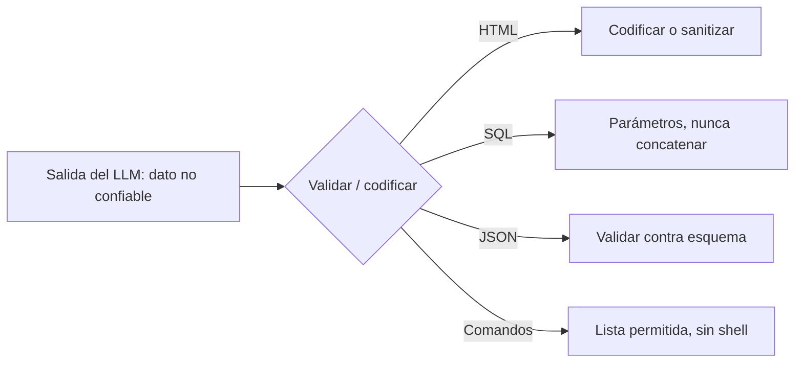

# OWASP Top 10 para LLMs

Parte de: [[21-IA-Machine-Learning/09 Responsabilidad y seguridad/_Índice Responsabilidad y seguridad|Responsabilidad y seguridad]]

> [!info] Cómo avanzar
> `progreso`: **pendiente** → **viendo** (estudiando) → **visto** (contestaste la autoevaluación sin abrir las respuestas) → **dominado** (hiciste el laboratorio o lo aplicaste de verdad).

## Contenido

### Qué es
El **OWASP Top 10 for LLM Applications** es una lista de los diez riesgos de seguridad más importantes en aplicaciones que usan modelos de lenguaje, publicada por el OWASP GenAI Security Project (la misma fundación del famoso OWASP Top 10 web). Sirve como checklist para diseñar, revisar y probar aplicaciones con LLMs, RAG y agentes.

Hay dos ediciones que vas a ver citadas: la **2025** (publicada a finales de 2024) y la **2026**, publicada en agosto de 2026, que por primera vez combina la opinión de practicantes con datos de incidentes reales. Revisa en el sitio oficial cuál es la edición vigente cuando la consultes.

### Cómo funciona
#### Lista 2026
| ID | Riesgo | Idea clave |
|---|---|---|
| LLM01 | Prompt Injection | Texto que el modelo toma como instrucciones; ahora incluye ataques en imágenes y audio ([[Prompt injection]]) |
| LLM02 | Sensitive Information Disclosure | El sistema revela datos personales, secretos o información de otros usuarios |
| LLM03 | Excessive Agency | El LLM tiene más herramientas, permisos o autonomía de los necesarios |
| LLM04 | Supply Chain | Modelos, datasets, librerías o plugins de terceros comprometidos |
| LLM05 | Data and Model Poisoning | Datos de entrenamiento, *fine-tuning* o embeddings manipulados |
| LLM06 | Unbounded Consumption | Consumo sin límites: costos ("denial of wallet"), denegación de servicio |
| LLM07 | Misinformation | Respuestas falsas o alucinadas que se toman como verdad ([[Alucinaciones y cómo reducirlas]]) |
| LLM08 | Hidden Context Exposure | Exposición de contenido no visible para el usuario: *system prompt*, contexto recuperado (antes "System Prompt Leakage") |
| LLM09 | Vector and Embedding Weaknesses | Fallas en RAG: acceso indebido entre usuarios, inyección por documentos, inversión de embeddings |
| LLM10 | Improper Output Handling | Usar la salida del modelo sin validar ni codificar (XSS, SQL, comandos) |

En la **edición 2025** el orden era: LLM01 Prompt Injection, LLM02 Sensitive Information Disclosure, LLM03 Supply Chain, LLM04 Data and Model Poisoning, LLM05 Improper Output Handling, LLM06 Excessive Agency, LLM07 System Prompt Leakage, LLM08 Vector and Embedding Weaknesses, LLM09 Misinformation, LLM10 Unbounded Consumption. El gran cambio de 2026 es que **Excessive Agency** subió al tercer lugar por los incidentes con agentes.

#### Dos riesgos que conviene entender a fondo
**Agencia excesiva** (*Excessive Agency*): darle al LLM capacidades de más. Tiene tres formas: **funcionalidad** excesiva (herramientas que no necesita, como `EjecutarSql` genérico), **permisos** excesivos (la herramienta usa una cuenta con más acceso del necesario) y **autonomía** excesiva (ejecuta acciones de alto impacto sin aprobación). Cuando el modelo se equivoca o es manipulado, el daño es proporcional a lo que puede hacer. Se mitiga con mínimo privilegio y aprobación humana ([[Guardrails y límites de un agente]], [[Humano en el ciclo (aprobaciones)]]).

**Manejo inadecuado de salida** (*Improper Output Handling*): tratar la respuesta del modelo como confiable. Si tu app **inserta la respuesta del LLM directo en HTML**, un atacante que logre que el modelo genere `` (por ejemplo, mediante inyección indirecta en un documento) consigue **XSS** en el navegador de tus usuarios. Lo mismo pasa si la salida se concatena en SQL, en un comando de shell o en una URL.



### Ejemplo
Itzamna.Clio (React) muestra la respuesta del asistente. Lo inseguro y lo seguro:

```tsx
// INSEGURO: XSS si el modelo devuelve HTML malicioso
<div dangerouslySetInnerHTML={{ __html: respuestaLLM }} />

// SEGURO: React escapa el texto por defecto
<div>{respuestaLLM}</div>

// Si necesitas formato Markdown, renderiza con una librería que sanitice
// (por ejemplo react-markdown sin HTML crudo, o DOMPurify antes de insertar)
```

Y en el backend de Itzamna.Dionisio: si el modelo propone un filtro de búsqueda, se valida con FluentValidation y se pasa como **parámetro de Dapper** a la consulta del archivo `.sql`; nunca se concatena texto del modelo en SQL. Para *Unbounded Consumption*: límite de tokens por petición, límite de tasa por usuario y alertas de costo.

### Cuándo usarlo y cuándo no
Úsalo como checklist en el diseño, en la revisión de código y en las pruebas de seguridad de **cualquier** aplicación con LLM. Complementa (no reemplaza) al OWASP Top 10 web y a tu modelado de amenazas. OWASP también publica guías específicas para aplicaciones agénticas; revísalas si construyes agentes.

### Errores comunes
- **Pensar que solo aplica el #1**: la mayoría de incidentes reales combinan varios (inyección + agencia excesiva + salida sin validar).
- **Confiar en la salida del modelo** porque "lo generó nuestro sistema".
- **Memorizar los números** en vez de los conceptos: el orden cambia entre ediciones.
- **No poner límites de consumo**: un bucle de agente o un abuso genera facturas enormes.
- **Ignorar la cadena de suministro**: modelos y servidores MCP descargados sin verificar.

### Para profundizar
- [OWASP Top 10 for LLM Applications (sitio oficial)](https://genai.owasp.org/llm-top-10/)
- [Anuncio de la edición 2026 (OWASP GenAI Security Project)](https://genai.owasp.org/2026/09/01/owasp-genai-security-project-unveils-2026-top-10-for-llm-applications-new-agent-control-standard-and-sponsors-as-community-tops-30000-members/)
- [Hoja de referencia de prevención de XSS (OWASP Cheat Sheet Series)](https://cheatsheetseries.owasp.org/cheatsheets/Cross_Site_Scripting_Prevention_Cheat_Sheet.html)

## Autoevaluación

Contesta primero en voz alta o en papel; luego despliega la respuesta.

> [!question]- ¿Qué es el OWASP Top 10 para LLMs?
> Una lista de OWASP con los riesgos más importantes de aplicaciones con LLMs, para guiar diseño y revisiones de seguridad.

> [!question]- Menciona al menos cinco riesgos de la lista.
> Edición 2025: prompt injection, divulgación de información sensible, cadena de suministro, envenenamiento de datos y modelos, manejo inadecuado de la salida, agencia excesiva, filtración del system prompt, debilidades de vectores y embeddings, desinformación y consumo sin límites. (Pendiente de confirmar si hay una edición más reciente.)

> [!question]- Caso: la app inserta la respuesta del LLM directo en HTML. ¿Qué riesgo es?
> Manejo inadecuado de la salida: puede causar XSS. Escapa o sanea la salida como cualquier entrada no confiable.

> [!question]- ¿Qué es "agencia excesiva"?
> Darle al modelo más herramientas, permisos o autonomía de los necesarios, de modo que un error o una inyección cause daño real.

