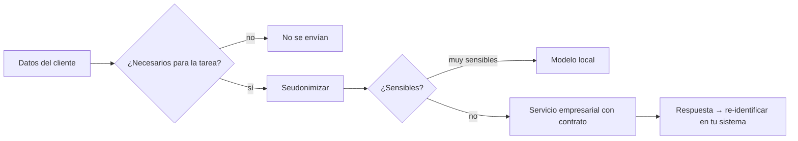

# Privacidad de datos al usar IA

Parte de: [[21-IA-Machine-Learning/09 Responsabilidad y seguridad/_Índice Responsabilidad y seguridad|Responsabilidad y seguridad]]

> [!info] Cómo avanzar
> `progreso`: **pendiente** → **viendo** (estudiando) → **visto** (contestaste la autoevaluación sin abrir las respuestas) → **dominado** (hiciste el laboratorio o lo aplicaste de verdad).

## Contenido

### Qué es
Usar servicios de IA implica **enviar datos a un tercero**: el prompt, los documentos que adjuntas, el código que pegas. La privacidad de datos al usar IA es decidir **qué datos pueden salir, a qué servicio, bajo qué condiciones contractuales y técnicas**, y cómo minimizar lo que se envía. Afecta datos personales de clientes, secretos comerciales, código propietario y credenciales.

### Cómo funciona
#### Qué revisar antes de mandar datos a un servicio de IA
1. **Términos y tipo de cuenta**: ¿es un chat de consumo o un servicio empresarial/API? Las condiciones difieren mucho. Pregunta: ¿se usan mis datos para entrenar modelos? ¿cuánto tiempo se retienen? ¿quién puede verlos (revisión humana)?
2. **Ubicación y residencia de datos**: ¿en qué región se procesan y guardan?
3. **Retención y registro**: muchos servicios guardan prompts temporalmente para detectar abuso. Por ejemplo, Microsoft documenta que en Azure OpenAI (Microsoft Foundry) los prompts y respuestas **no se usan para entrenar los modelos base ni se comparten con OpenAI**, pero pueden almacenarse para monitoreo de abuso; clientes aprobados pueden solicitar que se desactive ese almacenamiento.
4. **Clasificación de los datos**: ¿son públicos, internos, confidenciales, datos personales, datos personales sensibles (salud, origen, creencias)?
5. **Marco legal**: en México, el tratamiento de datos personales por particulares se rige por la nueva Ley Federal de Protección de Datos Personales en Posesión de los Particulares, publicada en el DOF el 20 de marzo de 2025; la autoridad que sustituyó al INAI en esta materia es la Secretaría Anticorrupción y Buen Gobierno. Implica aviso de privacidad, finalidades y consentimiento. Si atiendes clientes de otros países pueden aplicar otras leyes (por ejemplo el RGPD europeo). Ante dudas, consulta al área legal.
6. **Políticas de tu empresa**: qué herramientas están aprobadas.

#### Cómo minimizar el riesgo
- **Minimización**: manda solo lo necesario. Para resumir un ticket no hace falta el RFC ni el teléfono del cliente.
- **Seudonimizar o anonimizar**: reemplaza datos personales por marcadores (`CLIENTE_1`, `RFC_1`) antes de enviar, y re-identifica en tu sistema si hace falta.
- **Servicios empresariales** con contrato y controles (Azure OpenAI/Foundry en tu suscripción, con redes privadas y Entra ID) en lugar de chats públicos.
- **Modelos locales** (Ollama) para datos muy sensibles: no salen de tu equipo.
- **Control de acceso en RAG**: que cada usuario recupere solo documentos que puede ver.
- **Cuidar los logs**: trazas y telemetría de prompts también contienen datos personales; aplica retención y acceso restringido.
- **Nunca enviar secretos**: cadenas de conexión, llaves, tokens.



### Ejemplo
En Ocelotl.Hermes, antes de mandar un mensaje de cliente al LLM, se enmascaran datos personales comunes en México:

```csharp
using System.Text.RegularExpressions;

public static partial class Enmascarador
{
    [GeneratedRegex(@"\b[A-ZÑ&]{3,4}\d{6}[A-Z0-9]{3}\b")] private static partial Regex Rfc();
    [GeneratedRegex(@"\b[A-Z]{4}\d{6}[HM][A-Z]{5}[A-Z0-9]\d\b")] private static partial Regex Curp();
    [GeneratedRegex(@"[\w.+-]+@[\w-]+\.[\w.]+")] private static partial Regex Correo();
    [GeneratedRegex(@"\b\d{10}\b")] private static partial Regex Telefono();

    public static string Aplicar(string texto) =>
        Telefono().Replace(Correo().Replace(Curp().Replace(Rfc().Replace(texto, "[RFC]"), "[CURP]"), "[CORREO]"), "[TEL]");
}

// var seguro = Enmascarador.Aplicar(mensajeCliente);  // luego se envía al IChatClient
```

Las expresiones regulares no atrapan todo (nombres, direcciones); para más cobertura existen servicios de detección de datos personales, como la detección de PII de Azure AI Language.

### Cuándo usarlo y cuándo no
Estos controles aplican siempre que haya datos de clientes, empleados o información confidencial. Para datos públicos (documentación abierta, código de ejemplo propio sin secretos) el riesgo es bajo y puedes usar herramientas más abiertas. Cuanto más sensible el dato, más te mueves hacia: servicio empresarial → seudonimización → modelo local → no usar IA.

### Errores comunes
- **Pegar código o datos de clientes en un chat público**: puedes violar contratos, la ley de datos personales y políticas internas; según la cuenta, esos datos pueden retenerse o usarse para mejorar el servicio. Y si el código trae credenciales, quedan expuestas: rótalas.
- **Suponer que "API" significa "privado"**: lee los términos de cada proveedor.
- **Olvidar los logs y la memoria** del agente ([[Memoria de agentes (corto y largo plazo)]]): ahí también quedan datos personales.
- **RAG sin permisos**: un usuario recupera documentos de otro.
- **No actualizar el aviso de privacidad** cuando una nueva finalidad (por ejemplo, análisis con IA) usa los datos.

### Para profundizar
- [Datos, privacidad y seguridad en Azure OpenAI (Microsoft Learn)](https://learn.microsoft.com/azure/foundry/responsible-ai/openai/data-privacy)
- [Ley Federal de Protección de Datos Personales en Posesión de los Particulares (Cámara de Diputados)](https://www.diputados.gob.mx/LeyesBiblio/pdf/LFPDPPP.pdf)
- [Detección de PII en Azure AI Language (Microsoft Learn)](https://learn.microsoft.com/azure/ai-services/language-service/personally-identifiable-information/overview)

## Autoevaluación

Contesta primero en voz alta o en papel; luego despliega la respuesta.

> [!question]- ¿Qué revisas antes de mandar datos a un servicio de IA?
> Si el proveedor usa los datos para entrenar, cuánto los retiene, dónde se procesan y qué contrato/aviso de privacidad aplica (en México, la ley de protección de datos personales vigente).

> [!question]- ¿Cómo minimizas el riesgo?
> Enviar solo lo necesario, anonimizar o seudonimizar datos personales, usar despliegues empresariales o modelos locales para datos sensibles.

> [!question]- Error común: pegar código o datos de clientes en un chat público.
> Puede violar contratos o la ley. Usa herramientas aprobadas por la organización.

