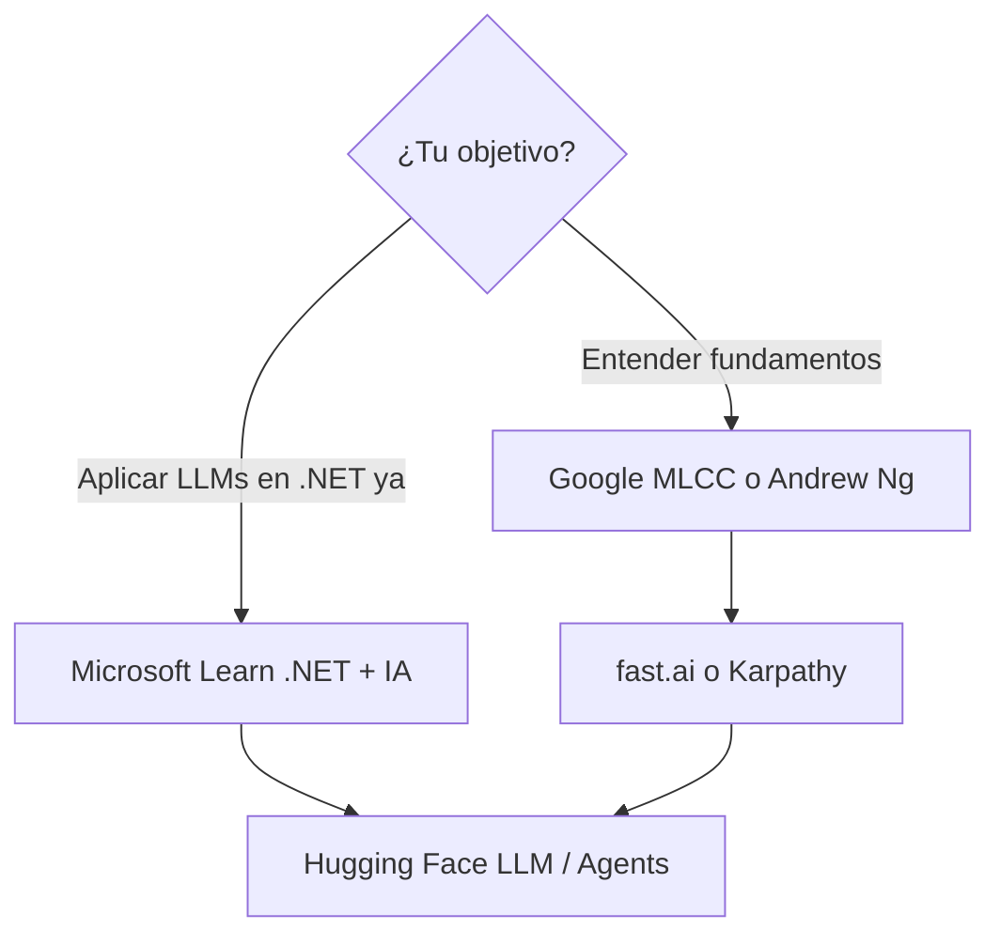

# Cursos recomendados de ML y deep learning

Parte de: [[21-IA-Machine-Learning/10 Recursos y práctica/_Índice Recursos y práctica|Recursos y práctica]]

> [!info] Cómo avanzar
> `progreso`: **pendiente** → **viendo** (estudiando) → **visto** (contestaste la autoevaluación sin abrir las respuestas) → **dominado** (hiciste el laboratorio o lo aplicaste de verdad).

## Contenido

### Qué es
Esta nota es una guía para **elegir cursos** de machine learning, deep learning y LLMs, con opciones conocidas y gratuitas o de bajo costo. No se trata de juntar certificados, sino de escoger uno o dos cursos que encajen con tu objetivo y terminarlos haciendo los ejercicios.

### Cómo funciona
#### Criterios para elegir un curso
1. **Objetivo**: ¿quieres entender fundamentos (cómo funcionan los modelos) o aplicar IA en apps (LLMs, RAG, agentes)? Son cursos distintos.
2. **Práctica**: que tenga notebooks, ejercicios o proyectos, no solo videos. Lo ideal es que puedas correrlo en Google Colab o en tu PC.
3. **Requisitos previos**: revisa qué asume (Python, álgebra, cálculo) para no frustrarte.
4. **Actualidad**: en LLMs y agentes, un curso de hace dos años puede usar APIs que ya cambiaron. En fundamentos (regresión, redes neuronales) la antigüedad importa menos.
5. **Calidad del autor**: universidades, empresas que construyen las herramientas (Google, Microsoft, Hugging Face) o autores reconocidos.
6. **Costo y formato**: gratuito, con pago por certificado o suscripción; ritmo propio o con fechas.
7. **Idioma**: casi todo el material de calidad está en inglés; algunos tienen subtítulos en español.

#### Opciones conocidas
| Curso | Enfoque | Costo |
|---|---|---|
| **Machine Learning Crash Course** (Google) | Fundamentos de ML con ejercicios interactivos | Gratuito |
| **Machine Learning Specialization** (DeepLearning.AI / Stanford, Andrew Ng, en Coursera) | Fundamentos de ML clásico y redes, muy didáctico | Pago; opción de auditar sin costo: Pendiente de confirmar |
| **Practical Deep Learning for Coders** (fast.ai) | Deep learning "de arriba hacia abajo": primero resultados, luego teoría | Gratuito |
| **Neural Networks: Zero to Hero** (Andrej Karpathy) | Construir redes y un GPT pequeño desde cero en Python | Gratuito (videos y código) |
| **Cursos de Hugging Face**: LLM Course, Agents Course y otros | Transformers, LLMs abiertos, agentes | Gratuitos |
| **ML for Beginners**, **Generative AI for Beginners**, **AI Agents for Beginners** (Microsoft, en GitHub) | Currículos con lecciones y código, varios con ejemplos en .NET | Gratuitos |
| **Módulos de Microsoft Learn** sobre .NET + IA, Microsoft Foundry y Azure ML | Integración con tu stack | Gratuitos (los laboratorios en Azure pueden generar costo) |

Precios, contenidos y disponibilidad cambian; verifica en el sitio de cada curso antes de inscribirte.

### Ejemplo
Combinación sugerida para tu perfil (desarrollador .NET, quiere llegar a agentes, prefiere herramientas gratuitas):
1. **Google Machine Learning Crash Course** para fundamentos, practicando en Colab (encaja con [[Qué es el machine learning]] y el resto de la sección de ML clásico).
2. **fast.ai** o **Karpathy** para deep learning; en tu GTX 1660 Ti de 6 GB puedes correr ejemplos pequeños, pero para entrenar modelos más grandes usa la GPU gratuita de Colab (con límites de uso).
3. **Hugging Face Agents Course** y **AI Agents for Beginners** de Microsoft para agentes.
4. **Microsoft Learn** para aterrizarlo en .NET con [[Microsoft.Extensions.AI]] y [[Semantic Kernel y Microsoft Agent Framework]].

Regla: por cada módulo de curso, haz un mini-proyecto propio con datos de tu trabajo (anonimizados) o públicos ([[Proyectos prácticos de IA]]).

### Cuándo usarlo y cuándo no
Un curso es útil cuando necesitas estructura y no sabes qué no sabes. Cuando ya tienes bases, la documentación oficial y los proyectos te enseñan más rápido que otro curso. Si te encuentras comprando un tercer curso del mismo tema sin terminar el primero, para y construye algo.

### Errores comunes
- **Coleccionar cursos** sin terminarlos.
- **Ver sin programar**: pausa el video y escribe el código tú.
- **Elegir un curso de agentes desactualizado**: revisa la fecha y las versiones de librerías.
- **Saltarse los ejercicios difíciles**: ahí es donde se aprende.
- **Pagar certificados** creyendo que valen más que un portafolio: en ML, un proyecto publicado demuestra más.

### Para profundizar
- [Machine Learning Crash Course (Google)](https://developers.google.com/machine-learning/crash-course)
- [Practical Deep Learning for Coders (fast.ai)](https://course.fast.ai/)
- [Cursos de Hugging Face](https://huggingface.co/learn)
- [AI Agents for Beginners (Microsoft, GitHub)](https://github.com/microsoft/ai-agents-for-beginners)

## Autoevaluación

Contesta primero en voz alta o en papel; luego despliega la respuesta.

> [!question]- ¿Qué criterios usas para elegir un curso?
> Que tenga práctica con código, sea reciente en temas de LLMs, tenga ejercicios evaluables y te deje un proyecto propio.

> [!question]- Menciona opciones conocidas.
> Machine Learning Specialization (DeepLearning.AI), Practical Deep Learning de fast.ai, los cursos de Hugging Face y las rutas de IA de Microsoft Learn. Disponibilidad y costo: (Pendiente de confirmar).

