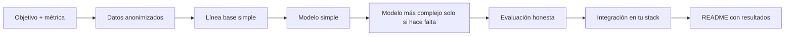

# Proyectos prácticos de IA

Parte de: [[21-IA-Machine-Learning/10 Recursos y práctica/_Índice Recursos y práctica|Recursos y práctica]]

> [!info] Cómo avanzar
> `progreso`: **pendiente** → **viendo** (estudiando) → **visto** (contestaste la autoevaluación sin abrir las respuestas) → **dominado** (hiciste el laboratorio o lo aplicaste de verdad).

## Contenido

### Qué es
Los **proyectos prácticos** son la forma de convertir lo que estudias en habilidad real y en portafolio. Un buen proyecto de práctica te obliga a pasar por todo el ciclo: conseguir datos, construir algo, evaluarlo y mostrarlo, con un alcance que puedas terminar.

### Cómo funciona
#### Qué hace bueno a un proyecto de práctica
1. **Alcance pequeño y terminable**: algo que puedas acabar en 1–3 fines de semana. Un proyecto terminado enseña más que uno ambicioso abandonado.
2. **Datos reales o realistas**: datasets públicos o datos de tu trabajo anonimizados ([[Privacidad de datos al usar IA]]).
3. **Métrica de éxito clara**: "el clasificador logra F1 ≥ 0.8 en el conjunto de prueba", "el RAG encuentra el documento correcto en 8 de 10 preguntas".
4. **Línea base**: compara contra algo simple (una regla, la media, búsqueda por palabras clave). Si tu modelo no le gana a la línea base, aprendiste algo importante.
5. **Evaluación honesta**: separar datos de prueba, correr varias veces, documentar fallas.
6. **Toca tu stack**: integrar con .NET, SQL Server o React te da algo que puedes usar en el trabajo.
7. **Se puede mostrar**: un repositorio con README, resultados y lo que aprendiste.

#### Ideas por nivel
| Nivel | Proyecto | Temas que practica |
|---|---|---|
| Básico | **Análisis exploratorio** de ventas o tickets con pandas y gráficas | [[pandas]], [[Visualización con matplotlib y seaborn]] |
| Básico | **Clasificador de tickets** por categoría (soporte, facturación, técnico) con scikit-learn y TF-IDF | [[scikit-learn]], [[Métricas de clasificación y regresión]] |
| Intermedio | **Predicción de pago tarde** en ML.NET servido desde una API ASP.NET Core | [[ML.NET]], [[Desplegar un modelo como API]] |
| Intermedio | **Buscador semántico** de la documentación de tus proyectos con embeddings y pgvector | [[Embeddings y bases vectoriales (pgvector y Azure AI Search)]] |
| Intermedio | **RAG con evaluación**: preguntas sobre manuales internos, con métricas de recuperación | [[RAG (generación aumentada con recuperación)]], [[Evaluación de respuestas de LLMs]] |
| Avanzado | **Agente de soporte de solo lectura** en .NET con herramientas y un servidor MCP propio | [[Herramientas y MCP (Model Context Protocol)]], [[Guardrails y límites de un agente]] |
| Avanzado | **Extracción estructurada** de datos de facturas/PDF a JSON validado | [[Salidas estructuradas (JSON)]] |
| Avanzado | **Pipeline MLOps**: entrenamiento con MLflow, despliegue y monitoreo de drift | [[MLflow]], [[Monitoreo de modelos y drift]] |
| Hobby | **Clasificar tus fotos** (Sony a6700, iPhone) por escena con un modelo preentrenado y [[Transfer learning y fine-tuning]] | Visión, transfer learning |

### Ejemplo
Proyecto "Clasificador de tickets de Ocelotl.Hermes", bien planteado:
1. **Objetivo**: sugerir la categoría de un ticket nuevo; métrica: F1 macro ≥ 0.75.
2. **Datos**: 2,000 tickets históricos exportados con una consulta `.sql`, sin nombres ni correos (enmascarados).
3. **Línea base**: reglas por palabras clave ("factura" → facturación). Mide su F1.
4. **Modelo 1**: TF-IDF + regresión logística en scikit-learn. **Modelo 2**: embeddings + clasificador. **Modelo 3** (opcional): LLM con *few-shot*. Compara métricas, costo y latencia.
5. **Integración**: el mejor modelo, exportado a ONNX o hecho en ML.NET, expuesto en un endpoint de la API.
6. **Entrega**: README con resultados, matriz de confusión y qué falló.

### Cuándo usarlo y cuándo no
Haz un proyecto al terminar cada sección del temario y usa los laboratorios de cada sección como punto de partida. Si un proyecto se alarga más de un mes, recórtalo: entrega una versión mínima y deja mejoras para la versión 2. Ver la secuencia general en [[Ruta de aprendizaje de IA (de cero a agentes)]].

### Errores comunes
- **Empezar por el modelo más complejo**: arrancar con deep learning o un agente multi-agente sin línea base. No sabrás si la complejidad aporta algo, tardarás más en depurar y gastarás más (tiempo, GPU, tokens). Empieza simple y sube solo si las métricas lo justifican.
- **Proyectos sin métrica**: "hice un chatbot" no dice si funciona.
- **Fuga de datos**: evaluar con datos que el modelo ya vio (ver [[Datos de entrenamiento, validación y prueba]]).
- **Usar datos reales de clientes sin anonimizar** o subirlos a un repositorio público.
- **No documentar**: sin README, en tres meses ni tú recordarás qué hiciste.

### Para profundizar
- [Datasets de Kaggle](https://www.kaggle.com/datasets)
- [Datasets en Hugging Face](https://huggingface.co/datasets)
- [Tutoriales de ML.NET (Microsoft Learn)](https://learn.microsoft.com/dotnet/machine-learning/tutorials/)

## Autoevaluación

Contesta primero en voz alta o en papel; luego despliega la respuesta.

> [!question]- ¿Qué hace bueno a un proyecto de práctica?
> Datos reales o propios, una métrica clara, comparación contra un modelo base y un entregable (notebook, API o demo) que puedas explicar.

> [!question]- Da tres ideas de proyectos.
> Clasificador de tickets de soporte; buscador RAG sobre tu bóveda de Obsidian con evaluación; agente con un servidor MCP que consulte una API propia.

> [!question]- Error común: empezar por el modelo más complejo.
> Empieza con un modelo base simple: te dice si lo complejo realmente aporta.

