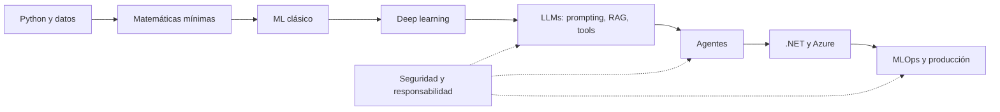

# Ruta de aprendizaje de IA (de cero a agentes)

Parte de: [[21-IA-Machine-Learning/10 Recursos y práctica/_Índice Recursos y práctica|Recursos y práctica]]

> [!info] Cómo avanzar
> `progreso`: **pendiente** → **viendo** (estudiando) → **visto** (contestaste la autoevaluación sin abrir las respuestas) → **dominado** (hiciste el laboratorio o lo aplicaste de verdad).

## Contenido

### Qué es
Una **ruta de aprendizaje** es el orden recomendado para estudiar IA de forma que cada tema se apoye en el anterior. Esta ruta está pensada para un desarrollador .NET que quiere llegar a construir agentes y aplicaciones con LLMs, sin perderse en teoría antes de practicar. Sigue el mismo orden que las secciones de esta área.

### Cómo funciona
#### Orden recomendado
| Etapa | Qué estudiar | Resultado práctico |
|---|---|---|
| 1. Bases | Python para datos: [[Python - básico]], [[NumPy]], [[pandas]], [[Jupyter notebooks]] | Cargas, limpias y graficas un CSV |
| 2. Matemáticas mínimas | [[Álgebra lineal para ML (vectores, matrices y producto punto)]], [[Estadística para ML (distribuciones, media, varianza)]], [[Probabilidad para ML]], [[Cálculo para ML (derivadas y gradiente)]] | Entiendes qué es un vector, un promedio y un gradiente |
| 3. ML clásico | [[Qué es el machine learning]], [[Regresión lineal]], [[Regresión logística]], [[Árboles de decisión y random forest]], [[Validación cruzada]], métricas, [[scikit-learn]] | Entrenas y evalúas un clasificador correctamente |
| 4. Deep learning | [[Neurona artificial y perceptrón]], [[Descenso de gradiente y backpropagation]], [[PyTorch]], [[Embeddings]], [[Mecanismo de atención]], [[Transformers]] | Entrenas una red pequeña y entiendes qué hay dentro de un LLM |
| 5. LLMs | [[Cómo funciona un LLM (tokens, contexto y predicción)]], [[Prompting efectivo]], [[Salidas estructuradas (JSON)]], [[Tool calling (llamadas a herramientas)]], [[RAG (generación aumentada con recuperación)]], [[Evaluación de respuestas de LLMs]] | Construyes un RAG y lo evalúas |
| 6. Agentes | [[Qué es un agente de IA]], [[El ciclo de un agente (razonar, actuar, observar)]], [[Herramientas y MCP (Model Context Protocol)]], [[Guardrails y límites de un agente]], [[Evaluación de agentes]] | Un agente con herramientas y MCP |
| 7. .NET y Azure | [[Microsoft.Extensions.AI]], [[Semantic Kernel y Microsoft Agent Framework]], [[Azure OpenAI y Azure AI Foundry]], [[ML.NET]], [[ONNX Runtime]] | Lo anterior integrado en tu stack |
| 8. Producción | [[MLOps - conceptos]], [[MLflow]], [[Desplegar un modelo como API]], [[Monitoreo de modelos y drift]] | Un modelo desplegado y monitoreado |
| Transversal | [[Prompt injection]], [[OWASP Top 10 para LLMs]], [[Privacidad de datos al usar IA]], [[IA responsable (sesgo, equidad y transparencia)]] | Diseñas pensando en seguridad desde el inicio |

#### Dos caminos según tu objetivo
- **Atajo de "ingeniero de IA aplicada"**: si tu meta inmediata es integrar LLMs en tus apps .NET, puedes ir de la etapa 1 directo a la 5–7, y regresar a ML clásico y deep learning después. Muchos desarrolladores construyen buenos RAG y agentes así.
- **Camino completo**: si quieres entrenar modelos propios, entender a fondo por qué funcionan o moverte hacia ciencia de datos, sigue el orden completo.

#### ¿Hace falta dominar todas las matemáticas antes de practicar?
**No.** Necesitas una base: qué es un vector y el producto punto (para entender embeddings y similitud), media y varianza (para entender datos y métricas), probabilidad básica (para entender clasificadores y la salida de un LLM) y la idea de derivada como "pendiente" (para entender el entrenamiento). Lo demás se aprende **cuando un tema lo pide**: si al estudiar backpropagation no entiendes la regla de la cadena, en ese momento la repasas. Aprender todo el cálculo y el álgebra antes de escribir una línea de código suele terminar en abandono.

### Ejemplo
Un plan realista de unas 5–6 horas por semana durante unos 6 meses (ajústalo a tu ritmo):
- **Mes 1**: Python, pandas y matemáticas mínimas. Proyecto: análisis exploratorio de ventas exportadas de Wee.Reporteria.
- **Mes 2**: ML clásico con scikit-learn. Proyecto: modelo de "pago tarde" con validación cruzada y métricas.
- **Mes 3**: Deep learning con PyTorch en Google Colab. Proyecto: red pequeña y embeddings de texto.
- **Mes 4**: LLMs y RAG. Proyecto: buscador de la documentación interna de Itzamna con pgvector.
- **Mes 5**: Agentes en .NET con Microsoft.Extensions.AI, Agent Framework y un servidor MCP. Proyecto: asistente de soporte de solo lectura.
- **Mes 6**: Producción: MLflow, despliegue y monitoreo; seguridad y evaluación del agente.

Cada mes, marca en las notas tu `progreso` y completa los laboratorios de la sección (ver [[Proyectos prácticos de IA]] y [[Cursos recomendados de ML y deep learning]]).

### Cuándo usarlo y cuándo no
Usa esta ruta como guía, no como contrato. Si en el trabajo te piden algo específico (un RAG la próxima semana), salta a esa sección y vuelve a la ruta después. Si ya sabes algo, verifícalo con la autoevaluación de cada nota y avanza.

### Errores comunes
- **Quedarse años en teoría** sin construir nada.
- **Saltar directo a agentes** sin entender tokens, contexto ni evaluación: los agentes fallan y no sabes por qué.
- **Consumir cursos sin practicar**: ver videos da sensación de avance; los proyectos dan habilidad.
- **Perseguir cada herramienta nueva**: los fundamentos cambian poco; los frameworks cambian cada mes.
- **Ignorar seguridad hasta el final**: aprende [[Prompt injection]] junto con tus primeros agentes.

### Para profundizar
- [Rutas de aprendizaje de IA en Microsoft Learn](https://learn.microsoft.com/training/browse/?terms=ai)
- [Curso intensivo de machine learning de Google](https://developers.google.com/machine-learning/crash-course)
- [Cursos de Hugging Face (LLM y agentes)](https://huggingface.co/learn)

## Autoevaluación

Contesta primero en voz alta o en papel; luego despliega la respuesta.

> [!question]- ¿En qué orden conviene estudiar?
> Python y datos → matemáticas básicas → ML clásico con scikit-learn → redes neuronales con PyTorch → LLMs (prompting, RAG, evaluación) → agentes y MCP → producción y seguridad.

> [!question]- ¿Hace falta dominar todas las matemáticas antes de practicar?
> No: aprende lo básico de cada tema y profundiza cuando un laboratorio lo pida.

