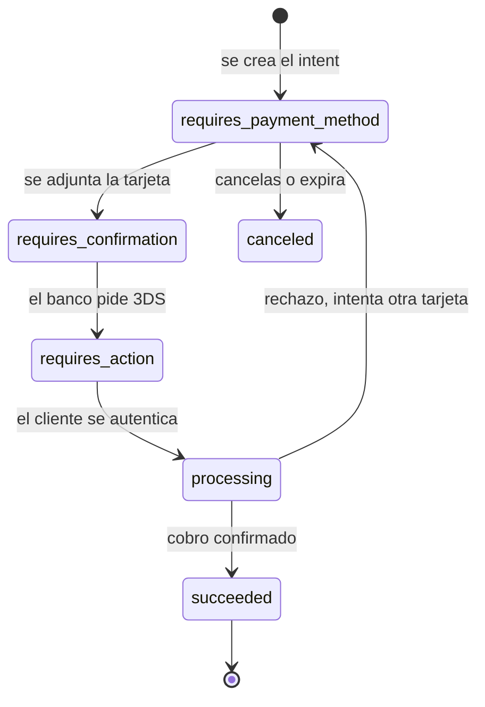

# Cargos, intents y estados de un pago

Parte de: [[22-Integraciones/01 Pagos/_Índice Pagos|Pagos]]

> [!info] Cómo avanzar
> `progreso`: **pendiente** → **viendo** (estudiando) → **visto** (contestaste la autoevaluación sin abrir las respuestas) → **dominado** (hiciste el laboratorio o lo aplicaste de verdad).

## Contenido

### Qué es
Un pago en línea no es un evento instantáneo sino un **proceso con estados**. Las pasarelas lo modelan con objetos que avanzan por una máquina de estados:

- **Cargo** (*charge*): el intento concreto de mover dinero con un método de pago. Es el modelo clásico (OpenPay lo sigue usando: `POST /charges`).
- **Payment intent** (Stripe): la **intención de cobrar** un monto a un cliente. Agrupa uno o varios intentos de cargo y conserva el estado mientras se resuelven pasos adicionales: autenticación **3D Secure**, pagos diferidos como **OXXO** o **SPEI**, reintentos con otra tarjeta. Gracias a eso tu sistema sigue un solo objeto de principio a fin.

Además hay que distinguir **autorizar** de **capturar**. Autorizar reserva el monto en la línea de crédito o saldo del cliente (el banco aparta el dinero); capturar ordena cobrarlo efectivamente. Si se separan (captura manual), puedes cobrar al confirmar existencias o al enviar el producto; si no capturas, la autorización **vence** (en tarjetas suele ser alrededor de 7 días; depende de la red y la pasarela) y el dinero se libera.

### Cómo funciona
Ciclo típico de un PaymentIntent de Stripe con tarjeta que pide 3D Secure:


- `requires_action` significa **que falta algo del cliente**: autenticarse con 3DS, o pagar el voucher OXXO o hacer la transferencia SPEI. No es dinero cobrado.
- `processing` indica que la pasarela está esperando la confirmación final (común en métodos bancarios).
- Con captura manual aparece `requires_capture` después de autorizar.
- En OXXO con Stripe el intent queda en `requires_action` mientras el voucher está vigente (5 días por defecto, configurable de 1 a 7) y llega `payment_intent.succeeded` cuando el pago se procesa, normalmente al siguiente día hábil.

En **OpenPay** los estatus de un cargo son `in_progress`, `charge_pending`, `completed`, `failed`, `cancelled` y `refunded`. Un cargo en tienda (efectivo) se crea en **`charge_pending`** con su referencia y pasa a **`completed`** cuando el cliente paga; tu sistema se entera por el webhook.

### Ejemplo
Estados de tu **orden interna**, independientes de la pasarela, y qué los mueve:

| Estado de la orden | Lo mueve | Nota |
|---|---|---|
| `pendiente` | Se crea la orden en tu API | Aún sin cobro |
| `esperando_pago` | Creaste el intent o el cargo y guardaste su id | Se muestra 3DS, voucher o CLABE |
| `pagada` | Webhook `payment_intent.succeeded` / cargo `completed` | Solo aquí se surte |
| `fallida` / `expirada` | Webhook `payment_intent.payment_failed`, `canceled`, vencimiento del voucher | Libera inventario apartado |
| `reembolsada` | Webhook `charge.refunded` | Total o parcial |

```csharp
// Handler del webhook en un slice de Ocelotl.Hermes (simplificado)
switch (evento.Type)
{
    case "payment_intent.succeeded":
        var pi = (PaymentIntent)evento.Data.Object;
        await _ordenes.MarcarPagadaAsync(pi.Metadata["orden_id"], pi.Id, pi.AmountReceived, ct);
        break;
    case "payment_intent.payment_failed":
    case "payment_intent.canceled":
        var fallido = (PaymentIntent)evento.Data.Object;
        await _ordenes.MarcarFallidaAsync(fallido.Metadata["orden_id"], fallido.Status, ct);
        break;
}
```
La transición debe ser **idempotente** y validar el estado de origen: un `UPDATE ... SET Estado = 'pagada' WHERE OrdenId = @id AND Estado = 'esperando_pago'` evita que un evento repetido o fuera de orden regrese una orden ya reembolsada a "pagada".

### Cuándo usarlo y cuándo no
- **Captura automática** para bienes digitales o servicios que entregas de inmediato.
- **Captura manual** cuando el monto final puede cambiar (propinas, peso de mercancía) o confirmas existencias antes de cobrar; recuerda que la autorización vence.
- Usa PaymentIntents (no la API vieja de Charges) en integraciones nuevas con Stripe.
- El detalle de cada proveedor está en [[Stripe]] y [[OpenPay]]; los métodos diferidos, en [[Pagos en efectivo y transferencia (OXXO y SPEI)]].

### Errores comunes
1. **Tratar `processing`, `requires_action` o `charge_pending` como pagado.** Son estados intermedios; surte solo con el estado final de éxito confirmado por webhook.
2. **Confiar en la redirección del navegador** (`return_url`) para marcar la orden pagada. El cliente puede cerrar la pestaña o manipular la URL.
3. **No guardar el id del intent o cargo en tu orden**: luego no puedes conciliar (ver [[Conciliación de pagos]]).
4. **Crear un intent nuevo en cada reintento del cliente**: generas cargos duplicados. Reutiliza el intent de la orden o usa claves de idempotencia.
5. **Ignorar el orden de los eventos**: los webhooks pueden llegar desordenados; consulta el objeto en la API si dudas.

### Para profundizar
- [Cómo funcionan los PaymentIntents (Stripe)](https://docs.stripe.com/payments/paymentintents/lifecycle)
- [Autorizar y capturar por separado (Stripe)](https://docs.stripe.com/payments/place-a-hold-on-a-payment-method)
- [Pagos con OXXO (Stripe)](https://docs.stripe.com/payments/oxxo)

## Ejercicios

Resuélvelos en papel o en la herramienta; la solución está plegada.

> [!question]- Ordena el ciclo típico de un PaymentIntent de Stripe con tarjeta y 3DS.
> `requires_payment_method` → `requires_confirmation` → `requires_action` → `processing` → `succeeded` (o `canceled`).

> [!question]- Diseña los estados de tu orden interna y qué evento los mueve.
> `pendiente` → `esperando_pago` (se creó el intent / voucher) → `pagada` (webhook de éxito) o `expirada` / `fallida` (webhook de vencimiento o fallo) → `reembolsada` (webhook de reembolso).

> [!question]- En OpenPay, ¿qué estatus tiene un cargo OXXO recién creado y cuál cuando el cliente paga?
> `charge_pending` al crearlo; `completed` cuando se paga.

## Autoevaluación

Contesta primero en voz alta o en papel; luego despliega la respuesta.

> [!question]- ¿Qué es un *payment intent*?
> Un objeto que representa la intención de cobrar un monto y que recorre estados hasta completarse o cancelarse; permite manejar pasos extra como 3D Secure o pagos diferidos (OXXO, SPEI).

> [!question]- ¿Qué diferencia hay entre autorizar y capturar?
> Autorizar reserva el monto en la tarjeta; capturar lo cobra. Separarlos permite cobrar al enviar el producto. Una autorización no capturada vence.

> [!question]- Un pago está en `requires_action`. ¿Qué significa en Stripe?
> Falta un paso del cliente: autenticación 3D Secure, o mostrar el voucher OXXO / las instrucciones SPEI. No es un pago hecho.

> [!question]- Error común: tratar `processing` o `charge_pending` como pagado.
> Son estados intermedios. Entrega el producto solo con el estado final de éxito confirmado por webhook.

## Práctica

- [[Lab 1 - Pago de prueba con Stripe y webhook en .NET]]

