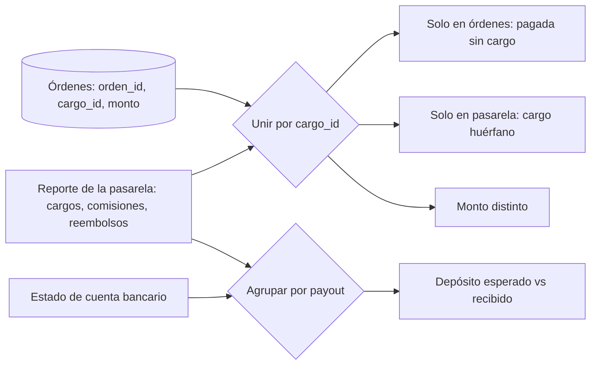

# Conciliación de pagos

Parte de: [[22-Integraciones/01 Pagos/_Índice Pagos|Pagos]]

> [!info] Cómo avanzar
> `progreso`: **pendiente** → **viendo** (estudiando) → **visto** (contestaste la autoevaluación sin abrir las respuestas) → **dominado** (hiciste el laboratorio o lo aplicaste de verdad).

## Contenido

### Qué es
**Conciliar pagos** es comparar tres fuentes que deberían contar la misma historia y explicar cada diferencia:

1. **Tus registros**: órdenes y pagos en tu base (lo que tu sistema cree que cobró).
2. **La pasarela**: cargos, reembolsos, comisiones y contracargos (lo que realmente se cobró).
3. **El banco**: los depósitos (*payouts*) que la pasarela transfirió a tu cuenta.

El objetivo es detectar órdenes marcadas como pagadas sin cargo real, cargos sin orden (por ejemplo, un webhook perdido), montos distintos, comisiones mal calculadas y depósitos que no cuadran. En México además alimenta la contabilidad y la facturación: cada cobro conciliado debe corresponder a un **CFDI de ingreso** (o, si la factura fue PPD, a un **complemento de pago**).

### Cómo funciona

**Por qué el depósito no coincide con las ventas del día**: un payout agrupa muchos cargos, se le **restan comisiones** de la pasarela (y su IVA), **reembolsos** y **contracargos**, y puede incluir cargos de **otros días** según el calendario de liquidación. Por ejemplo, Stripe liquida OXXO en hasta 4 días hábiles (pagos de martes a jueves se depositan el lunes siguiente; de viernes a lunes, el miércoles siguiente), mientras que las tarjetas siguen otro calendario. Por eso se concilia **por payout**, usando el reporte de la pasarela que detalla qué transacciones componen cada depósito (en Stripe, los *balance transactions* de cada payout).

**Qué identificador usar**: el **id del cargo o intent** de la pasarela guardado en tu orden, y a la inversa tu `orden_id` en la `metadata` del cargo. Así unes en ambas direcciones. Conciliar por monto y fecha produce falsos positivos (dos clientes pagan $299 el mismo día).

### Ejemplo
Tus órdenes pagadas son `{A: 500, B: 300, C: 200}` y la pasarela reporta `{A: 500, B: 300, D: 150}`:

- **A y B** cuadran.
- **C** está pagada en tu sistema sin cargo en la pasarela: puede ser un error de lógica (se marcó pagada por la redirección del navegador) o un cargo en otra cuenta. Hay que revisarla antes de surtir.
- **D** es un cargo sin orden: probablemente un webhook que falló o una orden que se borró. Hay que ligarlo o reembolsarlo.

Depósito neto esperado con ventas de $10,000, comisiones de $350 y un reembolso de $500, si todo cae en el mismo payout: `10,000 − 350 − 500 = $9,150`.

Script de conciliación con pandas (útil para un reporte en Wee.Reporteria):
```python
import pandas as pd

ordenes = pd.DataFrame({'cargo_id': ['ch_A', 'ch_B', 'ch_C'], 'monto': [500, 300, 200]})
pasarela = pd.DataFrame({'cargo_id': ['ch_A', 'ch_B', 'ch_D'], 'monto': [500, 300, 150],
                         'comision': [18.0, 10.8, 5.4]})

m = ordenes.merge(pasarela, on='cargo_id', how='outer',
                  suffixes=('_ord', '_pas'), indicator=True)
solo_orden = m[m['_merge'] == 'left_only']        # C
solo_pasarela = m[m['_merge'] == 'right_only']    # D
monto_distinto = m[(m['_merge'] == 'both') & (m['monto_ord'] != m['monto_pas'])]

print(solo_orden[['cargo_id', 'monto_ord']])
print(solo_pasarela[['cargo_id', 'monto_pas']])
```
En producción guarda montos en **centavos enteros** para evitar diferencias por redondeo de punto flotante.

### Cuándo usarlo y cuándo no
- **Diario y automatizado** en cualquier negocio que cobre en línea; los errores se vuelven más caros con el tiempo.
- Distingue dos niveles: **operativo** (órdenes contra pasarela, para detectar fallas de integración) y **contable** (pasarela contra banco, para cuadrar ingresos, comisiones e IVA con el contador).
- Con [[Marketplaces y comisiones|marketplaces]] agrega una tercera dimensión: lo que corresponde a cada vendedor.
- Si emites CFDI, concilia también facturas contra cobros: una factura PPD sin su complemento de pago, o un cobro sin factura, es una diferencia fiscal. El complemento de pago 2.0 debe emitirse a más tardar el día 5 del mes siguiente al cobro (confírmalo con tu contador y la RMF vigente).

### Errores comunes
1. **Conciliar por monto y fecha** en lugar de ids.
2. **Esperar que el depósito diario sea igual a las ventas del día.** Concilia por payout.
3. **Olvidar el IVA de las comisiones**: las pasarelas en México cobran comisión más IVA; el neto real es menor.
4. **No registrar reembolsos y contracargos** en tu base: tu sistema sigue mostrando ingresos que ya no existen.
5. **Hacerlo a mano en Excel cada mes**: las diferencias viejas ya no se pueden investigar.

### Para profundizar
- [Conciliación de payouts (Stripe)](https://docs.stripe.com/payouts/reconciliation)
- [Balance transactions (Stripe API)](https://docs.stripe.com/api/balance_transactions)
- [pandas.DataFrame.merge](https://pandas.pydata.org/docs/reference/api/pandas.DataFrame.merge.html)

## Ejercicios

Resuélvelos en papel o en la herramienta; la solución está plegada.

> [!question]- Órdenes pagadas `{A: 500, B: 300, C: 200}` (pesos). La pasarela reporta `{A: 500, B: 300, D: 150}`. ¿Diferencias?
> `C`: orden marcada pagada sin cargo en la pasarela (revisar). `D`: cargo sin orden (pago huérfano: revisar webhook perdido).

> [!question]- Escríbelo con pandas.
> ```python
> m = ordenes.merge(pasarela, on='cargo_id', how='outer', suffixes=('_ord','_pas'), indicator=True)
> solo_orden = m[m['_merge'] == 'left_only']
> solo_pasarela = m[m['_merge'] == 'right_only']
> monto_distinto = m[(m['_merge'] == 'both') & (m['monto_ord'] != m['monto_pas'])]
> ```

> [!question]- Ventas $10,000, comisiones $350, reembolso $500. ¿Depósito neto esperado?
> `10 000 - 350 - 500 = $9,150` (si todo cae en el mismo payout).

## Autoevaluación

Contesta primero en voz alta o en papel; luego despliega la respuesta.

> [!question]- ¿Qué es conciliar pagos?
> Comparar tus registros (órdenes) contra lo que reporta la pasarela y lo que llegó al banco (depósitos/payouts) para detectar diferencias: pagos sin orden, órdenes sin pago, montos distintos, comisiones y reembolsos.

> [!question]- ¿Por qué el depósito del banco no coincide con la suma de ventas del día?
> El payout agrupa varios cargos, descuenta comisiones, reembolsos y contracargos, y puede corresponder a otros días según el calendario de la pasarela.

> [!question]- ¿Qué identificador usas para unir los registros?
> El id del cargo/intent de la pasarela guardado en tu orden (y tu id de orden en la metadata del cargo). Nunca concilies solo por monto y fecha.

## Práctica

- [[Lab 1 - Pago de prueba con Stripe y webhook en .NET]]

