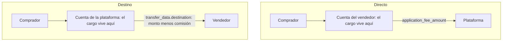

# Marketplaces y comisiones

Parte de: [[22-Integraciones/01 Pagos/_Índice Pagos|Pagos]]

> [!info] Cómo avanzar
> `progreso`: **pendiente** → **viendo** (estudiando) → **visto** (contestaste la autoevaluación sin abrir las respuestas) → **dominado** (hiciste el laboratorio o lo aplicaste de verdad).

## Contenido

### Qué es
Un **marketplace** cobra a compradores en nombre de **terceros** (vendedores, instructores, prestadores de servicio) y se queda con una **comisión**. Ejemplos: una plataforma de cursos, una tienda de impresiones 3D por encargo o un directorio de fotógrafos que cobra la sesión. El reto no es técnico sino **regulatorio y de responsabilidad**: si todo el dinero entra a la cuenta de la plataforma y luego tú lo repartes, te conviertes en intermediario de fondos de terceros, y cargas con conocer a cada vendedor (KYC), con las disputas y reembolsos de todos y con obligaciones fiscales. Las soluciones como [[Stripe Connect]] delegan buena parte de eso en la pasarela: cada vendedor tiene su propia cuenta conectada verificada.

### Cómo funciona

- **Cargo directo** (*direct charge*): el cargo se crea **en la cuenta del vendedor**; el comprador ve el nombre del vendedor en su estado de cuenta y la plataforma cobra una `application_fee_amount`. El vendedor asume comisiones de la pasarela, reembolsos y disputas.
- **Cargo con destino** (*destination charge*): el cargo vive **en la cuenta de la plataforma**, que transfiere al vendedor su parte. La plataforma aparece como comercio y asume más responsabilidad (reembolsos, contracargos, comisiones de la pasarela).
- **Cargos y transferencias separados**: la plataforma cobra y luego reparte a uno o varios vendedores (carrito con productos de varios vendedores).

**Antes de cobrar en nombre de un vendedor** revisa que su cuenta esté habilitada: en Stripe, `charges_enabled = true` (y `payouts_enabled` para que reciba dinero), sin `requirements.currently_due` pendientes. Si cobras a una cuenta deshabilitada, el cargo falla o el dinero queda retenido.

### Ejemplo
Venta de $1,000.00 con comisión de plataforma de 8 %: `100000 × 0.08 = 8000` centavos ($80.00). La comisión de la pasarela es aparte y la define tu contrato o la página de precios (en México, Stripe publica 3.6 % + $3 MXN más IVA por tarjeta nacional en su tarifa estándar).

Para $333.33 al 7.5 %: `33333 × 0.075 = 2499.975`, que redondeado al centavo es 2500. Calcula siempre en **centavos con `decimal`**, nunca con `double`, y documenta la regla de redondeo:

```csharp
public static long ComisionPlataforma(long totalCentavos, decimal tasa)
{
    // decimal evita errores binarios; AwayFromZero: 0.5 centavos sube
    return (long)Math.Round(totalCentavos * tasa, MidpointRounding.AwayFromZero);
}

var fee = ComisionPlataforma(33_333, 0.075m);   // 2500

var opciones = new PaymentIntentCreateOptions
{
    Amount = 33_333,
    Currency = "mxn",
    ApplicationFeeAmount = fee,
    TransferData = new PaymentIntentTransferDataOptions { Destination = vendedor.StripeAccountId },
    Metadata = new Dictionary<string, string> { ["orden_id"] = orden.Id.ToString() }
};
```

**Aspecto fiscal en México**: las plataformas digitales que intermedian ventas de bienes o servicios entre terceros tienen obligaciones de **retención de ISR e IVA** a los vendedores personas físicas (y, desde 2026, también a personas morales), además de emitir CFDI de retenciones e informar al SAT. Para 2026 se reportan, por ejemplo, retenciones de ISR de 2.5 % en enajenación de bienes y de 50 % del IVA (8 %) cuando el vendedor tiene RFC, que suben si no lo proporciona. Las tasas dependen del tipo de actividad y cambian con cada reforma: **valídalas con un contador y la LISR/LIVA vigentes** antes de implementarlas (Pendiente de confirmar las tasas exactas por actividad). Tu comisión, por su parte, se factura al vendedor con su propio CFDI.

### Cuándo usarlo y cuándo no
- **Cargo directo** cuando los vendedores son negocios establecidos que atienden a sus clientes (soporte, reembolsos).
- **Cargo con destino** cuando la plataforma es la marca visible y quiere controlar la experiencia y las disputas.
- **Separados** para carritos con varios vendedores o pagos diferidos al vendedor.
- Si solo vendes tus propios productos, no necesitas un esquema de marketplace; una cuenta normal de [[Stripe]] u [[OpenPay]] basta.

### Errores comunes
1. **Recibir todo en tu cuenta y pagar a vendedores por transferencia manual**: riesgo regulatorio y contable.
2. **Calcular comisiones con `double`** o redondear distinto en cada parte del sistema; genera centavos perdidos en la [[Conciliación de pagos|conciliación]].
3. **No revisar `charges_enabled`** antes de cobrar.
4. **Ignorar quién paga reembolsos y disputas** según el tipo de cargo: define si revocas la comisión (`refund_application_fee`) y si reviertes la transferencia.
5. **Olvidar las retenciones fiscales** como plataforma intermediaria en México.

### Para profundizar
- [Tipos de cargo en Connect (Stripe)](https://docs.stripe.com/connect/charges)
- [Comisiones de plataforma (application fees)](https://docs.stripe.com/connect/direct-charges#collect-fees)
- [Preguntas generales del esquema de intermediación de plataformas (SAT, PDF)](https://www.sat.gob.mx/minisitio/PlataformasTecnologicas/PlataformasTecnologicas_Intermediacion/documentos/PreguntasGenerales_esquema_intermediacion.pdf)

## Ejercicios

Resuélvelos en papel o en la herramienta; la solución está plegada.

> [!question]- Venta de $1,000.00 con comisión de plataforma de 8 % (ejemplo). ¿Cuánto es `application_fee_amount` en centavos?
> `100000 · 0.08 = 8000` centavos ($80.00). La comisión de la pasarela se descuenta aparte según el contrato (no la supongas).

> [!question]- Calcula la comisión de plataforma en centavos de forma segura para $333.33 al 7.5 %.
> ```csharp
> long total = 33333;
> long fee = (long)Math.Round(total * 0.075m, MidpointRounding.AwayFromZero); // 2500
> ```
> `33333 · 0.075 = 2499.975` → `2500`. Define y documenta la regla de redondeo.

## Autoevaluación

Contesta primero en voz alta o en papel; luego despliega la respuesta.

> [!question]- ¿Qué problema tiene un marketplace al cobrar por terceros?
> Si todo entra a la cuenta de la plataforma y luego se reparte, la plataforma carga con el KYC, la regulación y las disputas de cada vendedor. Las soluciones tipo Connect delegan eso a la pasarela.

> [!question]- ¿Qué diferencia hay entre cargo directo y cargo con destino (destination charge)?
> Directo: el cargo vive en la cuenta del vendedor y la plataforma cobra una `application_fee`. Destino: vive en la plataforma y se transfiere al vendedor; la plataforma asume más responsabilidad (reembolsos, disputas).

> [!question]- ¿Qué revisas antes de cobrar en nombre de un vendedor?
> Que su cuenta esté habilitada para cobrar (en Stripe `charges_enabled`) y sin requisitos pendientes.

