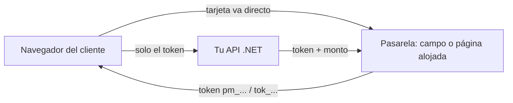

# PCI DSS

Parte de: [[22-Integraciones/01 Pagos/_Índice Pagos|Pagos]]

> [!info] Cómo avanzar
> `progreso`: **pendiente** → **viendo** (estudiando) → **visto** (contestaste la autoevaluación sin abrir las respuestas) → **dominado** (hiciste el laboratorio o lo aplicaste de verdad).

## Contenido

### Qué es
**PCI DSS** (*Payment Card Industry Data Security Standard*) es el estándar de seguridad que exigen las marcas de tarjetas (Visa, Mastercard, American Express, Discover, JCB) a todo aquel que **almacene, procese o transmita** datos de tarjetahabientes. Lo publica el PCI Security Standards Council. La versión vigente es la **4.0.1**; sus requisitos "a futuro" se volvieron obligatorios el **31 de marzo de 2025**. No es una ley, pero tu adquirente o pasarela te obliga a cumplirlo por contrato, y un incumplimiento puede costar multas, la pérdida de la capacidad de cobrar con tarjeta y responsabilidad por fraudes.

Datos protegidos: el **PAN** (número de tarjeta), nombre, fecha de vencimiento y los **datos sensibles de autenticación**: CVV/CVC, banda magnética completa y PIN. Estos últimos **nunca** pueden almacenarse después de autorizar, ni cifrados.

### Cómo funciona
El estándar tiene 12 requisitos agrupados en seis objetivos: red segura, proteger los datos, gestión de vulnerabilidades, control de acceso, monitoreo y pruebas, y política de seguridad. Lo importante para un desarrollador es el **alcance**: todo sistema que toca datos de tarjeta, o que puede afectar su seguridad, entra en la auditoría.

**Cómo reduces tu alcance**: no dejes que el número de tarjeta pase por tus servidores. Usa **tokenización** con componentes de la pasarela: Stripe Checkout o Payment Element, el formulario de OpenPay.js, o una página de pago alojada. La tarjeta viaja del navegador directamente a la pasarela, que te devuelve un **token**; tu API solo maneja ese token. Así tu base nunca ve el PAN.

**Qué es un SAQ**: el **Self-Assessment Questionnaire** es el cuestionario de autoevaluación con el que los comercios pequeños y medianos validan su cumplimiento (los grandes requieren auditoría con un QSA). Hay varios tipos según cómo integras:

- **SAQ A**: comercios que delegan **todo** el procesamiento a un tercero (página alojada o iframe de la pasarela) y no almacenan datos de tarjeta. Es el más corto. Desde enero de 2025 ya no incluye los requisitos 6.4.3 y 11.6.1 (control de scripts de la página de pago), pero a cambio el comercio debe confirmar que su sitio no es susceptible a ataques de scripts que afecten sus sistemas de comercio electrónico.
- **SAQ A-EP**: tu página carga el formulario y su JavaScript, aunque el dato vaya directo a la pasarela; más requisitos porque tu sitio puede alterar el formulario.
- **SAQ D**: almacenas o procesas datos de tarjeta en tus sistemas; prácticamente todo el estándar.

### Ejemplo
En Itzamna.Clio (React + Vite) usas el Payment Element de Stripe, que se monta en un iframe de Stripe. El flujo:

1. Tu API crea el PaymentIntent y devuelve solo el `client_secret`.
2. El componente de Stripe recolecta la tarjeta dentro de su iframe y confirma el pago.
3. Tu API recibe el webhook firmado y marca la orden.

Tu base guarda `payment_intent_id`, los **últimos 4 dígitos** y la marca (que la pasarela te devuelve) para mostrar "Visa terminación 4242". Eso no es dato sensible bajo PCI. Para cobros futuros guardas el **PaymentMethod** o customer de la pasarela, nunca la tarjeta.

Medidas complementarias en tu sitio: **Content Security Policy** restrictiva en la página de pago, inventario de scripts de terceros, TLS en todo el sitio y registros que no capturen cuerpos de petición con datos de pago.

### Cuándo usarlo y cuándo no
- Aplica **siempre** que aceptes tarjetas, aunque sea mediante una pasarela: la pregunta no es si aplica, sino qué SAQ te corresponde.
- Diseña para **SAQ A** salvo que tengas una razón fuerte; almacenar tarjetas tú mismo (SAQ D) solo tiene sentido para procesadores o empresas grandes con equipo de seguridad.
- Pagos en efectivo o SPEI (ver [[Pagos en efectivo y transferencia (OXXO y SPEI)]]) no involucran datos de tarjeta.

### Errores comunes
1. **Guardar el CVV "para cobros futuros".** Está prohibido almacenarlo después de la autorización, aunque esté cifrado. Para cobros recurrentes usa el método de pago tokenizado de la pasarela.
2. **Mandar la tarjeta a tu API** "para validarla" antes de enviarla a la pasarela: metes todos tus servidores en alcance.
3. **Loguear peticiones completas** que incluyen datos de tarjeta en Application Insights o archivos.
4. **Scripts de terceros sin control** (analítica, chat) en la página de pago, que pueden robar datos (ataques tipo Magecart).
5. **Creer que usar una pasarela te exime**: igual debes completar tu SAQ y mantener tu sitio seguro.

### Para profundizar
- [PCI Security Standards Council: biblioteca de documentos](https://www.pcisecuritystandards.org/document_library/)
- [Cambios en SAQ A (blog oficial del PCI SSC)](https://blog.pcisecuritystandards.org/important-updates-announced-for-merchants-validating-to-self-assessment-questionnaire-a)
- [Guía de integración segura y PCI (Stripe)](https://docs.stripe.com/security/guide)

## Autoevaluación

Contesta primero en voz alta o en papel; luego despliega la respuesta.

> [!question]- ¿Qué es PCI DSS?
> El estándar de seguridad de la industria de tarjetas que deben cumplir quienes almacenan, procesan o transmiten datos de tarjeta. Versión vigente: 4.x (Pendiente de confirmar la última revisión).

> [!question]- ¿Cómo reduces tu alcance de PCI?
> No tocando datos de tarjeta: checkout alojado por la pasarela o campos/iframes de su librería JS, tokens en tu servidor y nada de números de tarjeta en logs o BD.

> [!question]- ¿Qué es un SAQ?
> Un cuestionario de autoevaluación; el tipo depende de cómo integras (p. ej. SAQ A cuando todo el manejo de tarjeta está tercerizado en la pasarela).

> [!question]- Error común: guardar el CVV "para cobros futuros".
> Está prohibido guardar el código de seguridad después de la autorización. Para cobros recurrentes se usa el método de pago tokenizado de la pasarela.

