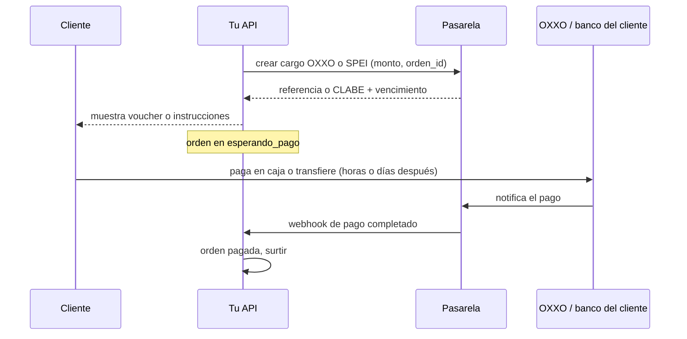

# Pagos en efectivo y transferencia (OXXO y SPEI)

Parte de: [[22-Integraciones/01 Pagos/_Índice Pagos|Pagos]]

> [!info] Cómo avanzar
> `progreso`: **pendiente** → **viendo** (estudiando) → **visto** (contestaste la autoevaluación sin abrir las respuestas) → **dominado** (hiciste el laboratorio o lo aplicaste de verdad).

## Contenido

### Qué es
En México una parte importante de los compradores no usa tarjeta o prefiere no darla en línea. Las dos alternativas más comunes son:

- **Pago en efectivo en tienda (OXXO y otras cadenas)**: el cliente recibe un **voucher** con una referencia o código de barras y paga en caja. Con Stripe, OXXO admite de $10 a $10,000 MXN por pago; con OpenPay se paga en la red de comercios de Paynet (incluye tiendas de conveniencia y farmacias).
- **Transferencia SPEI**: el **Sistema de Pagos Electrónicos Interbancarios**, operado por **Banxico**, mueve dinero entre bancos en segundos, todos los días. El cliente transfiere desde su banca en línea a una **CLABE**.

La **CLABE** (Clave Bancaria Estandarizada) tiene **18 dígitos**: banco (3), plaza (3), número de cuenta (11) y **dígito verificador** (1). Los primeros tres dígitos identifican la institución según el catálogo de Banxico; por ejemplo, `002` corresponde a Banamex.

### Cómo funciona

Desde la app, el pago en OXXO es **asíncrono**: creas el cargo, la pasarela devuelve la referencia con su fecha de vencimiento y la orden queda **pendiente** hasta que llega el webhook. En Stripe el voucher vence a los 5 días por defecto (configurable de 1 a 7), el PaymentIntent queda en `requires_action` y la confirmación llega por lo general al siguiente día hábil. Los pagos OXXO **no tienen contracargos**, pero tampoco se pueden reembolsar por la pasarela: si devuelves dinero, debe ser por otro medio (por ejemplo, transferencia).

**Por qué asignar una CLABE por cliente o por cargo**: con una sola CLABE para todos, tendrías que identificar quién pagó por el concepto o la referencia que el cliente escribe, y muchos se equivocan. Una **CLABE única** (las pasarelas generan cuentas virtuales) te dice automáticamente a qué cliente u orden corresponde cada depósito y permite conciliar sin intervención manual.

Costos de referencia en Stripe México (tarifa estándar, sin IVA): OXXO 4 % + $3 MXN por pago exitoso; transferencias bancarias $7 MXN por transacción. Verifica la página de precios antes de cotizar: cambian.

### Ejemplo
**Dígito verificador de la CLABE**: se multiplica cada uno de los 17 primeros dígitos por los pesos 3, 7, 1 (repetidos), se toma el **módulo 10** de cada producto, se suman, y el verificador es `(10 − suma mod 10) mod 10`. Para `00201007777777777` la suma da 69, así que el verificador es `(10 − 9) mod 10 = 1` y la CLABE completa es `002010077777777771`.

```csharp
public static bool ClabeValida(string clabe)
{
    if (clabe.Length != 18 || !clabe.All(char.IsAsciiDigit)) return false;
    ReadOnlySpan<int> pesos = [3, 7, 1];
    var suma = 0;
    for (var i = 0; i < 17; i++)
        suma += (clabe[i] - '0') * pesos[i % 3] % 10;
    return (10 - suma % 10) % 10 == clabe[17] - '0';
}

// En FluentValidation
RuleFor(x => x.Clabe).Must(ClabeValida).WithMessage("La CLABE no es válida.");
```
Esto valida el formato al registrar la cuenta de un vendedor o de reembolso; no garantiza que la cuenta exista.

### Cuándo usarlo y cuándo no
- **OXXO**: clientes sin tarjeta, montos pequeños y medianos, compras no urgentes.
- **SPEI**: montos mayores (no hay tope bajo como en OXXO), B2B, pagos de servicios; la confirmación es casi inmediata cuando el cliente transfiere.
- **No** para entregas inmediatas que no pueden esperar (boletos de última hora) salvo que muestres claramente que se confirma al pagar.
- Los estados y eventos se detallan en [[Cargos, intents y estados de un pago]].

### Errores comunes
1. **No manejar el vencimiento del voucher OXXO**: la orden queda colgada con inventario apartado. Escucha el evento de cancelación o vencimiento, o programa la expiración en tu sistema.
2. **Mostrar "pago exitoso"** al generar el voucher.
3. **Una sola CLABE para todos** y conciliar por el concepto de la transferencia.
4. **No validar montos recibidos en SPEI**: el cliente puede transferir de menos o de más; define qué hacer (pago parcial, saldo a favor).
5. **Prometer reembolsos automáticos** en pagos OXXO.

### Para profundizar
- [Pagos con OXXO (Stripe)](https://docs.stripe.com/payments/oxxo)
- [SPEI: información de Banco de México](https://www.banxico.org.mx/servicios/spei_-informacion-banco-mex.html)
- [Precios de métodos de pago locales en México (Stripe)](https://stripe.com/en-mx/pricing/local-payment-methods)

## Ejercicios

Resuélvelos en papel o en la herramienta; la solución está plegada.

> [!question]- Calcula el dígito verificador de la CLABE cuyos 17 primeros dígitos son `00201007777777777`.
> Pesos `3,7,1` repetidos; suma de `(dígito·peso) mod 10` = 69. Verificador `(10 - 69 mod 10) mod 10 = 1` → CLABE `002010077777777771`.

> [!question]- Escribe en Python la validación de una CLABE.
> ```python
> def clabe_valida(c: str) -> bool:
>     if len(c) != 18 or not c.isdigit():
>         return False
>     s = sum((int(d) * w) % 10 for d, w in zip(c[:17], [3, 7, 1] * 6))
>     return (10 - s % 10) % 10 == int(c[17])
>
> clabe_valida('002010077777777771')  # True
> ```

> [!question]- ¿Qué banco indican los primeros 3 dígitos `002`?
> El código de banco según el catálogo de Banxico (002 corresponde a Banamex/Citi en el catálogo; confírmalo en el catálogo vigente).

## Autoevaluación

Contesta primero en voz alta o en papel; luego despliega la respuesta.

> [!question]- ¿Cómo funciona un pago en OXXO desde el punto de vista de la app?
> Creas el cargo, la pasarela devuelve una referencia/código de barras con vencimiento, el cliente paga en tienda y te llega un webhook horas o días después. Mientras tanto la orden queda pendiente.

> [!question]- ¿Qué es SPEI y qué es una CLABE?
> SPEI es el sistema de transferencias interbancarias de Banxico. La CLABE es la cuenta estandarizada de 18 dígitos: banco (3), plaza (3), cuenta (11) y dígito verificador (1).

> [!question]- ¿Por qué las pasarelas asignan una CLABE por cliente o por cargo?
> Para identificar automáticamente quién pagó y conciliar sin depender de que el cliente escriba bien la referencia.

> [!question]- Error común: no manejar el vencimiento del voucher OXXO.
> La orden queda colgada y el inventario apartado. Escucha el evento de vencimiento o programa la expiración de tu lado.

