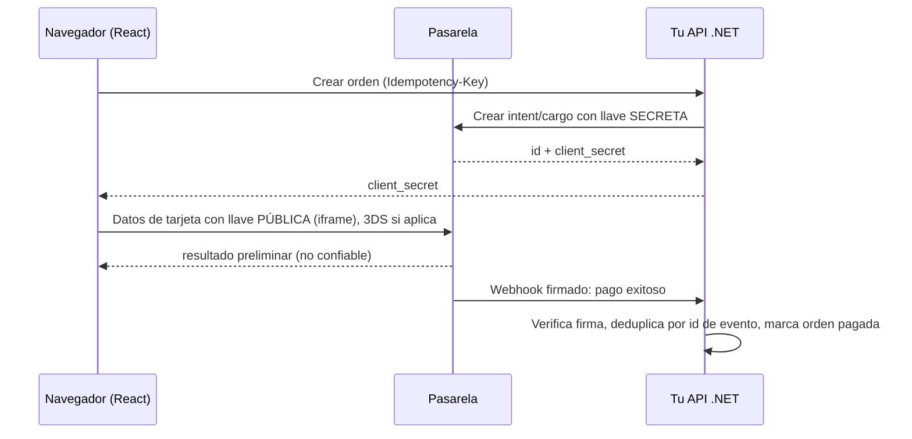

# Pasarelas de pago - conceptos

Parte de: [[22-Integraciones/01 Pagos/_Índice Pagos|Pagos]]

> [!info] Cómo avanzar
> `progreso`: **pendiente** → **viendo** (estudiando) → **visto** (contestaste la autoevaluación sin abrir las respuestas) → **dominado** (hiciste el laboratorio o lo aplicaste de verdad).

## Contenido

### Qué es
Una **pasarela de pago** es el servicio que conecta tu aplicación con la red financiera para cobrar a tus clientes. Entre bambalinas intervienen varios actores: el **emisor** (el banco de la tarjeta del cliente), la **red** (Visa, Mastercard), el **adquirente** (el banco que recibe el dinero por el comercio) y el **procesador**. La pasarela te abstrae de todo eso con una API: recolecta los datos de pago de forma segura, **tokeniza** la tarjeta, pide la autorización, aplica antifraude y 3D Secure, te notifica el resultado y deposita los fondos (menos comisiones) en tu cuenta. En México las más usadas por desarrolladores son [[Stripe]], [[OpenPay]] (de BBVA), Mercado Pago, Conekta y Clip, además de los métodos locales [[Pagos en efectivo y transferencia (OXXO y SPEI)|OXXO y SPEI]].

### Cómo funciona

Conceptos clave:

- **Tokenizar**: cambiar el número de tarjeta por un identificador opaco (token o *payment method*) que solo tiene sentido para esa pasarela. Importa porque así tus servidores nunca tocan el PAN, reduces tu alcance de [[PCI DSS]] y puedes cobrar de nuevo sin guardar la tarjeta.
- **Llave pública vs secreta**: la **pública** (`pk_...`) va en el front y solo sirve para tokenizar o confirmar en el navegador; exponerla no da acceso a tu cuenta. La **secreta** (`sk_...`) vive solo en el servidor (Key Vault, variables de entorno) y permite crear cargos, reembolsar y leer datos. Si se filtra, rótala de inmediato.
- **Montos en la unidad mínima**: casi todas las APIs reciben **centavos enteros** (`19999` para $199.99 MXN).
- **Idempotencia**: mandar la misma operación dos veces no debe cobrar dos veces. Stripe acepta la cabecera `Idempotency-Key`; en tu API, la orden tiene una clave única.
- **Webhooks**: la pasarela te avisa por HTTP de los cambios; es la **única fuente confiable** del resultado.

### Ejemplo
Convertir $199.99 MXN a centavos sin errores de redondeo: usa `decimal`, nunca `double` (en binario 199.99 no es exacto y `199.99 * 100` puede dar 19998.999...).
```csharp
decimal precio = 199.99m;
long centavos = (long)decimal.Round(precio * 100m, 0, MidpointRounding.AwayFromZero); // 19999
```
**Doble clic en "Pagar"**: el front genera un `Idempotency-Key` (un GUID) por intento de compra y deshabilita el botón; la API guarda la clave con una restricción `UNIQUE` y, si llega repetida, devuelve la misma respuesta en lugar de crear otro cargo. Además reutiliza el intent ya asociado a la orden.

**Webhook repetido**: las pasarelas reintentan si no respondes 2xx a tiempo, así que el mismo evento puede llegar dos veces. Guarda el `id` del evento en una tabla con clave única y, si ya existe, responde 200 sin reprocesar:
```sql
-- webhooks/RegistrarEvento.sql
INSERT INTO pagos.EventosProcesados (EventoId, Tipo, RecibidoEn)
SELECT @eventoId, @tipo, SYSUTCDATETIME()
WHERE NOT EXISTS (SELECT 1 FROM pagos.EventosProcesados WHERE EventoId = @eventoId);
SELECT @@ROWCOUNT;  -- 0 = duplicado, no reprocesar
```
Responde rápido (200) y procesa en segundo plano si la lógica es pesada.

**Facturación (CFDI)**: la pasarela cobra, pero **no factura por ti**. Si tus clientes piden factura, emites el CFDI de ingreso con un PAC a partir de la orden pagada; con pago en una sola exhibición normalmente es método **PUE**. La pasarela, a su vez, te factura sus comisiones.

### Cuándo usarlo y cuándo no
- **Siempre** usa una pasarela en lugar de integrarte directo con un adquirente, salvo que seas un procesador.
- Elige por: métodos que necesitan tus clientes (tarjeta, OXXO, SPEI, meses sin intereses), comisiones, calidad de la API y SDK de .NET, tiempos de depósito y soporte local. Como referencia, Stripe México publica 3.6 % + $3 MXN más IVA por tarjeta nacional en su tarifa estándar.
- Los estados de cada pago se explican en [[Cargos, intents y estados de un pago]].

### Errores comunes
1. **Dar por pagada una orden por la respuesta del navegador.** El cliente puede cerrar la ventana, la red puede fallar o alguien puede falsificar la llamada; confirma solo con el webhook verificado (o consultando la API desde el servidor).
2. **Llave secreta en el front o en el repo.**
3. **Montos con `double`** o en pesos cuando la API espera centavos.
4. **No verificar la firma del webhook**: cualquiera podría mandar un "pago exitoso" falso a tu endpoint.
5. **Sin idempotencia**: dobles cargos por reintentos y dobles clics.

### Para profundizar
- [Idempotencia en la API de Stripe](https://docs.stripe.com/api/idempotent_requests)
- [Recibir eventos con webhooks (Stripe)](https://docs.stripe.com/webhooks)
- [Precios de Stripe en México](https://stripe.com/en-mx/pricing)

## Ejercicios

Resuélvelos en papel o en la herramienta; la solución está plegada.

> [!question]- Convierte `$199.99 MXN` a centavos en C# sin errores de redondeo.
> ```csharp
> long centavos = (long)Math.Round(199.99m * 100m, MidpointRounding.AwayFromZero); // 19999
> ```
> Usa `decimal`, no `double`: en Python `int(19.99 * 100)` da `1998` por el error de punto flotante.

> [!question]- Un cliente hace doble clic en "Pagar". ¿Cómo evitas dos cargos?
> Envía un `Idempotency-Key` único por intento de pago (p. ej. el id de la orden + intento) y desactiva el botón mientras se procesa; la pasarela devuelve el mismo resultado para la misma llave.

> [!question]- Un webhook llega dos veces con el mismo `id` de evento. ¿Qué haces?
> Guardar los ids procesados (inbox) y responder 200 sin reprocesar el duplicado.

## Autoevaluación

Contesta primero en voz alta o en papel; luego despliega la respuesta.

> [!question]- ¿Qué hace una pasarela de pago?
> Conecta tu aplicación con la red de pagos (adquirente, red de tarjetas, banco emisor): recibe los datos de pago de forma segura, solicita la autorización y te notifica el resultado.

> [!question]- ¿Qué es tokenizar una tarjeta y por qué importa?
> El navegador manda la tarjeta directo a la pasarela (con su librería JS) y tu servidor solo recibe un token. Así tu sistema no almacena ni ve el número, y tu alcance de PCI DSS baja mucho.

> [!question]- ¿Qué diferencia hay entre llave pública y secreta?
> La pública va en el front y solo sirve para tokenizar; la secreta solo vive en el servidor y permite cobrar, reembolsar y consultar. Si la secreta se filtra, hay que rotarla de inmediato.

> [!question]- Error común: dar por pagada una orden por la respuesta del navegador.
> El usuario puede cerrar la pestaña o manipular la respuesta. La fuente de verdad es el webhook firmado (o una consulta del servidor a la pasarela).

## Práctica

- [[Lab 1 - Pago de prueba con Stripe y webhook en .NET]]

