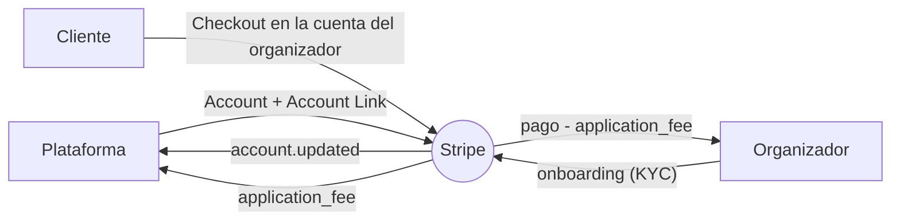

---
proyecto:
  - Pochteca.Nomisma
proyectos:
  - "[[Pochteca.Nomisma]]"
tipo: herramienta
nivel: avanzado
estado: completo
tags:
  - conocimiento
  - backend
  - pagos
  - stripe
  - marketplace
progreso: pendiente
area: Integraciones
contenido: completo
---
# Stripe Connect

> La parte de [[Stripe]] para **plataformas y marketplaces**: cada vendedor (aquí, el organizador) tiene su propia cuenta conectada y la plataforma cobra en su nombre, quedándose con una comisión.

## Qué es y qué problema resuelve
Si la plataforma cobra todo en su cuenta y luego reparte, carga con la regulación, el KYC y las disputas de cada vendedor. Con Connect, cada vendedor es una **cuenta conectada** (`acct_…`) que Stripe verifica, y los cobros pueden vivir en su cuenta.

## Cómo funciona por dentro
- **Cuenta conectada**: se crea con `AccountService` indicando quién controla qué (`controller`: dashboard, quién paga las comisiones de Stripe, quién absorbe pérdidas).
- **Onboarding**: un **Account Link** (`account_onboarding`) de un solo uso lleva al vendedor a la página de Stripe para dar sus datos; regresa a `return_url`, o a `refresh_url` si el link venció.
- **Tipos de cargo**:
  - **Directo**: el cobro vive en la cuenta conectada (`Stripe-Account: acct_…`); la plataforma se queda con `application_fee_amount`.
  - **Destination / separate charges and transfers**: el cobro vive en la plataforma y se transfiere.
- **Eventos de cuentas conectadas**: un endpoint de webhook aparte (*"Listen to events on connected accounts"*) con su propio secreto; cada evento trae `account`.
- **Estados de la cuenta**: `details_submitted`, `charges_enabled`, `payouts_enabled` y `requirements` (`currently_due`, `past_due`).



## Cuándo usarla y cuándo no
### Ventajas
- El KYC y los pagos a vendedores los hace Stripe.
- La comisión se cobra en el mismo cargo.
### Desventajas
- Más estados y eventos que manejar (cuenta restringida, desautorizada).
- Cargos directos: los reembolsos y disputas viven en la cuenta del vendedor.

## Alternativas
| Alternativa | En qué se diferencia |
|---|---|
| Destination charges | El cobro vive en la plataforma; más control, más responsabilidad |
| Cobrar todo y transferir a mano | Sin KYC de Stripe: la plataforma carga con todo |

## Cómo se usó en Pochteca.Nomisma
- Cargo **directo** con Checkout alojado: `RequestOptions.StripeAccount = acct_…` + `ApplicationFeeAmount` + `IdempotencyKey` ([[Stripe Checkout - Back]]).
- Cuentas con dashboard completo, comisiones de Stripe a cargo de la cuenta y pérdidas a cargo de Stripe ([[Cuentas Stripe Connect - Back]]).
- Webhook propio con inbox idempotente ([[Webhook Stripe Connect - Back]]).
- Allowlist de `return_url` / `refresh_url` en configuración: el cliente no puede mandar al organizador a otra página.

```csharp
// Pochteca.Nomisma.Infrastructure/Payments/Stripe/Connect/StripeCheckoutService.cs
var requestOptions = new RequestOptions
{
    // Cargo directo: el PaymentIntent/Charge vive en la cuenta del organizador,
    // nunca en la cuenta de plataforma (HU-PAY-002).
    StripeAccount = solicitud.StripeAccountId,
    IdempotencyKey = solicitud.IdempotencyKey
};
```

Funcionalidades: [[Cuentas Stripe Connect]], [[Stripe Checkout]], [[Webhook Stripe Connect]].

## Errores comunes y buenas prácticas
- Usar el mismo secreto de webhook para eventos propios y de cuentas conectadas.
- Dejar que el cliente decida `livemode` o las URL de regreso.
- Cobrar sin revisar `charges_enabled`.

## Qué estudiar después
- [[Webhooks]], [[Idempotencia]], disputas y reembolsos en cargos directos.

## Documentación oficial
- https://docs.stripe.com/connect
- https://docs.stripe.com/connect/direct-charges
- https://docs.stripe.com/connect/webhooks

## Autoevaluación

Contesta primero en voz alta o en papel; luego despliega la respuesta.

> [!question]- ¿Qué es una cuenta conectada?
> La cuenta de Stripe de cada vendedor (`acct_…`) asociada a la plataforma; Stripe hace su verificación (KYC) y sus pagos.

> [!question]- ¿Para qué sirve un Account Link?
> Es un enlace de un solo uso al onboarding alojado por Stripe; regresa a `return_url` o a `refresh_url` si venció. Las URL deben venir de una lista permitida en configuración, no del cliente.

> [!question]- ¿Cómo haces un cargo directo en la cuenta del vendedor con Stripe.net?
> Con `RequestOptions { StripeAccount = "acct_…", IdempotencyKey = … }` y `ApplicationFeeAmount` para la comisión de la plataforma.

> [!question]- Error común: usar el mismo secreto de webhook para eventos propios y de cuentas conectadas.
> Son endpoints distintos con secretos distintos; los eventos de cuentas conectadas traen el campo `account`.

