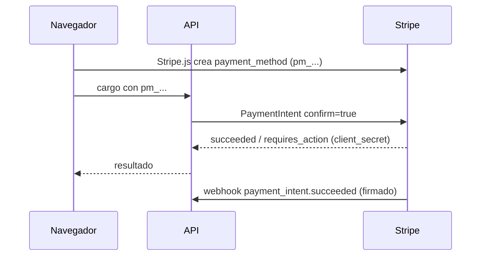

---
proyecto:
  - Pochteca.Nomisma
proyectos:
  - "[[Pochteca.Nomisma]]"
tipo: herramienta
nivel: intermedio
estado: completo
tags:
  - conocimiento
  - backend
  - pagos
  - stripe
progreso: pendiente
area: Integraciones
---
# Stripe

> Plataforma de pagos con API REST y SDK oficial para .NET (`Stripe.net`). [[Pochteca.Nomisma]] la usa para cobrar con tarjeta, OXXO y SPEI en México, y con [[Stripe Connect]] para cobrar en las cuentas de los organizadores.

## Qué es y qué problema resuelve
Cobrar con tarjeta exige PCI, 3D Secure, antifraude y conciliación. Stripe se encarga de eso: el navegador **tokeniza** la tarjeta con Stripe.js (la API nunca ve el número) y el back crea el cobro con la llave secreta.

## Cómo funciona por dentro
- **Llaves**: `pk_test_` / `pk_live_` (publicable, para el front) y `sk_test_` / `sk_live_` (secreta, solo back). El prefijo dice el modo.
- **PaymentIntent**: el objeto central de un cobro. Ciclo: `requires_payment_method` → `requires_confirmation` → `requires_action` (3DS, voucher OXXO, instrucciones SPEI) → `processing` → `succeeded` / `canceled`.
- **Métodos en México**: `card` (con `installments` = meses sin intereses), `oxxo` (voucher con referencia y vencimiento), `customer_balance` + `mx_bank_transfer` (SPEI a una CLABE por cliente).
- **Centavos**: los montos van en la unidad mínima (`long`).
- **Webhooks**: Stripe manda `Event`s firmados (`Stripe-Signature`); se verifican con `EventUtility.ConstructEvent(payload, firma, whsec_…)`.
- **Idempotency-Key**: un header que hace que repetir una petición no cree dos objetos ([[Idempotencia]]).
- **Errores**: `StripeException` con `HttpStatusCode` y `StripeError` (`type`, `code`, `message`, y a veces el `PaymentIntent`).



## Cuándo usarla y cuándo no
### Ventajas
- SDK tipado, buena documentación, modo test completo y Stripe CLI para webhooks locales.
- OXXO y SPEI sin contratos aparte.
### Desventajas
- Comisiones por transacción; SPEI y OXXO tienen reglas propias (nombre real en OXXO, customer por SPEI).
- La versión de API de la cuenta y la del SDK deben coincidir para verificar webhooks.

## Alternativas
| Alternativa | En qué se diferencia |
|---|---|
| [[OpenPay]] | Mexicana (BBVA), REST simple, sin SDK .NET moderno |
| Mercado Pago / Conekta | Fuertes en LATAM; otro modelo de checkout |
| Stripe Checkout alojado | La página de pago la pone Stripe ([[Stripe Checkout]]) |

## Cómo se usó en Pochteca.Nomisma
- `StripeStrategy` implementa `IPasarelaPagoStripe` ([[Patrón Strategy]]): un `PaymentIntent` con `Confirm = true` por método.
- `ErroresStripe` traduce `StripeException` a excepciones con `codigo` (404, 502, 503, 409); al **crear** un cargo, un rechazo se regresa como resultado fallido.
- El modo live/test se deriva de la llave (`sk_live_`), nunca de lo que manda el cliente.

```csharp
// Pochteca.Nomisma.Infrastructure/Payments/Stripe/ErroresStripe.cs
return ex.HttpStatusCode switch
{
    HttpStatusCode.NotFound => new NoEncontradoException(mensaje, ex),
    HttpStatusCode.Unauthorized or HttpStatusCode.Forbidden =>
        new PasarelaSinAccesoException(Proveedor, "Stripe no aceptó la llave configurada (Stripe:SecretKey).", ex),
    (HttpStatusCode)0 or HttpStatusCode.TooManyRequests or >= HttpStatusCode.InternalServerError =>
        new PasarelaNoDisponibleException(Proveedor, "Stripe no está disponible en este momento. Intenta de nuevo.", ex),
    _ => new PasarelaRechazoException(Proveedor, mensaje, ex)
};
```

Funcionalidades: [[Cargos Stripe]], [[Webhook Stripe]].

> [!tip] Reutilizable
> `ErroresStripe.EjecutarAsync(() => service.XAsync(...), ct)` envuelve cualquier llamada de Stripe.net y deja la API sin conocer el SDK.

## Errores comunes y buenas prácticas
- Leer el cuerpo del webhook ya deserializado: la firma se calcula sobre el **texto crudo**.
- Truncar en lugar de redondear al pasar a centavos.
- Confiar en la respuesta del navegador para dar por pagada una orden: lo que vale es el webhook.
- Usar la llave secreta en el front.

## Qué estudiar después
- [[Stripe Connect]], [[Webhooks]], [[Idempotencia]].

## Documentación oficial
- https://docs.stripe.com/payments/payment-intents
- https://docs.stripe.com/payments/oxxo
- https://docs.stripe.com/payments/bank-transfers
- https://docs.stripe.com/webhooks

## Autoevaluación

Contesta primero en voz alta o en papel; luego despliega la respuesta.

> [!question]- ¿Qué indican los prefijos `pk_test_`, `sk_test_` y `sk_live_`?
> `pk_` es la llave publicable (front) y `sk_` la secreta (solo back); `test`/`live` indica el modo. El modo se deriva de la llave del servidor, nunca de lo que mande el cliente.

> [!question]- ¿Por qué la verificación de la firma del webhook debe usar el cuerpo crudo?
> La firma `Stripe-Signature` se calcula sobre el texto exacto recibido; si lo deserializas y vuelves a serializar, cambian bytes y la verificación falla.

> [!question]- ¿Qué hace el header `Idempotency-Key`?
> Repetir la misma petición con la misma llave devuelve el mismo resultado sin crear un segundo objeto (evita cobros dobles en reintentos).

> [!question]- En México, ¿con qué métodos se cobra OXXO, SPEI y meses sin intereses?
> OXXO: `oxxo` (voucher). SPEI: `customer_balance` con `mx_bank_transfer` (CLABE por cliente). MSI: `card` con `installments`.

> [!question]- ¿Cómo pruebas webhooks en tu máquina?
> Con Stripe CLI: `stripe listen --forward-to localhost:PUERTO/ruta` y `stripe trigger payment_intent.succeeded`. La CLI te da el `whsec_` para verificar la firma.

## Práctica

- [[Lab 1 - Pago de prueba con Stripe y webhook en .NET]]

