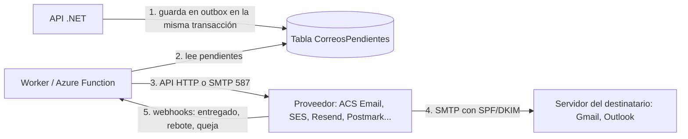

# Correo transaccional (SMTP y proveedores)

Parte de: [[22-Integraciones/02 Correo/_Índice Correo|Correo]]

> [!info] Cómo avanzar
> `progreso`: **pendiente** → **viendo** (estudiando) → **visto** (contestaste la autoevaluación sin abrir las respuestas) → **dominado** (hiciste el laboratorio o lo aplicaste de verdad).

## Contenido

### Qué es
El **correo transaccional** es el que tu sistema envía **a una persona como consecuencia de algo que hizo** o que le concierne directamente: confirmar una cuenta, restablecer una contraseña, un código de verificación, el recibo de una compra, el aviso de que su voucher OXXO vence mañana. Se distingue del **correo de marketing** (boletines, promociones), que va a listas y requiere consentimiento y baja. La diferencia importa porque los proveedores separan ambos flujos (IP, dominios, reputación) y porque el transaccional debe llegar **rápido y a la bandeja de entrada**: si el código de Xolotl.Hecate tarda 10 minutos, el usuario se va.

### Cómo funciona

**SMTP directo o API del proveedor**:

- **SMTP** es el protocolo estándar; cualquier proveedor lo acepta y con `MailKit` en .NET funciona en minutos. Es portable, pero más lento (varias idas y vueltas por mensaje) y da menos información de errores.
- **API HTTP** del proveedor: una petición JSON por mensaje o por lote, plantillas del lado del proveedor, etiquetas, y webhooks de entrega, rebote y queja. Es lo recomendable para una app moderna; a cambio te acopla al proveedor, lo que mitigas con una interfaz `IEnviadorCorreo`.
- Montar **tu propio servidor SMTP** para enviar a Internet no es buena idea: las IP nuevas no tienen reputación y terminas en spam.

**Puertos para envío autenticado** (*submission*): **587** con **STARTTLS** (la conexión inicia en claro y se eleva a TLS) y **465** con **TLS implícito** desde el inicio (RFC 8314 lo recomienda). El **25** es para el tránsito entre servidores y muchos proveedores de nube, incluida Azure, lo bloquean para salida.

Proveedores comunes (precios verificados en noviembre de 2026; revísalos antes de decidir):
- **Azure Communication Services Email**: pago por uso, US$0.00025 por correo más US$0.00012 por MB transferido; se integra con tu suscripción y con identidad administrada.
- **Resend**: plan gratuito de 3,000 correos al mes con límite de 100 al día; plan Pro desde US$20 al mes por 50,000.
- **Amazon SES**, **Postmark**, **Mailgun**, **Brevo**: alternativas maduras.
- **Twilio SendGrid** retiró sus planes gratuitos en mayo de 2025; ahora solo hay prueba y planes de pago.

### Ejemplo
Patrón *outbox*: el endpoint no envía; registra el correo y responde.
```csharp
// Slice "RegistrarUsuario": dentro de la misma transacción del alta
await cn.ExecuteAsync(_sql.EncolarCorreo, new
{
    Para = cmd.Correo,
    Plantilla = "confirmar-cuenta",
    Datos = JsonSerializer.Serialize(new { nombre = cmd.Nombre, enlace }),
    ClaveIdempotencia = $"confirmar:{usuarioId}"
}, tx);

// Worker (BackgroundService) que envía con reintentos
public sealed class EnviadorAcs(EmailClient cliente) : IEnviadorCorreo
{
    public async Task EnviarAsync(CorreoPendiente c, CancellationToken ct)
    {
        var msg = new EmailMessage(
            senderAddress: "no-responder@notificaciones.midominio.mx",
            recipientAddress: c.Para,
            content: new EmailContent(c.Asunto) { Html = c.Html, PlainText = c.Texto });
        await cliente.SendAsync(WaitUntil.Started, msg, ct);   // no bloquea hasta la entrega
    }
}
```
El worker marca cada fila como enviada, reintenta con espera exponencial ante errores temporales y registra el id del proveedor para cruzarlo con los webhooks.

### Cuándo usarlo y cuándo no
- Usa un **proveedor transaccional** para todo correo automático de la app; usa un subdominio dedicado (`notificaciones.midominio.mx`) para aislar su reputación.
- Para marketing usa la herramienta de campañas del proveedor o una aparte, con consentimiento y enlace de baja.
- Para códigos de un solo uso considera además SMS o apps autenticadoras; el correo puede retrasarse.
- La entregabilidad depende de autenticar tu dominio: ver [[SPF, DKIM y DMARC]].

### Errores comunes
1. **Enviar el correo dentro de la misma petición HTTP**: si el proveedor tarda o falla, el registro del usuario responde lento o con error 500 aunque el alta ya se guardó. Desacopla con *outbox* y un worker o una cola.
2. **Usar el puerto 25** desde Azure: está bloqueado; usa 587 o la API.
3. **No procesar rebotes ni quejas**: seguir enviando a direcciones inválidas destruye tu reputación.
4. **Credenciales SMTP en appsettings del repo**: guárdalas en Key Vault.
5. **Enviar desde `@gmail.com`** o desde un dominio sin SPF/DKIM/DMARC: rechazo o spam.

### Para profundizar
- [Azure Communication Services Email (Microsoft Learn)](https://learn.microsoft.com/azure/communication-services/concepts/email/email-overview)
- [Precios de ACS Email](https://learn.microsoft.com/azure/communication-services/concepts/email-pricing)
- [RFC 8314: TLS para envío y acceso a correo](https://www.rfc-editor.org/rfc/rfc8314)
- [MailKit](https://github.com/jstedfast/MailKit)

## Autoevaluación

Contesta primero en voz alta o en papel; luego despliega la respuesta.

> [!question]- ¿Qué es correo transaccional?
> El que dispara una acción del usuario o del sistema (confirmación de pago, restablecer contraseña), a diferencia del masivo de marketing.

> [!question]- ¿SMTP directo o API de un proveedor?
> La API del proveedor (SendGrid, Amazon SES, Azure Communication Services, etc.) da reputación de IP, reintentos, webhooks de rebote/entrega y métricas. SMTP es estándar y portable, pero tú manejas más detalles.

> [!question]- ¿Qué puertos usa SMTP para envío autenticado?
> 587 con STARTTLS (el recomendado para clientes) o 465 con TLS implícito. El 25 es para servidor a servidor y muchos proveedores de nube lo bloquean.

> [!question]- Error común: enviar el correo dentro de la misma petición HTTP y fallar si el proveedor tarda.
> Encola el envío (cola o tarea en segundo plano) con reintentos; la petición del usuario no debe depender del proveedor.

## Práctica

- [[Lab 2 - Verificar SPF, DKIM y DMARC de tu dominio]]

