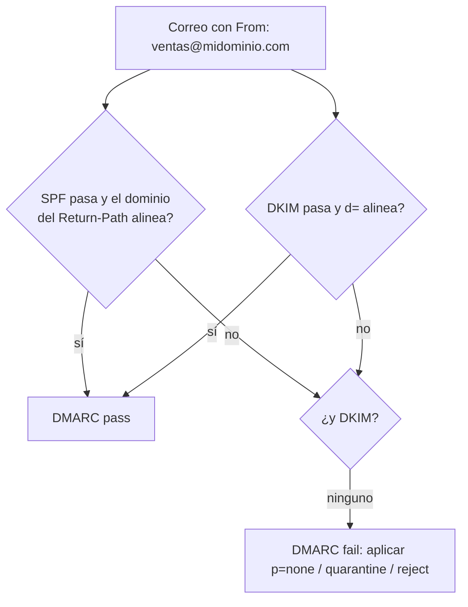

# DMARC (política y reportes)

Parte de: [[SPF, DKIM y DMARC]]

> [!info] Cómo avanzar
> `progreso`: **pendiente** → **viendo** (estudiando) → **visto** (contestaste la autoevaluación sin abrir las respuestas) → **dominado** (hiciste el laboratorio o lo aplicaste de verdad).

## Contenido

### Qué es
**DMARC** (*Domain-based Message Authentication, Reporting and Conformance*, RFC 7489) es la política que el dueño de un dominio publica para decir a los receptores **qué hacer con los correos que dicen venir de su dominio pero no se autentican**, y **a dónde enviar reportes** sobre lo que observan. Une a SPF y DKIM con el dominio que ve el usuario en el campo `From:` mediante la **alineación**: no basta con que SPF o DKIM pasen; deben pasar **para el mismo dominio** (o uno relacionado) que aparece en el `From`.

### Cómo funciona

Se publica como registro **TXT en `_dmarc.<dominio>`**. Etiquetas clave:

| Etiqueta | Significado |
|---|---|
| `v=DMARC1` | Versión (obligatoria, primera) |
| `p=` | Política: `none` (solo monitorear), `quarantine` (a spam), `reject` (rechazar) |
| `rua=mailto:` | Dónde enviar reportes **agregados** (diarios, XML) |
| `ruf=mailto:` | Reportes **forenses** de fallos individuales (pocos receptores los envían) |
| `pct=` | Porcentaje de correos fallidos a los que se aplica la política (por defecto 100) |
| `adkim=`, `aspf=` | Alineación `r` (relajada: mismo dominio organizacional, permite subdominios) o `s` (estricta: dominio exacto) |
| `sp=` | Política para subdominios |

**Reportes `rua`**: archivos XML (normalmente comprimidos) que cada receptor grande envía a diario con, por cada IP de origen: cuántos mensajes vio con tu dominio en el `From`, si SPF y DKIM pasaron y alinearon, y qué política aplicó. Sirven para descubrir **quién envía en tu nombre**: tu proveedor transaccional, el CRM, la facturación electrónica... o un suplantador. No contienen el contenido de los correos. Como son XML difíciles de leer, se suelen procesar con herramientas como dmarcian, Postmark DMARC o EasyDMARC (algunas con plan gratuito).

### Ejemplo
DMARC en modo monitoreo con reportes a `dmarc@midominio.com`:
```
_dmarc.midominio.com.  TXT  "v=DMARC1; p=none; rua=mailto:dmarc@midominio.com"
```
Interpretar `v=DMARC1; p=quarantine; pct=25; adkim=s`: a los correos que fallen DMARC se les aplica cuarentena (spam) **solo al 25 %**; el resto se trata como `none`. La alineación de DKIM es **estricta**: el `d=` debe ser exactamente el dominio del `From` (un `d=mail.midominio.com` no alinea con `midominio.com`). SPF queda en relajada por defecto.

Caso: el `From` es `ventas@midominio.com`, SPF pasa pero para `bounce.proveedor.com` (el Return-Path del proveedor) y DKIM pasa con `d=midominio.com`. **DMARC pasa**: SPF no alinea, pero DKIM sí, y basta con uno de los dos.

**Ruta sana de adopción**:
1. Publica `p=none` con `rua` y recolecta reportes 2–4 semanas.
2. Identifica todas las fuentes legítimas y corrige su SPF y DKIM alineado.
3. Sube a `p=quarantine` con `pct=25`, luego 50 y 100, vigilando los reportes.
4. Llega a `p=reject` cuando ya no aparezcan fuentes legítimas fallando.

**Por qué empezar con `p=none`**: si publicas `reject` de entrada y tu sistema de facturación o tu CRM envía sin DKIM alineado, esos correos legítimos se rechazan sin que te enteres. Monitorear primero te muestra el inventario real de remitentes.

Requisitos actuales de los grandes buzones para remitentes de más de 5,000 correos al día: Gmail y Yahoo exigen SPF, DKIM y DMARC (al menos `p=none`) con alineación, baja con un clic y tasa de quejas baja (Gmail pide menos de 0.3 %); Outlook.com empezó a rechazar en mayo de 2025 los envíos masivos que no cumplen SPF, DKIM y DMARC `p=none` alineado.

### Cuándo usarlo y cuándo no
- **Todo dominio** que envía correo debería tener DMARC; incluso los que **no envían** deberían publicar `v=DMARC1; p=reject;` (junto con `v=spf1 -all`) para que nadie los suplante.
- Usa `sp=` si tus subdominios tienen necesidades distintas.
- Requiere entender [[SPF (Sender Policy Framework)]] y [[DKIM (firma de correo)]]; el resumen está en [[SPF, DKIM y DMARC]].

### Errores comunes
1. **Publicar `p=reject` sin monitorear** primero.
2. **No leer los reportes**: `rua` sin procesar no sirve de nada.
3. **Varios registros DMARC** en `_dmarc`: el receptor los ignora todos.
4. **Reportes a otro dominio sin autorización**: si `rua` apunta a un dominio distinto, ese dominio debe publicar un registro que lo autorice (`midominio.com._report._dmarc.otrodominio.com`).
5. **Olvidar subdominios** que envían (`notificaciones.midominio.com`) y heredan la política.

### Para profundizar
- [RFC 7489: DMARC](https://www.rfc-editor.org/rfc/rfc7489)
- [Requisitos de Outlook para remitentes masivos (Microsoft)](https://techcommunity.microsoft.com/blog/outlook/strengthening-email-security-outlook-new-requirements-for-high-volume-senders/4399730)
- [dmarc.org: información general](https://dmarc.org/overview/)

## Ejercicios

Resuélvelos en papel o en la herramienta; la solución está plegada.

> [!question]- Escribe un DMARC en modo monitoreo que mande reportes a `dmarc@midominio.com`.
> Nombre `_dmarc.midominio.com`, TXT: `v=DMARC1; p=none; rua=mailto:dmarc@midominio.com`

> [!question]- Interpreta `v=DMARC1; p=quarantine; pct=25; adkim=s`.
> Mandar a spam el 25 % de los mensajes que fallen DMARC (el resto se trata como `none`), con alineación DKIM estricta (dominio exacto, no subdominios).

> [!question]- El `From` es `ventas@midominio.com`, SPF pasa para `bounce.proveedor.com` y DKIM pasa con `d=midominio.com`. ¿Pasa DMARC?
> Sí: DKIM está alineado con el `From` (SPF no lo está, pero basta uno).

## Autoevaluación

Contesta primero en voz alta o en papel; luego despliega la respuesta.

> [!question]- ¿Dónde se publica y qué etiquetas son clave?
> TXT en `_dmarc.dominio`: `v=DMARC1; p=none|quarantine|reject; rua=mailto:…` (reportes agregados); opcionales `pct`, `sp` (subdominios), `adkim`/`aspf` (alineación estricta o relajada).

> [!question]- ¿Qué contienen los reportes `rua`?
> Resúmenes XML diarios de los receptores: qué IPs enviaron con tu dominio, cuántos mensajes y si pasaron SPF/DKIM/alineación.

> [!question]- ¿Cuál es una ruta sana de adopción?
> `p=none` con `rua` → revisar reportes y corregir remitentes legítimos → `p=quarantine` (puedes usar `pct`) → `p=reject`.

## Práctica

- [[Lab 2 - Verificar SPF, DKIM y DMARC de tu dominio]]

