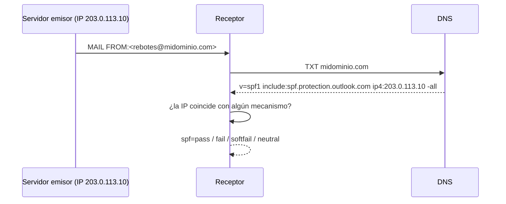

# SPF (Sender Policy Framework)

Parte de: [[SPF, DKIM y DMARC]]

> [!info] Cómo avanzar
> `progreso`: **pendiente** → **viendo** (estudiando) → **visto** (contestaste la autoevaluación sin abrir las respuestas) → **dominado** (hiciste el laboratorio o lo aplicaste de verdad).

## Contenido

### Qué es
**SPF** (*Sender Policy Framework*, RFC 7208) es un registro DNS en el que un dominio declara **qué servidores (IP o servicios) están autorizados a enviar correo en su nombre**. El servidor receptor toma el dominio del **remitente de sobre** (el `MAIL FROM` o *Return-Path*, no el `From` visible), consulta su SPF y verifica si la IP que le está entregando el mensaje aparece en la lista. Es la primera defensa contra la suplantación y uno de los requisitos de los grandes buzones.

### Cómo funciona

**Dónde vive y cómo se ve**: es un registro **TXT en la raíz del dominio** (o del subdominio que usas en el Return-Path) que empieza con `v=spf1`, seguido de mecanismos evaluados de izquierda a derecha:

- `ip4:` / `ip6:`: direcciones o rangos autorizados.
- `include:`: incorpora el SPF de otro dominio (el de tu proveedor).
- `a`, `mx`: las IP de los registros A o MX del dominio.
- `redirect=`: usa por completo el SPF de otro dominio.
- Al final, un **calificador** con `all` para "todo lo demás".

**`-all`, `~all` y `?all`**:
- `-all` (*fail*): lo que no está en la lista **no está autorizado**; el receptor puede rechazarlo.
- `~all` (*softfail*): probablemente no autorizado; normalmente se acepta pero se marca como sospechoso. Útil mientras completas el inventario de remitentes.
- `?all` (*neutral*): no afirmas nada; casi equivale a no tener SPF.
- `+all` autoriza a todo Internet: nunca lo uses.

Con DMARC en `reject` o `quarantine`, la diferencia entre `-all` y `~all` pierde peso, porque DMARC decide; aun así `-all` es lo más claro una vez que tu lista está completa.

**El límite que suele romperlo**: la evaluación de SPF puede hacer como máximo **10 consultas DNS** adicionales (cada `include`, `a`, `mx`, `redirect` y `exists` cuenta, y también los `include` anidados dentro de otros). Si se supera, el resultado es **`permerror`** y para DMARC equivale a que SPF falló. Con Microsoft 365, el proveedor transaccional, el CRM y la facturación, es fácil pasarse. Además hay un límite de 2 consultas "vacías" (*void lookups*) que no devuelven nada.

### Ejemplo
SPF de un dominio que envía desde Microsoft 365 y desde la IP `203.0.113.10`, rechazando el resto:
```
midominio.com.  TXT  "v=spf1 include:spf.protection.outlook.com ip4:203.0.113.10 -all"
```
Consultarlo:
```powershell
Resolve-DnsName -Type TXT midominio.com | Where-Object Strings -Match 'v=spf1'
nslookup -type=TXT midominio.com
```
```bash
dig +short TXT midominio.com
```
Para reducir consultas cuando te acercas al límite: usa **subdominios por proveedor** (el transaccional envía con Return-Path `rebotes.notificaciones.midominio.com`, que tiene su propio SPF), elimina `include` de servicios que ya no usas y prefiere `ip4:` cuando el proveedor publica IP fijas. El "aplanado" automático de SPF (convertir `include` en IP) funciona, pero se desactualiza cuando el proveedor cambia sus rangos.

### Cuándo usarlo y cuándo no
- **Siempre** publica SPF en dominios que envían, y `v=spf1 -all` en dominios que **no** envían correo, para que nadie los use.
- Recuerda que SPF valida el Return-Path, no el `From`, y **se rompe en reenvíos** (el reenviador envía desde su IP). Por eso se complementa con [[DKIM (firma de correo)]] y se une con [[DMARC (política y reportes)]]. El panorama está en [[SPF, DKIM y DMARC]].

### Errores comunes
1. **Dos registros SPF** en el mismo dominio (uno por cada proveedor): el resultado es `permerror`. Debe haber **uno solo** que combine todo.
2. **Pasar de 10 consultas** acumulando `include`.
3. **Usar `+all` o `?all`** "para que no falle".
4. **Agregar el SPF al dominio equivocado**: si el proveedor usa su propio Return-Path, tu SPF no se evalúa y lo que necesitas es DKIM alineado.
5. **Registro tipo SPF (99)** en lugar de TXT: está obsoleto.

### Para profundizar
- [RFC 7208: SPF](https://www.rfc-editor.org/rfc/rfc7208)
- [Configurar SPF en Microsoft 365](https://learn.microsoft.com/defender-office-365/email-authentication-spf-configure)
- [Requisitos de Outlook para remitentes masivos](https://techcommunity.microsoft.com/blog/outlook/strengthening-email-security-outlook-new-requirements-for-high-volume-senders/4399730)

## Ejercicios

Resuélvelos en papel o en la herramienta; la solución está plegada.

> [!question]- Escribe el SPF de un dominio que envía desde Microsoft 365 y desde la IP `203.0.113.10`, rechazando el resto.
> `v=spf1 include:spf.protection.outlook.com ip4:203.0.113.10 -all`

> [!question]- ¿Qué comando consulta el SPF de `midominio.com`?
> `nslookup -type=txt midominio.com` (Windows) o `dig TXT midominio.com +short`.

## Autoevaluación

Contesta primero en voz alta o en papel; luego despliega la respuesta.

> [!question]- ¿Dónde vive y cómo se ve un registro SPF?
> En un registro TXT del dominio: `v=spf1 include:_spf.proveedor.com ip4:203.0.113.10 -all`.

> [!question]- ¿Qué diferencia hay entre `-all`, `~all` y `?all`?
> `-all`: rechazar lo no listado (fail). `~all`: marcar como sospechoso (softfail). `?all`: neutral, sin opinión.

> [!question]- ¿Qué límite tiene SPF que suele romperlo?
> Máximo 10 consultas DNS (por `include`, `a`, `mx`, `redirect`…); si se excede da `permerror`.

## Práctica

- [[Lab 2 - Verificar SPF, DKIM y DMARC de tu dominio]]

