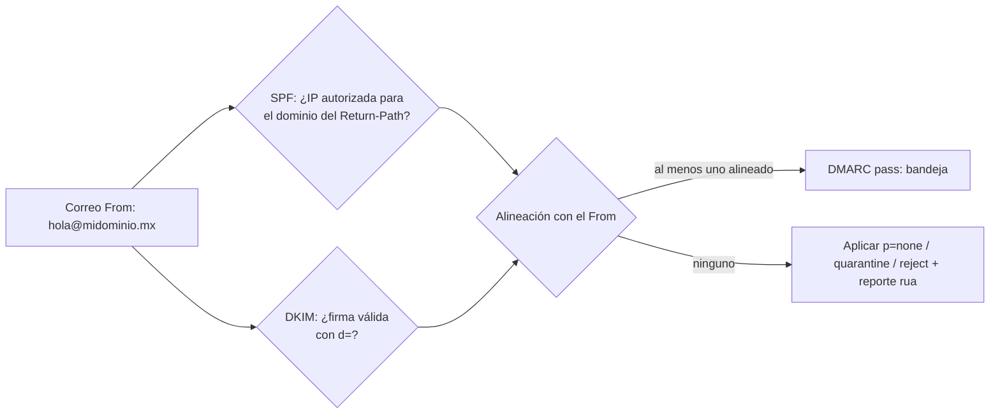

# SPF, DKIM y DMARC

Parte de: [[22-Integraciones/02 Correo/_Índice Correo|Correo]]

> [!info] Cómo avanzar
> `progreso`: **pendiente** → **viendo** (estudiando) → **visto** (contestaste la autoevaluación sin abrir las respuestas) → **dominado** (hiciste el laboratorio o lo aplicaste de verdad).

## Contenido

### Qué es
**SPF, DKIM y DMARC** son tres estándares que, juntos, permiten a los servidores de correo verificar que un mensaje que dice venir de tu dominio **realmente lo enviaste tú** y decidir qué hacer si no. Sin ellos, cualquiera puede mandar un correo con `From: pagos@midominio.mx` y tus correos legítimos tienen más probabilidades de terminar en spam. En una frase cada uno:

- [[SPF (Sender Policy Framework)|SPF]]: **qué servidores** pueden enviar por tu dominio (lista de IP en DNS).
- [[DKIM (firma de correo)|DKIM]]: **firma digital** que prueba que el mensaje no se alteró y lo autorizó tu dominio.
- [[DMARC (política y reportes)|DMARC]]: **política y reportes**: exige que SPF o DKIM pasen *alineados* con el `From` visible, dice qué hacer si fallan y te envía reportes.

### Cómo funciona

Cada estándar mira un dominio distinto del mensaje:

| | Dominio que evalúa | Se rompe con |
|---|---|---|
| SPF | Return-Path (remitente de sobre) | Reenvíos (cambia la IP) |
| DKIM | `d=` de la firma | Modificaciones del contenido |
| DMARC | `From:` visible | — (usa los dos anteriores) |

**Alineación en DMARC**: el dominio que autenticó (el del Return-Path en SPF o el `d=` en DKIM) debe coincidir con el dominio del `From`. En modo **relajado** (por defecto) basta con el mismo dominio organizacional (`notificaciones.midominio.mx` alinea con `midominio.mx`); en **estricto** debe ser idéntico. Esto es lo que impide que un atacante pase SPF con *su* dominio en el Return-Path y ponga *tu* dominio en el `From`.

### Ejemplo
Configuración típica para tu dominio con Microsoft 365 para el correo de la empresa y Azure Communication Services para el transaccional de tus APIs:

```
; SPF: un solo registro con todo lo autorizado
midominio.mx.                       TXT   "v=spf1 include:spf.protection.outlook.com -all"
; DKIM de Microsoft 365 (CNAME que da el portal)
selector1._domainkey.midominio.mx.  CNAME selector1-midominio-mx._domainkey.<tenant>.onmicrosoft.com.
; El transaccional usa un subdominio con sus propios registros SPF y DKIM que da el proveedor
; DMARC en monitoreo al inicio
_dmarc.midominio.mx.                TXT   "v=DMARC1; p=none; rua=mailto:dmarc@midominio.mx"
```
Verificación rápida: envía un correo a una cuenta de Gmail, abre **Mostrar original** y busca `SPF: PASS`, `DKIM: PASS` y `DMARC: PASS`. Si DMARC falla aunque SPF pase, normalmente es un problema de alineación.

**Por qué empezar con `p=none`**: al publicar DMARC aún no sabes todo lo que envía en tu nombre (el sistema de facturación que manda los CFDI, el CRM, una alerta de monitoreo). Con `p=none` nada se bloquea y los reportes agregados te muestran esas fuentes; las corriges y luego endureces a `quarantine` y `reject`. Empezar con `reject` puede bloquear correos legítimos sin que lo notes.

Hoy no es opcional: Gmail y Yahoo exigen estos registros a los remitentes de más de 5,000 correos diarios desde 2024 y Outlook.com rechaza desde mayo de 2025 los envíos masivos que no cumplen.

### Cuándo usarlo y cuándo no
- **Siempre** configura los tres en cada dominio y subdominio que envía correo; es parte de cualquier integración de [[Correo transaccional (SMTP y proveedores)|correo transaccional]].
- En dominios que no envían, publica SPF `-all` y DMARC `p=reject` para evitar suplantación.
- Practícalo en el laboratorio de verificación de tu dominio.

### Errores comunes
1. **Tener dos registros SPF en el mismo dominio**: el estándar exige uno solo; con dos, el resultado es `permerror` y SPF se considera fallido. Combínalos en un único registro con varios `include`.
2. **DKIM firmado con el dominio del proveedor** en lugar del tuyo: no alinea.
3. **Quedarse en `p=none` para siempre**: monitoreas, pero no proteges a nadie de la suplantación.
4. **Olvidar a los remitentes externos** (facturación, encuestas) antes de pasar a `reject`.
5. **Confundir el `From` con el Return-Path** al diagnosticar.

### Para profundizar
- [RFC 7208: SPF](https://www.rfc-editor.org/rfc/rfc7208)
- [RFC 6376: DKIM](https://www.rfc-editor.org/rfc/rfc6376)
- [RFC 7489: DMARC](https://www.rfc-editor.org/rfc/rfc7489)
- [Autenticación de correo en Microsoft 365](https://learn.microsoft.com/defender-office-365/email-authentication-about)

## Subtemas

- [[SPF (Sender Policy Framework)]]
- [[DKIM (firma de correo)]]
- [[DMARC (política y reportes)]]

## Autoevaluación

Contesta primero en voz alta o en papel; luego despliega la respuesta.

> [!question]- ¿Qué resuelve cada uno en una frase?
> SPF: qué servidores pueden enviar por tu dominio. DKIM: firma criptográfica que prueba que el mensaje no se alteró y quién lo firmó. DMARC: qué hacer si fallan y a quién reportarlo, exigiendo alineación con el dominio del `From`.

> [!question]- ¿Qué es la alineación en DMARC?
> Que el dominio validado por SPF (Return-Path) o por DKIM (`d=`) coincida con el dominio visible del `From`. Sin alineación, DMARC falla aunque SPF o DKIM pasen.

> [!question]- ¿Por qué empezar con `p=none`?
> Para recibir reportes y descubrir todos los servicios que envían en tu nombre antes de pasar a `quarantine` y `reject` sin bloquear correo legítimo.

> [!question]- Error común: tener dos registros SPF en el mismo dominio.
> Es inválido (`permerror`). Debe haber un solo registro `v=spf1` que incluya todos los servicios.

## Práctica

- [[Lab 2 - Verificar SPF, DKIM y DMARC de tu dominio]]

## Progreso de los subtemas

```base
filters:
  and:
    - file.inFolder("22-Integraciones/02 Correo/SPF, DKIM y DMARC")
    - file.name != "SPF, DKIM y DMARC"
views:
  - type: table
    name: Progreso
    order:
      - file.name
      - progreso
      - nivel
```
