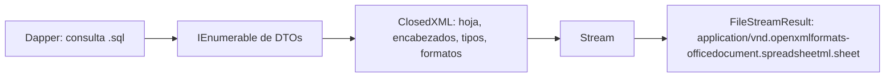

# Generar Excel desde .NET

Parte de: [[22-Integraciones/03 Documentos y archivos/_Índice Documentos y archivos|Documentos y archivos]]

> [!info] Cómo avanzar
> `progreso`: **pendiente** → **viendo** (estudiando) → **visto** (contestaste la autoevaluación sin abrir las respuestas) → **dominado** (hiciste el laboratorio o lo aplicaste de verdad).

## Contenido

### Qué es
Generar archivos **`.xlsx`** desde una API o un worker .NET es una necesidad constante: exportar el listado de una pantalla, enviar el reporte mensual de Wee.Reporteria o producir una plantilla para importar datos. Un `.xlsx` es un **paquete ZIP con XML** (formato Office Open XML, estándar ECMA-376), así que no necesitas Excel instalado: lo construyen librerías.

Opciones principales:

| Librería | Licencia | Estilo | Cuándo |
|---|---|---|---|
| **Open XML SDK** (`DocumentFormat.OpenXml`) | MIT (Microsoft) | Bajo nivel, control total, verboso | Archivos enormes con escritura en streaming (`OpenXmlWriter`) o requisitos muy específicos |
| **ClosedXML** | MIT | Alto nivel, sobre Open XML SDK | La opción gratuita más cómoda para reportes con formato |
| **MiniExcel** | Apache 2.0 | Streaming, poca memoria | Exportar/importar muchas filas sin formato elaborado |
| **NPOI** | Apache 2.0 | Puerto de Apache POI; también `.xls` viejo | Si necesitas `.xls` binario |
| **EPPlus 8** | Doble: Polyform Noncommercial o comercial | Muy completo | Uso comercial **requiere licencia de pago**; en código debes declarar la licencia (`ExcelPackage.License.SetCommercial(...)` o `SetNonCommercialPersonal(...)`) |

**CSV** sigue siendo válido cuando el consumidor es otro sistema; no tiene tipos, formatos ni varias hojas.

### Cómo funciona

Lo que cuidas al exportar **números y fechas**:

- Escribe los valores **con su tipo** (`decimal`, `DateTime`), no como texto ya formateado. Si escribes `"$1,234.50"` como string, Excel no puede sumar ni filtrar.
- Aplica el **formato de número** en la celda (`#,##0.00`, `"$"#,##0.00`, `dd/mm/yyyy`). El formato es presentación; el valor sigue siendo numérico.
- Excel guarda las fechas como **número de serie** sin zona horaria: convierte de UTC a la hora de México antes de escribir y decláralo en el encabezado.
- Identificadores como CURP, RFC, códigos postales con cero inicial o números de más de 15 dígitos (Excel solo guarda 15 dígitos de precisión) deben ir como **texto**.
- Evita la **inyección de fórmulas** (CSV/Excel injection): un valor de usuario que empieza con `=`, `+`, `-` o `@` puede interpretarse como fórmula; escribe esos valores como texto.

### Ejemplo
Endpoint con ClosedXML en un controller:
```csharp
[HttpGet("ventas/exportar")]
public async Task<IActionResult> Exportar([FromQuery] DateOnly desde, [FromQuery] DateOnly hasta, CancellationToken ct)
{
    var filas = await _consulta.EjecutarAsync(desde, hasta, ct);   // IConsultaVentasPorPeriodo

    using var libro = new XLWorkbook();
    var hoja = libro.Worksheets.Add("Ventas");
    string[] titulos = ["Folio", "Fecha (hora CDMX)", "Cliente", "RFC", "Total"];
    for (var c = 0; c < titulos.Length; c++) hoja.Cell(1, c + 1).Value = titulos[c];

    var fila = 2;
    foreach (var v in filas)
    {
        hoja.Cell(fila, 1).Value = v.Folio;
        hoja.Cell(fila, 2).Value = v.FechaLocal;                       // DateTime real
        hoja.Cell(fila, 3).Value = v.Cliente;
        hoja.Cell(fila, 4).SetValue(v.Rfc);                            // texto
        hoja.Cell(fila, 5).Value = v.Total;                            // decimal
        fila++;
    }
    hoja.Column(2).Style.DateFormat.Format = "dd/mm/yyyy hh:mm";
    hoja.Column(5).Style.NumberFormat.Format = "\"$\"#,##0.00";
    hoja.Range(1, 1, fila - 1, titulos.Length).CreateTable();        // filtros y estilo
    hoja.SheetView.FreezeRows(1);
    hoja.Columns().AdjustToContents();

    var ms = new MemoryStream();
    libro.SaveAs(ms);
    ms.Position = 0;
    return File(ms, "application/vnd.openxmlformats-officedocument.spreadsheetml.sheet",
                $"ventas_{desde:yyyyMMdd}_{hasta:yyyyMMdd}.xlsx");
}
```

**Caso: exportar 500,000 filas.** Una hoja admite hasta 1,048,576 filas, así que cabe, pero:
- ClosedXML arma todo el documento **en memoria**; con medio millón de filas puede consumir varios GB. Usa **escritura en streaming** (MiniExcel, o `OpenXmlWriter` del Open XML SDK) y lee los datos con Dapper sin buffer (`buffered: false`) para no tener todo en una lista.
- No lo generes **dentro de la petición HTTP**: toma minutos y la conexión puede cortarse. Encola un trabajo, genera en un worker, guarda en Blob Storage y avisa con un enlace de descarga (SAS de corta duración).
- Omite `AdjustToContents` y estilos por celda, que son costosos; define anchos fijos.
- Pregunta si de verdad lo quieren en Excel; para análisis, un CSV o una conexión de Power BI puede ser mejor.

### Cuándo usarlo y cuándo no
- **ClosedXML** para la mayoría de reportes con formato.
- **Streaming** para volúmenes grandes.
- **No** uses Office Interop (automatizar Excel instalado) en servidores: Microsoft no lo soporta en servicios y se cuelga (ver [[Generar documentos Word desde .NET (Open XML)]]).
- Para imágenes en reportes, prepara las miniaturas con [[ImageSharp]].

### Errores comunes
1. **Números como texto**: el usuario no puede sumar; Excel muestra el triángulo verde.
2. **Fechas en UTC sin aviso**: las ventas de las 19:00 aparecen al día siguiente.
3. **EPPlus en un proyecto comercial sin licencia**.
4. **Todo en memoria** con cientos de miles de filas.
5. **Valores de usuario que empiezan con `=`** escritos como fórmula.

### Para profundizar
- [ClosedXML (documentación)](https://docs.closedxml.io/)
- [Open XML SDK: estructura de una hoja de cálculo](https://learn.microsoft.com/office/open-xml/spreadsheet/structure-of-a-spreadsheetml-document)
- [MiniExcel (repositorio)](https://github.com/mini-software/MiniExcel)
- [Límites y especificaciones de Excel](https://support.microsoft.com/office/excel-specifications-and-limits-1672b34d-7043-467e-8e27-269d656771c3)

## Autoevaluación

Contesta primero en voz alta o en papel; luego despliega la respuesta.

> [!question]- ¿Qué opciones hay para generar `.xlsx` en .NET?
> Open XML SDK (bajo nivel), ClosedXML (API sencilla sobre Open XML, licencia MIT), EPPlus (licencia comercial/no comercial desde la versión 5) y NPOI. Revisa la licencia de cada una antes de usarla.

> [!question]- ¿Qué cuidas al exportar números y fechas?
> Escribirlos como número/fecha, no como texto, y aplicar formato de celda; si no, Excel no puede sumar ni ordenar bien.

> [!question]- Caso: hay que exportar 500 000 filas. ¿Qué cuidas?
> Memoria: usar escritura en streaming (`OpenXmlWriter` con el SDK) o generar CSV si no se requiere formato.

## Práctica

- [[Lab 3 - Generar un .docx y un .xlsx desde .NET]]

