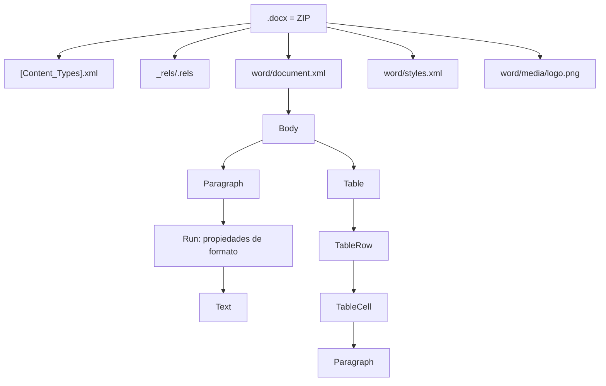

# Generar documentos Word desde .NET (Open XML)

Parte de: [[22-Integraciones/03 Documentos y archivos/_Índice Documentos y archivos|Documentos y archivos]]

> [!info] Cómo avanzar
> `progreso`: **pendiente** → **viendo** (estudiando) → **visto** (contestaste la autoevaluación sin abrir las respuestas) → **dominado** (hiciste el laboratorio o lo aplicaste de verdad).

## Contenido

### Qué es
Un **`.docx`** por dentro es un **paquete ZIP** (formato *Office Open XML*, estándar ECMA-376 e ISO/IEC 29500) con varias **partes XML** relacionadas entre sí:

- `word/document.xml`: el cuerpo del documento (párrafos, tablas, secciones).
- `word/styles.xml`: los estilos; `word/numbering.xml`: listas numeradas.
- `word/header1.xml`, `word/footer1.xml`: encabezados y pies.
- `word/media/`: imágenes.
- `[Content_Types].xml` y los archivos `_rels/*.rels`: qué tipo es cada parte y cómo se relacionan.

Puedes comprobarlo renombrando un `.docx` a `.zip` y abriéndolo. Como es XML, se puede generar desde .NET **sin tener Word instalado**.

El **Open XML SDK** (paquete NuGet `DocumentFormat.OpenXml`, de Microsoft, licencia MIT) ofrece clases fuertemente tipadas para cada elemento (`Body`, `Paragraph`, `Run`, `Text`, `Table`), abre y guarda el paquete (`WordprocessingDocument`) y valida contra el esquema (`OpenXmlValidator`). Es de **bajo nivel**: tú construyes la estructura XML con objetos, no hay un "ponle negritas a este texto y que se acomode". No convierte a PDF ni calcula la paginación.

### Cómo funciona

La jerarquía básica: un **párrafo** (`w:p`) contiene **runs** (`w:r`), tramos de texto con el mismo formato; cada run contiene **texto** (`w:t`). Si una palabra en negritas está a mitad de un párrafo, ese párrafo tiene tres runs.

### Ejemplo
**Plantilla con marcadores**: diseñas el documento en Word (logo, estilos, pie legal) y lo rellenas desde código. Es la forma más mantenible. Usa **controles de contenido** (*content controls*, `w:sdt`) con etiqueta, porque Word suele partir un texto como `{{Cliente}}` en varios runs cuando lo editas y una búsqueda simple de texto falla.

```csharp
using DocumentFormat.OpenXml.Packaging;
using DocumentFormat.OpenXml.Wordprocessing;

public static byte[] GenerarConstancia(string plantillaPath, IReadOnlyDictionary<string, string> datos)
{
    var bytes = File.ReadAllBytes(plantillaPath);
    using var ms = new MemoryStream();
    ms.Write(bytes);                                   // trabajar sobre una copia en memoria
    using (var doc = WordprocessingDocument.Open(ms, isEditable: true))
    {
        var cuerpo = doc.MainDocumentPart!.Document.Body!;
        // Controles de contenido con etiqueta (Tag) = nombre del campo
        foreach (var sdt in cuerpo.Descendants<SdtElement>())
        {
            var tag = sdt.SdtProperties?.GetFirstChild<Tag>()?.Val?.Value;
            if (tag is null || !datos.TryGetValue(tag, out var valor)) continue;

            var textos = sdt.Descendants<Text>().ToList();
            if (textos.Count == 0) continue;
            textos[0].Text = valor;                     // conserva el formato del primer run
            foreach (var t in textos.Skip(1)) t.Remove();
        }
        // Agregar un párrafo al final, con estilo definido en la plantilla
        cuerpo.AppendChild(new Paragraph(
            new ParagraphProperties(new ParagraphStyleId { Val = "Nota" }),
            new Run(new Text($"Generado el {DateTime.Now:dd/MM/yyyy}"))));
    }
    return ms.ToArray();
}
```
En el controller devuelves `File(bytes, "application/vnd.openxmlformats-officedocument.wordprocessingml.document", "constancia.docx")`.

**Cuándo usar una plantilla en vez de construir todo con código**: casi siempre que el documento tiene **diseño** (membrete, tipografía, márgenes, pie legal) que alguien de negocio quiere ajustar. Con plantilla, cambiar el logo o un párrafo legal no requiere desplegar código. Construir todo en código conviene solo para documentos muy dinámicos y simples (una tabla generada sin diseño especial) o cuando la estructura cambia por completo según los datos.

Si necesitas productividad sobre Open XML, existen librerías de más alto nivel (por ejemplo, para rellenar plantillas con sintaxis de etiquetas), pero revisa la licencia de cada una antes de usarla en un proyecto comercial.

### Cuándo usarlo y cuándo no
- **Sí**: contratos, constancias, cartas y reportes editables que el usuario quiere abrir y ajustar en Word.
- **No** si el usuario necesita un documento final no editable: genera **PDF** (con una librería de PDF o convirtiendo el `.docx` con un servicio), recordando que el Open XML SDK no convierte a PDF.
- Para hojas de cálculo, ver [[Generar Excel desde .NET]].

### Errores comunes
1. **Usar Office Interop en un servidor**: automatizar Word instalado desde una API o un servicio no está soportado por Microsoft, requiere licencias de Office en el servidor, deja procesos `WINWORD.EXE` colgados, se bloquea con diálogos invisibles y no escala con peticiones concurrentes. No funciona en contenedores Linux ni en App Service. Usa Open XML.
2. **Buscar y reemplazar texto plano** como `{{Nombre}}`: Word lo parte en varios runs; usa controles de contenido o normaliza los runs.
3. **Olvidar `xml:space="preserve"`** en textos con espacios al inicio o final (`new Text(" x") { Space = SpaceProcessingModeValues.Preserve }`): Word los recorta.
4. **Editar la plantilla original** en lugar de una copia en memoria.
5. **No validar**: un XML mal formado hace que Word diga "el archivo está dañado"; usa `OpenXmlValidator` en las pruebas.

### Para profundizar
- [Open XML SDK (Microsoft Learn)](https://learn.microsoft.com/office/open-xml/open-xml-sdk)
- [Estructura de un documento WordprocessingML](https://learn.microsoft.com/office/open-xml/word/structure-of-a-wordprocessingml-document)
- [Consideraciones para la automatización de Office en servidor (Microsoft)](https://support.microsoft.com/help/257757)

## Autoevaluación

Contesta primero en voz alta o en papel; luego despliega la respuesta.

> [!question]- ¿Qué es un `.docx` por dentro?
> Un ZIP con partes XML (Office Open XML): `word/document.xml` con el contenido, estilos, relaciones, imágenes, etc.

> [!question]- ¿Qué ofrece el Open XML SDK (`DocumentFormat.OpenXml`)?
> Clases tipadas para crear y modificar documentos de Office sin tener Office instalado: `WordprocessingDocument`, `Body`, `Paragraph`, `Run`, `Text`.

> [!question]- ¿Cuándo usar una plantilla en vez de construir todo con código?
> Cuando el formato lo diseña negocio: preparas un `.docx` con marcadores o controles de contenido y el código solo reemplaza valores. Más fácil de mantener.

> [!question]- Error común: usar Office Interop en un servidor.
> Interop requiere Office instalado, no está soportado para uso desatendido en servidores y falla bajo carga. Usa Open XML SDK u otra librería.

## Práctica

- [[Lab 3 - Generar un .docx y un .xlsx desde .NET]]

