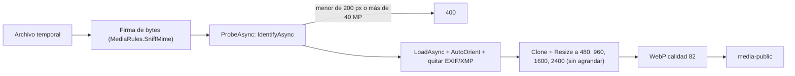

# ImageSharp

> Librería 100 % administrada (sin dependencias nativas) de SixLabors para leer, transformar y codificar imágenes en .NET; [[Itzamna.Dionisio]] usa `SixLabors.ImageSharp` 3.1.12 para validar fotos y generar variantes WebP.

## Qué es y qué problema resuelve
Las fotos que suben los creadores vienen de celular: varios MB, orientación en EXIF, metadatos con ubicación y formatos variados. Servirlas tal cual es lento y expone datos. ImageSharp permite, en C# puro y multiplataforma (Linux en App Service):
- **Identificar** formato y dimensiones sin decodificar toda la imagen (`Image.IdentifyAsync`).
- **Corregir orientación** (`AutoOrient`), **quitar metadatos**, **redimensionar** y **codificar** a WebP/JPEG/PNG.

## Cómo funciona por dentro
- `Image.IdentifyAsync(stream)` lee solo la cabecera: ancho, alto, formato detectado.
- `Image.LoadAsync(stream)` decodifica a un buffer de píxeles en memoria (ancho × alto × 4 bytes aprox.).
- `image.Mutate(x => ...)` transforma en sitio; `image.Clone(x => ...)` crea una copia transformada.
- `Resize(width, 0)`: alto 0 = mantener proporción.
- Encoders (`WebpEncoder { Quality = 82 }`) + `SaveAsWebpAsync`.
- Lanza `UnknownImageFormatException` / `InvalidImageContentException` si no es una imagen válida.



## Cuándo usarla y cuándo no
### Ventajas
- Sin binarios nativos: funciona igual en Windows, Linux y contenedores.
- API fluida y segura en memoria.
- Soporta WebP, JPEG, PNG, GIF, TIFF, BMP.
### Desventajas
- Más lenta que librerías nativas (libvips).
- Imágenes grandes consumen mucha RAM al decodificar (por eso el tope de megapíxeles).
- Licencia Six Labors Split License: gratis bajo ciertos umbrales; revisar para uso comercial.
- Procesar en la petición alarga la subida.

## Alternativas
| Alternativa | En qué se diferencia |
|---|---|
| SkiaSharp | Binding nativo de Skia; rápido, depende de binarios nativos. |
| NetVips (libvips) | Muy rápido y con poca memoria; nativo. |
| Magick.NET (ImageMagick) | Soporta casi cualquier formato; pesado y nativo. |
| Servicio externo (Cloudinary, Imgix, Azure Functions) | Transforma bajo demanda por URL; costo por uso. |

## Cómo se usó en Itzamna
- Puerto `IImageProcessor` en Application (`ProbeAsync`, `CreateWebpVariantsAsync`); adaptador `ImageSharpProcessor` en `Infrastructure/Media/`, registrado *singleton*.
- Reglas en `Features/Media/MediaFeatures.cs` (`MediaRules`): `MinImageSide = 200`, `MaxImagePixels = 40_000_000`, `VariantWidths = [480, 960, 1600, 2400]`. Antes de ImageSharp se valida el tipo real por **firma de bytes** (nunca por extensión).
- Variantes generadas **en la misma petición** (decisión en `.ai/03_ROADMAP.md`: "sin worker en segundo plano todavía").

`Itzamna.Dionisio/src/Itzamna.Dionisio.Infrastructure/Media/ImageSharpProcessor.cs`:
```csharp
using var image = await Image.LoadAsync(stream, cancellationToken);
image.Mutate(x => x.AutoOrient());
image.Metadata.ExifProfile = null;
image.Metadata.XmpProfile = null;

var encoder = new WebpEncoder { Quality = 82 };
var results = new List<ProcessedImage>();
foreach (var width in widths)
{
    using var resized = width < image.Width ? image.Clone(x => x.Resize(width, 0)) : image.Clone(_ => { });
    using var output = new MemoryStream();
    await resized.SaveAsWebpAsync(output, encoder, cancellationToken);
    results.Add(new ProcessedImage(resized.Width, resized.Height, output.ToArray()));
}
```
Las variantes se guardan en `media-public` ([[Azure Blob Storage]]) y el front las usa en `srcset` ([[Imágenes responsive]]). Los videos no se procesan: se copian tal cual (no hay transcodificación).

Funcionalidad: [[Biblioteca de medios]].

> [!note] Pendiente de confirmar
> No encontré revisión de la licencia de ImageSharp para el uso comercial de Itzamna. El worker de variantes/video está en [[Secciones pendientes]].

## Errores comunes y buenas prácticas
- Confiar en la extensión o el MIME del navegador: validar firma de bytes y luego `IdentifyAsync`.
- Decodificar sin límite de píxeles: una "bomba" de descompresión agota la memoria.
- Olvidar `AutoOrient` antes de quitar EXIF: fotos de lado.
- Agrandar imágenes pequeñas: aquí nunca se escala por encima del original.
- Olvidar `using` en `Image`: fuga de memoria (buffers grandes).

## Qué estudiar después
- [[Azure Blob Storage]], [[Imágenes responsive]], [[BackgroundService]] (para mover el proceso a un worker)
- Formatos AVIF/WebP, calidad vs peso.

## Documentación oficial
- https://docs.sixlabors.com/articles/imagesharp/
- https://github.com/SixLabors/ImageSharp

## Autoevaluación

Contesta primero en voz alta o en papel; luego despliega la respuesta.

> [!question]- ¿Qué ventaja tiene ImageSharp frente a SkiaSharp o NetVips?
> Es 100 % administrada (sin binarios nativos): funciona igual en Windows, Linux y contenedores. A cambio es más lenta y usa más memoria.

> [!question]- ¿Por qué usar `Image.IdentifyAsync` antes de `LoadAsync`?
> Lee solo la cabecera (formato y dimensiones) sin decodificar: permite rechazar imágenes demasiado grandes o pequeñas antes de gastar memoria.

> [!question]- ¿Por qué aplicar `AutoOrient` antes de quitar los metadatos EXIF?
> La orientación de las fotos de celular viene en EXIF; si la quitas primero, la imagen queda de lado.

> [!question]- Error común: no limitar los megapíxeles al decodificar.
> Una imagen "bomba de descompresión" puede agotar la memoria del servidor. Valida dimensiones (p. ej. un tope de megapíxeles) antes de cargar.

> [!question]- ¿Qué revisar sobre la licencia?
> ImageSharp usa la Six Labors Split License: gratuita bajo ciertas condiciones; para uso comercial hay que revisar si aplica una licencia de pago.

