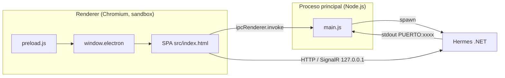

# Electron

> Framework para crear aplicaciones de escritorio con HTML, CSS y JavaScript, uniendo Chromium (la ventana) y Node.js (acceso al sistema).

## Qué es y qué problema resuelve
Electron empaqueta un navegador Chromium y un runtime de Node.js en un solo ejecutable. Permite escribir la interfaz como una página web y, a la vez, hacer cosas que un navegador no deja: lanzar procesos, leer archivos o abrir el navegador del sistema.

En Ocelotl resuelve dos problemas: dar a [[Ocelotl.Iris]] una ventana de escritorio en el punto de farmacia y **arrancar [[Ocelotl.Hermes]] (.NET) como proceso hijo**, de modo que el operador abre un solo programa.

Versión usada en Iris: Electron `^43.1.1`.

## Cómo funciona por dentro
- **Proceso principal (main)**: es Node.js. Crea ventanas (`BrowserWindow`), maneja el ciclo de vida (`app`) y tiene acceso completo al sistema.
- **Proceso de renderizado (renderer)**: cada ventana es una página Chromium. Con la configuración segura no tiene acceso a Node.
- **Preload**: script que corre antes de la página, en un contexto aislado, y expone una API mínima con `contextBridge` (ver [[Preload y contextBridge]]).
- **IPC**: los procesos se comunican por canales con nombre (`ipcMain.handle` / `ipcRenderer.invoke` para pedir-responder; `send` / `on` para mensajes de una vía).



## Cuándo usarla y cuándo no
### Ventajas
- Una sola base de código web para una app de escritorio.
- Acceso a Node para orquestar procesos locales (aquí, Hermes).
- Funciona sin internet: todo se carga con `loadFile` desde disco.
### Desventajas
- Ejecutables pesados (incluye Chromium completo) y consumo alto de memoria.
- Superficie de ataque grande si se configura mal (`nodeIntegration: true`, sin aislamiento).
- Hay que mantenerse al día con las versiones por los parches de seguridad de Chromium.

## Alternativas
| Alternativa | En qué se diferencia |
|---|---|
| Tauri | Usa el webview del sistema y un backend en Rust; binarios mucho más pequeños. |
| WebView2 / WPF / WinForms (.NET) | Nativo de Windows; se podría integrar con Hermes en el mismo proceso, pero ata la UI a Windows. |
| PWA en el navegador | Sin instalación, pero no puede lanzar Hermes ni controlar procesos locales. |
| NW.js | Modelo parecido, mezcla Node y DOM en el mismo contexto (menos aislamiento por defecto). |

## Cómo se usó en Ocelotl
En [[Ocelotl.Iris]] el proceso principal (`electron/main.js`):
1. Genera un **secreto aleatorio por arranque** (`crypto.randomBytes(32)`) que solo conocen Iris y Hermes (ver [[Arranque y seguridad local]]).
2. **Lanza Hermes como proceso hijo** con `child_process.spawn`: en producción el `.exe` empaquetado (`resources/hermes/Ocel.Hermes.API.exe`); en desarrollo `dotnet run --project ... --launch-profile Hermes` sobre el repo hermano. Le pasa `HERMES_SESSION_SECRET` e `isElectron=1` por variables de entorno.
3. Lee `PUERTO:xxxx` del `stdout` de Hermes y resuelve una promesa con el puerto (timeout de 60 s). Hermes lo imprime en `ApplicationStarted` (`Ocelotl.Hermes/src/Ocelotl.Hermes.Api/Program.cs`).
4. Crea la ventana con `contextIsolation: true`, `nodeIntegration: false`, `sandbox: true` y carga la página con `fnCargarPagina`: en desarrollo, el servidor de [[Vite]] (`loadURL(IRIS_DEV_URL)`); empaquetada, `dist/index.html` con `loadFile`.
5. Expone por IPC el puerto y el secreto (`ipcMain.handle`), y un canal `abrir-externo` que solo acepta URLs `https://` y las abre con `shell.openExternal` (p. ej. el PDF de un ingreso en [[Ingresos]]).
6. Bloquea ventanas nuevas con `setWindowOpenHandler(() => ({ action: 'deny' }))`.
7. Quita el menú (`Menu.setApplicationMenu(null)`), habilita F12 / Ctrl+Shift+I solo en desarrollo y mata a Hermes en `will-quit`.

Ventana y lanzamiento de Hermes (`Ocelotl.Iris/electron/main.js`):
```js
const Ventana = new BrowserWindow({
    width: Limites.AnchoVentana,
    height: Limites.AltoVentana,
    webPreferences: {
        preload: Path.join(__dirname, Rutas.Preload),
        contextIsolation: true,
        nodeIntegration: false,
        sandbox: true
    }
})
// Cualquier window.open o link target=_blank sale al navegador del sistema, nunca a otra ventana de Electron.
Ventana.webContents.setWindowOpenHandler(() => ({ action: 'deny' }))
fnCargarPagina(Ventana)   // Vite en desarrollo; dist/index.html empaquetada
```

Solo `https` hacia el navegador del sistema (`Ocelotl.Iris/electron/main.js`):
```js
ipcMain.on(Canales.AbrirExterno, (_, Url) => {
    const isHttps = typeof Url == 'string' && Url.startsWith('https://')
    if (!isHttps) return console.warn(Mensajes.UrlRechazada(Url))
    shell.openExternal(Url)
})
```

Funcionalidades que dependen de esto: [[Arranque y seguridad local]], [[Ingresos]] (abrir PDF), [[Eventos en tiempo real]] (el puerto que usa SignalR).

> [!warning] Pendiente de confirmar
> El comentario junto a `setWindowOpenHandler` dice que los `window.open` / `target=_blank` "salen al navegador del sistema", pero el handler solo devuelve `{ action: 'deny' }` y no llama a `shell.openExternal`: en la práctica esos enlaces se bloquean. La salida al navegador real ocurre solo vía `window.electron.fnAbrirExterno` (`src/shared/externo.js`).

> [!warning] Pendiente de confirmar
> El preload expone `fnAlCambiarActualizacion` (canal `update-status`) y main maneja `instalar-actualizacion` con `electron-updater`, pero en `main.js` no se ve ningún envío de `update-status` ni configuración del updater; si no está instalado solo registra un aviso.

> [!tip] Reutilizable
> El patrón "Electron lanza un backend local, lee su puerto por stdout y lo entrega por IPC pull + secreto por arranque" sirve para cualquier app de escritorio con backend propio (otro servicio .NET, Python, etc.).

## Errores comunes y buenas prácticas
- **Nunca** `nodeIntegration: true` ni `contextIsolation: false` en una página que muestre contenido no confiable. Iris usa la combinación segura más `sandbox: true`.
- Validar todo lo que llega por IPC desde el renderer (Iris valida que la URL empiece por `https://`).
- Matar los procesos hijos al salir (`will-quit`) para no dejar Hermes huérfano ocupando el puerto.
- No pasar el puerto con un evento "push" al cargar la página: si la página recarga se pierde. Iris lo resuelve con IPC pull (ver [[Preload y contextBridge]]).
- Poner un timeout a la espera del backend para mostrar un error claro en vez de quedarse colgado.
- Definir una [[Content Security Policy]] aunque todo sea local.

## Qué estudiar después
- [[Preload y contextBridge]]
- [[Content Security Policy]]
- [[ES Modules e import maps]]
- [[SignalR]]
- Empaquetado e instaladores (electron-builder, `extraResources`) y auto-actualización (electron-updater).
- [[Ocelotl.Iris - Arquitectura]]

## Documentación oficial
- https://www.electronjs.org/docs/latest/
- https://www.electronjs.org/docs/latest/tutorial/security
- https://www.electronjs.org/docs/latest/tutorial/process-model
- https://www.electronjs.org/docs/latest/tutorial/ipc
- https://www.electronjs.org/docs/latest/tutorial/sandbox

## Autoevaluación

Contesta primero en voz alta o en papel; luego despliega la respuesta.

> [!question]- ¿Qué diferencia hay entre el proceso principal y el renderer?
> El principal es Node.js: crea ventanas y tiene acceso completo al sistema. Cada renderer es una página de Chromium que, con la configuración segura, no tiene acceso a Node.

> [!question]- ¿Qué combinación de `webPreferences` es la segura?
> `contextIsolation: true`, `nodeIntegration: false` y `sandbox: true`, más un preload con una API mínima.

> [!question]- ¿Para qué sirve `setWindowOpenHandler`?
> Para controlar qué pasa con `window.open` y enlaces `target=_blank`: devolver `{ action: 'deny' }` los bloquea; si quieres abrirlos fuera, llama `shell.openExternal` con URLs validadas.

> [!question]- Error común: no matar los procesos hijos al cerrar la app.
> Quedan procesos huérfanos ocupando puertos (como el backend local). Termínalos en `will-quit`.

> [!question]- ¿Qué alternativa daría ejecutables mucho más pequeños?
> Tauri, que usa el webview del sistema y un backend en Rust en lugar de empaquetar Chromium.

