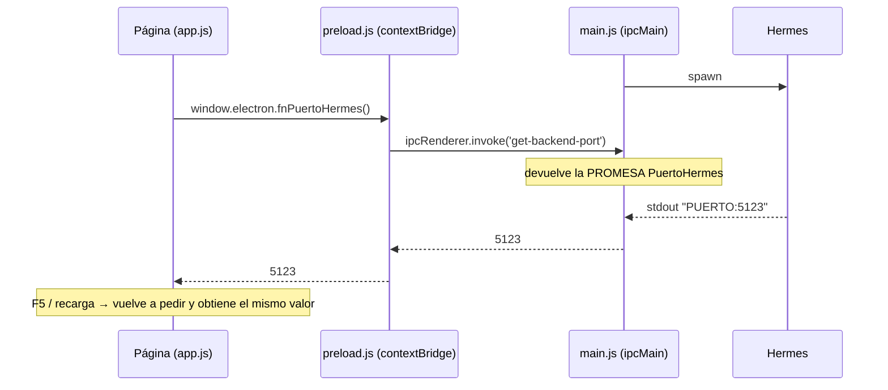

# Preload y contextBridge

> El script *preload* de Electron corre antes de la página en un contexto aislado y usa `contextBridge` para exponerle una API mínima y segura que habla con el proceso principal por IPC.

## Qué es y qué problema resuelve
Con la configuración segura de [[Electron]] (`contextIsolation: true`, `nodeIntegration: false`, `sandbox: true`) la página no puede usar `require`, Node ni `ipcRenderer`. Pero necesita algo del proceso principal (en Iris: el puerto de Hermes y el secreto de sesión).

El **preload** es el único punto con acceso a `ipcRenderer`, y **`contextBridge.exposeInMainWorld`** copia hacia `window` solo las funciones que tú decides. La página nunca ve el objeto `ipcRenderer` completo, así que aunque se inyectara código malicioso no podría enviar mensajes arbitrarios.

## Cómo funciona por dentro
- **Context isolation**: el preload y la página comparten el DOM pero tienen **mundos de JavaScript distintos** (objetos globales separados). La página no puede modificar los prototipos que usa el preload.
- `contextBridge.exposeInMainWorld('nombre', api)` clona la API al mundo de la página; funciones y promesas se envuelven para cruzar la frontera.
- Con `sandbox: true`, el preload solo puede usar un subconjunto de módulos (`contextBridge`, `ipcRenderer`, etc.), no todo Node.
- **IPC**:
  - `ipcRenderer.invoke(canal, ...args)` ↔ `ipcMain.handle(canal, fn)`: petición-respuesta; devuelve una promesa con lo que regrese `fn` (si `fn` devuelve una promesa, se espera).
  - `ipcRenderer.send(canal, ...args)` ↔ `ipcMain.on(canal, fn)`: mensaje de una vía.
  - `webContents.send` ↔ `ipcRenderer.on`: del main hacia la página (push).



### Pull vs. push: por qué no se pierde el puerto
Si main hiciera *push* (`webContents.send('puerto', 5123)` cuando Hermes arranca):
- si la página aún no cargó o no registró su `on(...)`, el mensaje se pierde;
- si el usuario recarga (F5), la página nueva nunca recibe el puerto.

Con **pull**, la página pide cuando lo necesita. Main responde con una **promesa** que se resuelve una sola vez cuando Hermes imprime su puerto: si la página llega antes, espera; si llega después (o recarga), obtiene el valor ya resuelto al instante.

## Cuándo usarla y cuándo no
### Ventajas
- Superficie mínima y explícita: la página solo puede hacer lo que el preload expone.
- Compatible con `sandbox: true` y con la [[Content Security Policy]].
- `invoke`/`handle` da una API con promesas, natural de usar con `await`.
### Desventajas
- Cada capacidad nueva requiere tocar tres sitios: main, preload y página.
- Los canales son cadenas: un error de tipeo falla en silencio (Iris los centraliza en objetos `Canales`, duplicados en main y preload).
- Lo que cruza el puente se clona: no pasan clases ni objetos con métodos.

## Alternativas
| Alternativa | En qué se diferencia |
|---|---|
| `nodeIntegration: true` | La página usa Node directamente; inseguro, desaconsejado. |
| `contextIsolation: false` + globals en preload | La página puede alterar el preload; inseguro. |
| Push con `webContents.send` | Sencillo, pero se pierden mensajes si la página no está lista o recarga. |
| Pasar datos por query string en `loadFile` | Sirve para valores conocidos al crear la ventana; el puerto de Hermes llega después. |
| `MessagePort` (`MessageChannelMain`) | Canal dedicado y de alto rendimiento entre procesos; más complejo. |

## Cómo se usó en Ocelotl
En [[Ocelotl.Iris]], `electron/preload.js` expone `window.electron` con:
- `fnPuertoHermes()` → `invoke('get-backend-port')`: espera a que Hermes levante.
- `fnSecretoSesion()` → `invoke('get-session-secret')`: el secreto aleatorio de este arranque (ver [[Arranque y seguridad local]]).
- `fnAbrirExterno(Url)` → `send('abrir-externo')`: main solo abre `https://` con `shell.openExternal`.
- `fnInstalarActualizacion()` y `fnAlCambiarActualizacion(Fn)` para actualizaciones.

`Ocelotl.Iris/electron/preload.js`:
```js
contextBridge.exposeInMainWorld('electron', {
    /** Puerto de Hermes. Espera a que Hermes levante si todavía no lo ha hecho. */
    fnPuertoHermes: () => ipcRenderer.invoke(Canales.PuertoHermes),
    /** Secreto de esta sesión; Hermes rechaza cualquier petición sin él. */
    fnSecretoSesion: () => ipcRenderer.invoke(Canales.SecretoSesion),
    fnAlCambiarActualizacion: (Fn) => ipcRenderer.on(Canales.EstadoActualizacion, (_, Estado) => Fn(Estado)),
    fnInstalarActualizacion: () => ipcRenderer.send(Canales.InstalarActualizacion),
    /** Abre una URL https en el navegador del sistema (p. ej. el PDF de un ingreso). */
    fnAbrirExterno: (Url) => ipcRenderer.send(Canales.AbrirExterno, Url)
})
```

Lado main, la promesa que se entrega por pull (`Ocelotl.Iris/electron/main.js`):
```js
const PuertoHermes = new Promise((Resolver, Rechazar) => {
    fnResolverPuerto = Resolver
    fnRechazarPuerto = Rechazar
})
// ...
ipcMain.handle(Canales.PuertoHermes, () => PuertoHermes)
ipcMain.handle(Canales.SecretoSesion, () => Secreto)
```

Uso en la página (`Ocelotl.Iris/src/app.js`); si no hay Electron (Iris abierto en un navegador para desarrollo) cae al puerto 5017 sin secreto:
```js
if (!window.electron) {
    console.warn(Mensajes.SinElectron)
    return { Puerto: PuertoDesarrollo, Secreto: null }
}
const [Puerto, Secreto] = await Promise.all([
    window.electron.fnPuertoHermes(),
    window.electron.fnSecretoSesion()
])
```

Funcionalidades: [[Arranque y seguridad local]], [[Ingresos]] (abrir PDF vía `shared/externo.js`).

> [!warning] Pendiente de confirmar
> `fnAlCambiarActualizacion` escucha `update-status`, pero `main.js` no envía ese canal en ningún punto; la función de actualizaciones parece incompleta. Además, `fnAlCambiarActualizacion` no devuelve forma de quitar el listener.

> [!tip] Reutilizable
> "Promesa única en main + `ipcMain.handle` que la devuelve + `invoke` en preload" es el patrón correcto para cualquier dato que el main obtiene de forma asíncrona y la página necesita de forma confiable aunque recargue.

## Errores comunes y buenas prácticas
- No exponer `ipcRenderer` entero ni un `send(canal, ...)` genérico: expón funciones concretas con canal fijo.
- Validar en main todo lo que llega (Iris valida `https://` en `abrir-externo`).
- Envolver callbacks de `ipcRenderer.on` para no filtrar el objeto `event` a la página (Iris pasa solo `Estado`).
- Preferir pull (`invoke`) para datos que la página necesita al arrancar.
- Mantener los nombres de canal en constantes compartidas para evitar errores de tipeo.
- Detectar la ausencia de `window.electron` para poder desarrollar en un navegador normal.

## Qué estudiar después
- [[Electron]]
- [[Content Security Policy]]
- [[Arranque y seguridad local]]
- `MessageChannelMain` / `MessagePort` en Electron.
- Modelo de procesos de Chromium y sandboxing.

## Documentación oficial
- https://www.electronjs.org/docs/latest/api/context-bridge
- https://www.electronjs.org/docs/latest/tutorial/context-isolation
- https://www.electronjs.org/docs/latest/tutorial/ipc
- https://www.electronjs.org/docs/latest/tutorial/sandbox

## Autoevaluación

Contesta primero en voz alta o en papel; luego despliega la respuesta.

> [!question]- ¿Qué hace `contextBridge.exposeInMainWorld`?
> Copia al `window` de la página solo las funciones que decides, desde el preload aislado; la página nunca recibe `ipcRenderer` completo.

> [!question]- ¿Qué diferencia hay entre `invoke`/`handle` y `send`/`on`?
> `invoke`↔`handle` es petición-respuesta con promesa; `send`↔`on` es mensaje de una vía; `webContents.send` empuja del main a la página.

> [!question]- ¿Por qué entregar el puerto del backend con *pull* (`invoke`) y no con *push*?
> Con push el mensaje se pierde si la página aún no escucha o si recarga (F5). Con pull la página pide cuando lo necesita y el main devuelve una promesa ya resuelta o que se resolverá.

> [!question]- Error común: exponer `send(canal, ...args)` genérico.
> Equivale a exponer `ipcRenderer`: cualquier script inyectado podría usar cualquier canal. Expón funciones concretas con canal fijo y valida los argumentos en main.

