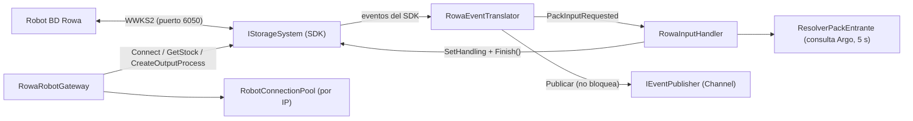

# SDK BD Rowa y WWKS2

> SDK .NET de BD Rowa (`StorageSystem.dll` y compañía, en `lib/Rowa`) con el que [[Ocelotl.Hermes]] se conecta a los robots de farmacia por WWKS2: conexión, stock, ingresos y salidas.

## Qué es y qué problema resuelve
Los robots de almacenamiento BD Rowa se comunican con el sistema de información de la farmacia (el "IT System") mediante el protocolo **WWKS2**. El SDK encapsula ese protocolo en una API .NET orientada a objetos (`IStorageSystem`) con métodos síncronos y **eventos .NET**, para no tener que implementar el protocolo a mano.

Lo que se ve en el código:
- El SDK expone el espacio de nombres `CareFusion.Lib.StorageSystem` (subespacios `Input`, `Output`, `State`, `Stock`, `Helpers.Enums`).
- El puerto por defecto que usa Hermes es **6050** (`Conectar.PuertoPorDefecto`, comentario "Puerto WWKS2 por defecto de los robots BD Rowa").
- Hermes se presenta con un **SubscriberId** (100 por defecto).

Detalles del protocolo en sí (formato de los mensajes, transporte exacto, versiones): Pendiente de confirmar con el manual de Rowa; el código de Hermes solo usa la API del SDK.

## Cómo funciona por dentro
Solo lo que se observa en `Infrastructure/Robot/*`:

| Pieza del SDK | Uso visto en Hermes |
|---|---|
| `RowaStorageSystem(subscriberId, intervaloRevisionEstadoMs)` | Crea la instancia (`RowaStorageSystemFactory`). |
| `IStorageSystem.Connect(ip, puerto)` / `Disconnect()` / `Connected` / `State` | Conexión y estado (`ComponentState.Ready` / `NotReady`). Síncronos. |
| `GetStock(includePackDetails, includeArticleDetails[, articleId])` | Devuelve `IArticle[]` (con `Id`, `Name`, `PackCount`, `Packs`). |
| `CreateOutputProcess(orden, bandeja)` → `AddCriteria(articuloId, cantidad, lote)` → `Start()` | Orden de salida (dispensado). |
| Eventos `StateChanged`, `PackInputRequested`, `PackInputFinished`, `PackStored`, `PackDispensed`, `OutputProcessFinished` | Suscritos en `RowaEventTranslator`. |
| `IInputRequest` (`Id`, `Packs`, `Finish()`) | Solicitud de ingreso que el robot espera que se conteste. |
| `IInputPack` (`ScanCode`, `Guid`, `BatchNumber`, `ExpiryDate`, `SetArticleInformation`, `SetPackInformation`, `SetHandling`) | Caja que el robot quiere ingresar; Hermes la permite o rechaza (`InputHandling.Allowed` / `Rejected`). |
| `IPack` (`Id`, `Guid`, `ScanCode`, `BatchNumber`, `ExpiryDate`, `StockInDate`, `IsInFridge`) | Caja en stock; `Guid` es la base de la [[Trazabilidad por caja]]. |
| `IOutputProcessInfo` (`State`, `Packs`) y `OutputProcessState` (`Completed`, `Incomplete`, `Rejected`, `Aborted`, `Aborting`) | Resultado de una orden de salida. |
| `InputResult.Completed`, `ExpiryDateSource.ITSystem` | Resultado de ingreso; origen de la caducidad. |

DLL referenciadas en `Ocelotl.Hermes.Infrastructure.csproj` (vía `$(RowaLibDir)` de `Directory.Build.props`): `StorageSystem`, `RowaLog`, `RowaSec`, `Rowa.Mosaic.Shared.Converters`, `Rowa.Mosaic.Shared.ScancodeParsers`, `Rowa.Observables`. En pruebas, solo en Windows: `StorageSystem.Simulators.Core` e `ItSystem.Simulator` (usan WinForms).



## Cuándo usarla y cuándo no
### Ventajas
- Es la vía soportada por el fabricante para hablar con los robots.
- API .NET directa: Hermes la usa sin puentes.
- Trae parsers de códigos (`ScancodeParsers`: GS1, IFA, Raw…, según el README).
### Desventajas
- Llamadas **síncronas** que pueden tardar: Hermes las envuelve en `Task.Run` + `WaitAsync(timeout)`.
- Los eventos llegan en hilos del SDK: no se puede bloquearlos ni dejar escapar excepciones.
- Partes (simuladores) dependen de Windows/WinForms; las DLL no son paquetes NuGet sino archivos en `lib/Rowa`.
- Convenciones propias: sin fecha = `DateTime.MinValue`; cajas sin GUID = `Guid.Empty`.

## Alternativas
| Alternativa | En qué se diferencia |
|---|---|
| Implementar WWKS2 a mano (sockets) | Control total, pero hay que conocer y mantener el protocolo (Pendiente de confirmar si hay especificación pública). |
| Middleware del fabricante u otros integradores | Pendiente de confirmar opciones disponibles. |

## Cómo se usó en Ocelotl
Todo vive en `Ocelotl.Hermes/src/Ocelotl.Hermes.Infrastructure/Robot/` (adaptador de [[Arquitectura hexagonal]]; "aquí termina WWKS2", dice `RowaMapeos`):
- **`RowaRobotGateway`**: implementa `IRobotConexiones`, `IRobotStock` e `IRobotDispensado` (una sola instancia, ver [[Inyección de dependencias]]). Usa `SemaphoreSlim` para serializar conectar/desconectar, `RobotConnectionPool` (diccionario concurrente por IP), y ejecuta las llamadas del SDK fuera del hilo de la petición con timeout (`Robot:TimeoutConexion`, `Robot:TimeoutOperacion`, ver [[Options pattern]]). Errores → `RobotNoDisponibleException` (`robot_no_disponible`, ver [[ProblemDetails]]).
- **`RowaEventTranslator`**: uno por robot conectado; se suscribe a los 6 eventos y los traduce a eventos de dominio (`EstadoRobotCambiado`, `IngresoTerminado`, `PackAlmacenado`, `PackDispensado`, `DispensadoTerminado`). Cada manejador va envuelto en `Seguro(...)`: una excepción nunca llega al SDK. `Dispose()` se desuscribe.
- **`RowaInputHandler`**: atiende `PackInputRequested`; delega la decisión al slice `ResolverPackEntrante` (en un scope propio) y **siempre** llama `Finish()` en un `finally`. Reemplaza al antiguo `InputObserver` con `async void`, que tumbaba el proceso si Argo fallaba.
- **`RowaMapeos`**: traduce `ComponentState`, `OutputProcessState`, `IArticle`, `IPack`, `IOutputProcessInfo` a tipos del dominio.

Conexión con timeout (`Ocelotl.Hermes/src/Ocelotl.Hermes.Infrastructure/Robot/RowaRobotGateway.cs`):
```csharp
var sistema = fabrica.Crear();
var suscripcion = new RowaEventTranslator(
    ip, sistema, eventos, ingresos, reloj, logs.CreateLogger<RowaEventTranslator>());

try
{
    await Task.Run(() => sistema.Connect(ip, puerto), CancellationToken.None)
        .WaitAsync(opciones.Value.TimeoutConexion, reloj, ct);
}
```

Respuesta al robot por cada caja (`Ocelotl.Hermes/src/Ocelotl.Hermes.Infrastructure/Robot/RowaInputHandler.cs`, extracto del `finally`):
```csharp
for (var i = 0; i < packs.Length; i++)
{
    var decision = decisiones is not null && i < decisiones.Count
        ? decisiones[i]
        : new DecisionPack.Rechazar(MotivoRechazo.ErrorInterno, "Error interno al validar la caja.");
    Aplicar(packs[i], decision, solicitud.Id);
}
```
Al permitir, Hermes pasa al robot los datos que dio [[Argo]] con `SetArticleInformation` (id, nombre, forma, presentación, máx. subunidades, refrigeración) y `SetPackInformation` (lote, referencia externa, caducidad, subcantidad, ubicación, serie, `ExpiryDateSource.ITSystem`), y luego `SetHandling(InputHandling.Allowed)`.

Salidas hechas desde la pantalla del robot (`PackDispensed`) reciben una orden generada `ROBOT-{Guid v7}` para agruparlas como un egreso sin receta ([[Historial de salidas]]).

Funcionalidades: [[Conexión de robots]], [[Stock e inventario]], [[Ingresos]], [[Formato de códigos de ingreso]], [[Dispensar]], [[Trazabilidad por caja]], [[Eventos en tiempo real]].

Pendiente de confirmar:
- Qué hace `IntervaloRevisionEstadoMs` exactamente dentro del SDK (el comentario dice "cada cuánto el SDK revisa el estado del robot").
- Si `IStorageSystem` implementa `IDisposable` (Hermes hace `(sistema as IDisposable)?.Dispose()` por si acaso).
- En qué hilo(s) y con qué concurrencia dispara el SDK sus eventos.
- Qué simbologías lee el lector del robot (README: Code128 y DataMatrix son las habituales).
- Significado de los parámetros `virtualArticleId` / `virtualArticleName` (Hermes envía vacío) y del `source` de `PackInputFinished`.
- Las DLL de `lib/Rowa` no están en esta copia del repositorio; las firmas se infirieron de su uso en el código y en los fakes de pruebas.

> [!tip] Reutilizable
> Envolver un SDK síncrono y basado en eventos con: `Task.Run(...).WaitAsync(timeout)`, un traductor de eventos con `try/catch` por manejador que solo publica a una cola, y `finally` para cerrar siempre las solicitudes, aplica a cualquier integración con hardware.

## Errores comunes y buenas prácticas
- `async void` en manejadores de eventos del SDK: una excepción tumba el proceso y el robot queda esperando.
- No llamar `Finish()` a una solicitud de ingreso: el robot se queda con la caja esperando respuesta.
- Hacer trabajo lento (Argo, SQLite) en el hilo del evento: bloquea al SDK; publicar a [[System.Threading.Channels]].
- Llamadas síncronas sin timeout: un robot que no responde congela la petición HTTP.
- No desuscribirse de los eventos al desconectar: fugas y eventos duplicados.
- Prefijos de código que empiecen con dígitos pueden interpretarse como GS1 (README, [[Formato de códigos de ingreso]]).

## Qué estudiar después
- [[System.Threading.Channels]], [[BackgroundService]], [[Eventos de dominio y reacciones]]
- [[Arquitectura hexagonal]], [[Patrón Outbox]], [[Idempotencia]]
- [[Ocelotl.Hermes - Arquitectura]], [[Ocelotl.Hermes - Aprendizajes]]
- GS1 (AIs 01, 17, 10, 21) para códigos de medicamentos.

## Documentación oficial
(Omitida: no hay una URL oficial pública confirmada del SDK/WWKS2. Pendiente de confirmar con BD Rowa.)

## Autoevaluación

Contesta primero en voz alta o en papel; luego despliega la respuesta.

> [!question]- ¿Qué es WWKS2 y qué papel tiene el SDK?
> WWKS2 es el protocolo con el que los robots BD Rowa hablan con el sistema de la farmacia; el SDK .NET lo encapsula en `IStorageSystem` con métodos síncronos y eventos.

> [!question]- ¿Por qué envolver las llamadas del SDK en `Task.Run(...).WaitAsync(timeout)`?
> Son síncronas y pueden tardar o colgarse; así no bloquean el hilo de la petición y fallan con un error claro si exceden el tiempo.

> [!question]- ¿Qué pasa si no se llama `Finish()` a una solicitud de ingreso?
> El robot se queda esperando respuesta con la caja. Por eso se llama siempre en un `finally`.

> [!question]- Error común: `async void` en manejadores de eventos del SDK.
> Una excepción no capturada tumba el proceso. Cada manejador debe atrapar sus excepciones y solo publicar a una cola (Channel) para procesar fuera del hilo del SDK.

