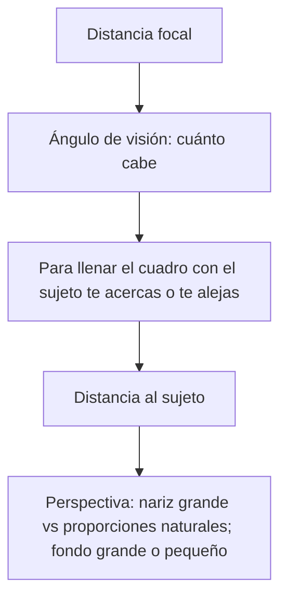

# Distancia focal y tipos de lente

Parte de: [[30-Fotografia/01 Fundamentos de la cámara/_Índice Fundamentos de la cámara|Fundamentos de la cámara]]

> [!info] Cómo avanzar
> `progreso`: **pendiente** → **viendo** (estudiando) → **visto** (contestaste la autoevaluación sin abrir las respuestas) → **dominado** (hiciste el laboratorio o lo aplicaste de verdad).

## Contenido

### Qué es
La **distancia focal** (en milímetros) es la distancia entre el centro óptico del lente y el sensor cuando enfocas a infinito. En la práctica, lo que te importa es su efecto: decide el **ángulo de visión**. Focal corta = ves mucho (gran angular). Focal larga = ves poco y "acercado" (telefoto). Para comparar entre cámaras se usa la focal **equivalente** a formato completo (ver [[Tamaño de sensor y factor de recorte]]).

Rangos típicos (equivalentes):
- **Ultra gran angular**: < 20 mm. Interiores, arquitectura, paisaje dramático.
- **Gran angular**: 24–35 mm. Calle, viaje, paisaje, grupos.
- **Normal**: ≈ 40–55 mm. Se parece a como "vemos" sin exagerar.
- **Telefoto corto**: 70–135 mm. Retrato, detalles.
- **Telefoto largo**: 200 mm o más. Fauna, deporte, Luna.

Tu iPhone 15 Pro trae tres cámaras: **0.5x ≈ 13 mm**, **1x ≈ 24 mm** y **3x ≈ 77 mm**, más recortes de 28 y 35 mm a partir de la principal. La Osmo Pocket 4P combina un 20 mm y un 60 mm equivalentes. Ver [[iPhone 15 Pro para foto y video]] y [[DJI Osmo Pocket 4P]].

### Cómo funciona
La focal decide **cuánto cabe** en el cuadro; la **distancia al sujeto** decide la **perspectiva** (la relación de tamaño entre lo cercano y lo lejano). Son cosas distintas que se confunden mucho:

Si haces un retrato con 0.5x tienes que pegarte a la cara para llenarla; a 30 cm la nariz está mucho más cerca que las orejas y se ve enorme. Con 3x te alejas a 2 m para el mismo encuadre y las proporciones se ven naturales, y además el fondo se ve "más grande" y cercano (compresión aparente). Si tomas un gran angular desde 2 m y recortas el centro, la perspectiva es **idéntica** a la del telefoto: lo que la cambió fue tu posición.

**Tipos de lente por construcción**:
- **Fijo (prime)**: una sola focal. Suele ser más luminoso (f/1.4–f/2), ligero y nítido, y te obliga a moverte (eso educa el encuadre).
- **Zoom**: rango de focales. Más versátil; normalmente menos luminoso (f/3.5–5.6 en kits) o más pesado y caro si es f/2.8 constante.
- **Macro**: enfoca muy cerca con ampliación 1:1. Ver [[Fotografía macro]].

### Ejemplo
Ejercicio "misma cara, tres distancias" con el iPhone:
1. Pide a alguien que se siente frente a una pared con algo de fondo.
2. Toma un retrato de medio cuerpo con **0.5x** (te acercas mucho), otro con **1x** y otro con **3x** (te alejas), cuidando que la persona ocupe lo mismo en el cuadro.
3. Compara: tamaño de la nariz, anchura de la cara, cuánto fondo se ve y qué tan grande se ve ese fondo.

Con la a6700 repite con un zoom de kit a 16 mm y a 50 mm. Para igualar la 3x del iPhone (≈ 77 mm eq.) en la a6700 necesitas 77 ÷ 1.5 ≈ **51 mm** reales: un 50 mm.

### Cuándo usarlo y cuándo no
- **Retrato**: 3x en el iPhone, 50–85 mm reales en la a6700. Evita 0.5x cerca de caras.
- **Cuarto pequeño o arquitectura**: 0.5x, pero mantén el teléfono **nivelado** (sin inclinarlo arriba o abajo) para que las verticales no converjan, y no dejes personas en las orillas: el ultra gran angular las estira.
- **Paisaje**: gran angular con primer plano interesante, o telefoto para aislar montañas y capas. Ver [[Punto de vista y capas de profundidad]].
- **Calle y viaje**: 24–35 mm equivalentes son un buen punto medio.

### Errores comunes
1. **"El telefoto aplana la cara por la focal."** Lo que la aplana es que te alejas. La focal solo te permite encuadrar igual desde más lejos.
2. **Usar zoom digital en lugar de caminar.** Pasar de 3x a 5x en el iPhone recorta la imagen y pierde detalle; acércate o recorta después con criterio.
3. **Gran angular sin primer plano.** Todo se ve pequeño y lejano; el gran angular pide algo cercano que dé escala.
4. **Ignorar la distorsión en orillas.** Las caras en las esquinas del 0.5x se deforman; ponlas hacia el centro.

### Para profundizar
- [Understanding Camera Lenses: Focal Length & Aperture (Cambridge in Colour)](https://www.cambridgeincolour.com/tutorials/camera-lenses.htm)
- [Using Wide Angle Lenses (Cambridge in Colour)](https://www.cambridgeincolour.com/tutorials/wide-angle-lenses.htm)
- [Using Telephoto Lenses (Cambridge in Colour)](https://www.cambridgeincolour.com/tutorials/telephoto-lenses.htm)
- [iPhone 15 Pro — especificaciones técnicas (Apple)](https://support.apple.com/en-us/111829)

## Ejercicios

Resuélvelos en papel o en la herramienta; la solución está plegada.

> [!question]- Quieres un retrato de medio cuerpo sin deformar la nariz. ¿Qué cámara del iPhone usas y por qué?
> La **3x (≈77 mm)**: te obliga a alejarte, y la mayor distancia da proporciones faciales más naturales que acercarte con la 0.5x.

> [!question]- Estás dentro de un cuarto pequeño y quieres que se vea todo. ¿Qué cámara eliges y qué cuidas?
> La **0.5x (≈13 mm)**. Cuida mantener el teléfono nivelado (sin inclinar arriba/abajo) para que las paredes no converjan, y no pongas personas cerca de las orillas porque se deforman.

> [!question]- ¿Qué focal real necesitas en la a6700 para igualar el ángulo de la 3x del iPhone (≈77 mm)?
> 77 / 1.5 ≈ **51 mm**: un 50 mm en la a6700 da un encuadre muy parecido.

## Autoevaluación

Contesta primero en voz alta o en papel; luego despliega la respuesta.

> [!question]- ¿Qué es la distancia focal y qué controla en la foto?
> La distancia (en mm) del centro óptico al sensor cuando enfoca a infinito. Controla el **ángulo de visión**: focal corta = más amplio (gran angular); focal larga = más cerrado (telefoto).

> [!question]- ¿Qué tres focales equivalentes trae el iPhone 15 Pro?
> Ultra gran angular **0.5x ≈ 13 mm**, principal **1x ≈ 24 mm** y telefoto **3x ≈ 77 mm**. La app nativa también ofrece recortes de 28 y 35 mm a partir de la principal. Ver [[iPhone 15 Pro para foto y video]].

> [!question]- ¿Qué diferencia hay entre un lente fijo (prime) y un zoom?
> El **fijo** tiene una sola focal: suele ser más luminoso, ligero y nítido, y te obliga a moverte. El **zoom** cubre un rango: más versátil, pero normalmente menos luminoso o más pesado.

> [!question]- Error común: "el telefoto aplana la cara por la focal". ¿Qué es lo que realmente cambia la perspectiva?
> La **distancia al sujeto**. Con telefoto te alejas para encuadrar igual, y desde más lejos las proporciones se ven más naturales. Si recortas una foto de gran angular tomada desde el mismo lugar, la perspectiva es idéntica.

## Práctica

- [[Práctica Foto 01 - Las tres cámaras del iPhone y los formatos]]

