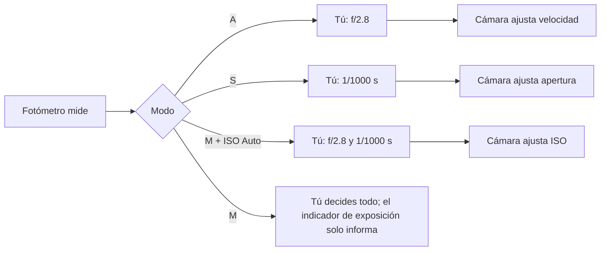

# Modos de disparo (Auto, P, A, S y M)

Parte de: [[30-Fotografia/01 Fundamentos de la cámara/_Índice Fundamentos de la cámara|Fundamentos de la cámara]]

> [!info] Cómo avanzar
> `progreso`: **pendiente** → **viendo** (estudiando) → **visto** (contestaste la autoevaluación sin abrir las respuestas) → **dominado** (hiciste el laboratorio o lo aplicaste de verdad).

## Contenido

### Qué es
Los modos de disparo deciden **quién controla cada lado del triángulo de exposición** (apertura, velocidad e ISO; ver [[Triángulo de exposición]]): tú o la cámara. No cambian la calidad del archivo; cambian qué decisiones creativas tomas tú. En la rueda de la a6700 verás, entre otros, **Auto, P, A, S y M**.

| Modo | Tú eliges | La cámara elige | Para qué |
|---|---|---|---|
| Auto | Nada (solo encuadre) | Todo, incluso flash y escena | Salir del paso |
| **P** (programa) | ISO, compensación; puedes "rotar" combinaciones | Apertura y velocidad | Fotos rápidas con algo de control |
| **A** (prioridad de apertura) | Apertura | Velocidad (e ISO si está en Auto) | Controlar profundidad de campo |
| **S** (prioridad de velocidad) | Velocidad | Apertura (e ISO si está en Auto) | Controlar movimiento |
| **M** (manual) | Apertura y velocidad (e ISO) | Nada, o solo el ISO si lo dejas en Auto | Luz constante, control total |

### Cómo funciona
El fotómetro mide la escena y propone una exposición "correcta" (ver [[Medición de luz (matricial, ponderada y puntual)]]). En los modos semiautomáticos, la cámara mueve el valor que tú **no** fijaste para alcanzar esa exposición:

En **A**, si eliges f/1.8 en un retrato, la cámara pondrá la velocidad que haga falta. En **S**, si eliges 1/1000 s para congelar a un niño corriendo, la cámara abrirá el diafragma; si no le alcanza, la foto sale oscura (o sube ISO si está en Auto).

**M con ISO automático** es muy popular en fauna, deporte y eventos: fijas la apertura que quieres (fondo) **y** la velocidad que necesitas (movimiento), y el ISO flota para exponer bien. La **compensación de exposición** sigue funcionando en ese caso porque mueve el ISO (ver [[Compensación de exposición]]).

### Ejemplo
Tres situaciones con la a6700:
1. **Retrato en el parque**: modo **A**, f/2 con un lente luminoso, ISO Auto. Vigila que la velocidad no baje de ≈ 1/125 s.
2. **Niños corriendo**: modo **S** a 1/1000 s, o **M** con f/2.8, 1/1000 s e ISO Auto. Enfoque AF-C (ver [[Modos de enfoque automático (AF-S, AF-C y seguimiento)]]).
3. **Retrato con luz de ventana constante** o paisaje en tripié: **M** con ISO 100; ajustas una vez y todas las fotos salen iguales.

**En el iPhone** la apertura de cada cámara es fija, así que la app nativa trabaja como un "P" muy inteligente. Con una app manual puedes fijar velocidad e ISO: eso imita **S** (fijas velocidad y dejas ISO automático) o **M** (fijas ambos). Blackmagic Camera ofrece estos controles para **video** (ver [[Blackmagic Camera (app)]]); para fotos fijas necesitas una app con modo foto manual, por ejemplo la cámara Profesional de [[Lightroom móvil (versión gratuita)]].

### Cuándo usarlo y cuándo no
- **A**: tu modo por defecto para retrato, paisaje, producto y viaje. La profundidad de campo es la decisión creativa más común.
- **S**: cuando el movimiento manda (deporte, mascotas, agua sedosa en tripié) y la luz cambia.
- **M**: luz constante (estudio, flash manual, noche con tripié, panorámicas y time-lapse para que no "parpadee" la exposición).
- **P o Auto**: cuando le pasas la cámara a alguien o no hay tiempo. No es un pecado.

### Errores comunes
1. **Quedarse en Auto "porque M es de profesionales".** A y S son fáciles y ya te dan el control que importa. Empieza con A.
2. **Modo A en interiores sin vigilar la velocidad.** La cámara baja a 1/20 s y salen fotos movidas. Configura una velocidad mínima con ISO Auto o usa M + ISO Auto.
3. **Modo S con una velocidad imposible.** Si el lente no abre más, la foto sale oscura; el número de apertura parpadea como aviso.
4. **M con ISO fijo y luz cambiante.** Cada foto sale distinta; usa ISO Auto o revisa el indicador de exposición.

### Para profundizar
- [Guía de ayuda α6700 (Sony)](https://helpguide.sony.net/ilc/2320/v1/en/)
- [Understanding Camera Exposure (Cambridge in Colour)](https://www.cambridgeincolour.com/tutorials/camera-exposure.htm)
- [Using Camera Shutter Speed Creatively (Cambridge in Colour)](https://www.cambridgeincolour.com/tutorials/camera-shutter-speed.htm)

## Autoevaluación

Contesta primero en voz alta o en papel; luego despliega la respuesta.

> [!question]- ¿Qué controlas tú y qué decide la cámara en el modo **A** (prioridad de apertura)?
> Tú eliges la **apertura** (y normalmente el ISO o ISO automático); la cámara calcula la **velocidad**. Ideal para controlar la profundidad de campo.

> [!question]- ¿Cuándo conviene **S** (prioridad de velocidad)?
> Cuando lo importante es el movimiento: congelar deporte (1/1000 s o más) o barridos intencionales. Tú fijas la velocidad y la cámara ajusta la apertura.

> [!question]- ¿Qué es **M** con ISO automático y por qué es popular?
> Fijas apertura y velocidad y la cámara ajusta solo el ISO para lograr la exposición. Combinas control creativo con adaptación a la luz; la compensación de exposición sigue funcionando en muchas cámaras.

> [!question]- El iPhone tiene apertura fija. ¿Qué "modo" puedes imitar con una app manual de foto como la cámara Profesional de Lightroom móvil?
> Básicamente **M** o **S**: fijas velocidad e ISO (y balance de blancos); la apertura no cambia en el iPhone 15 Pro. Para fotos usa la cámara Profesional de [[Lightroom móvil (versión gratuita)]] (u otra app que dispare fotos, p. ej. en DNG); Blackmagic Camera solo graba video, así que sirve para practicar estos controles en video, no para fotos. En la a6700 sí podrás usar A, S y M completos.

## Práctica

- [[Práctica Foto 02 - Velocidad, ISO y profundidad de campo]]

