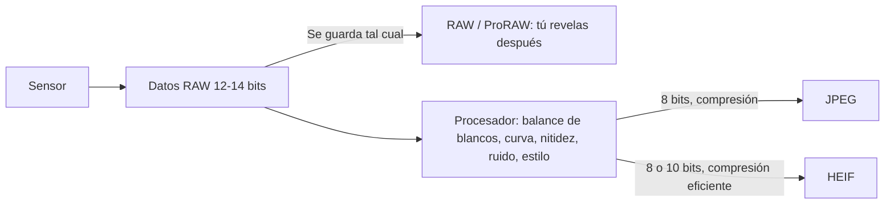

# RAW vs JPEG y HEIF

Parte de: [[30-Fotografia/01 Fundamentos de la cámara/_Índice Fundamentos de la cámara|Fundamentos de la cámara]]

> [!info] Cómo avanzar
> `progreso`: **pendiente** → **viendo** (estudiando) → **visto** (contestaste la autoevaluación sin abrir las respuestas) → **dominado** (hiciste el laboratorio o lo aplicaste de verdad).

## Contenido

### Qué es
Cuando disparas, el sensor genera datos crudos. La cámara puede **guardarlos tal cual** (RAW) o **procesarlos y comprimirlos** en una imagen terminada (JPEG o HEIF).

- **RAW**: los datos del sensor casi sin interpretar, con 12–14 bits por canal. No es una "foto" todavía: hay que revelarla (balance de blancos, contraste, nitidez, ruido). En la a6700 son archivos ARW, con opción comprimida o comprimida sin pérdida.
- **JPEG**: imagen terminada de 8 bits, comprimida con pérdida. Universal, ligera, lista para compartir.
- **HEIF/HEIC**: imagen terminada con mejor compresión que JPEG (≈ mitad de tamaño a calidad similar) y opción de 10 bits. Es el formato por defecto del iPhone y la a6700 también lo ofrece.
- **Apple ProRAW**: un DNG que guarda datos con más profundidad **pero después** de la fusión de varios cuadros del iPhone (Deep Fusion, HDR, reducción de ruido). Es un RAW "computacional": conserva flexibilidad de edición y aprovecha el procesamiento de Apple.

### Cómo funciona

En el JPEG, la cámara **decide por ti** y luego tira lo que no usó: altas luces apenas fuera del rango y matices de color desaparecen. Con 8 bits tienes 256 niveles por canal; con 14 bits, 16,384. Esa reserva es la que te permite rescatar un cielo, corregir el balance de blancos sin degradar la imagen o subir sombras 2 pasos sin bandas.

En el iPhone 15 Pro activas ProRAW en **Ajustes > Cámara > Formatos** (opción "ProRAW y control de resolución"); luego aparece el botón RAW en la app Cámara. Un ProRAW de 48 MP pesa del orden de 75 MB según Apple, contra unos pocos MB de un HEIF.

### Ejemplo
Ejercicio en la a6700: configura la calidad en **RAW + JPEG** y toma una escena con ventana brillante y cuarto en sombra.
1. Abre el JPEG en tu editor y baja altas luces al máximo: la ventana se queda blanca y plana.
2. Abre el RAW (ver [[Revelado RAW vs retoque]]) y haz lo mismo: aparece detalle del exterior.
3. Cambia el balance de blancos de "Luz día" a "Tungsteno" en ambos: el JPEG se mancha; el RAW cambia limpio.

Repite en el iPhone con una foto HEIF y otra ProRAW de la misma escena.

### Cuándo usarlo y cuándo no
**RAW / ProRAW** cuando:
- La escena tiene mucho contraste o luz mezclada.
- Es una foto importante que vas a editar o imprimir.
- Haces paisaje, noche, producto o retrato cuidado.

**HEIF/JPEG** cuando:
- Disparas ráfagas largas (deporte) y el búfer o la tarjeta se llenan rápido.
- Vas a compartir de inmediato o son fotos casuales y documentos.
- El espacio es limitado (un ProRAW de 48 MP ocupa decenas de veces más).

Un punto medio en la a6700 es **RAW + JPEG/HEIF**: el JPEG para ver y compartir, el RAW como "negativo". Si vas a compartir HEIF fuera del ecosistema Apple, algunos sitios no lo aceptan; exporta a JPEG.

### Errores comunes
1. **"El RAW se ve peor que el JPEG."** El RAW se muestra plano, sin contraste ni nitidez, porque no está revelado. El JPEG ya trae la receta aplicada. Revela el RAW y supera al JPEG.
2. **Disparar RAW y no editar nunca.** Ocupas espacio sin ganar nada; si no vas a revelar, usa HEIF.
3. **Creer que el RAW lo arregla todo.** No recupera altas luces totalmente quemadas ni corrige el desenfoque o el movimiento. Ver [[Histograma y rango dinámico]].
4. **Olvidar el espacio y el respaldo.** RAW llena tarjetas y discos; planea tu almacenamiento. Ver [[Respaldo 3-2-1 de fotos y videos]].

### Para profundizar
- [Acerca de Apple ProRAW (Apple)](https://support.apple.com/119916)
- [Tomar fotos Apple ProRAW con el iPhone (Apple)](https://support.apple.com/guide/iphone/iphae1e882a3/ios)
- [Understanding RAW Files (Cambridge in Colour)](https://www.cambridgeincolour.com/tutorials/RAW-file-format.htm)

## Autoevaluación

Contesta primero en voz alta o en papel; luego despliega la respuesta.

> [!question]- ¿Qué es un archivo RAW?
> Los datos casi sin procesar del sensor más metadatos. No es una imagen terminada: necesitas "revelarla" (darktable, RawTherapee, Lightroom). Guarda más información de tonos y color que un JPEG.

> [!question]- ¿Qué es Apple ProRAW y en qué se diferencia de un RAW clásico?
> Es un **DNG** que ya incluye parte del procesamiento computacional del iPhone (fusión de tomas, reducción de ruido) pero conserva la latitud de edición de un RAW. En la cámara principal puede ser de 48 MP. Pesa mucho más que un HEIF.

> [!question]- ¿Cuándo prefieres HEIF/JPEG en vez de RAW?
> Para fotos del día a día, ráfagas, cuando no vas a editar o cuando importa el espacio. HEIF guarda más calidad que JPEG en menos espacio, pero no todos los programas lo abren.

> [!question]- Error común: "el RAW se ve peor que el JPEG, así que el JPEG es mejor". ¿Qué está pasando?
> El JPEG ya trae contraste, color y nitidez aplicados por la cámara; el RAW se muestra "plano" a propósito. Tras revelarlo, el RAW permite recuperar luces y sombras que el JPEG ya perdió.

## Práctica

- [[Práctica Foto 01 - Las tres cámaras del iPhone y los formatos]]

