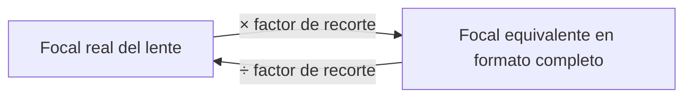

# Tamaño de sensor y factor de recorte

Parte de: [[30-Fotografia/01 Fundamentos de la cámara/_Índice Fundamentos de la cámara|Fundamentos de la cámara]]

> [!info] Cómo avanzar
> `progreso`: **pendiente** → **viendo** (estudiando) → **visto** (contestaste la autoevaluación sin abrir las respuestas) → **dominado** (hiciste el laboratorio o lo aplicaste de verdad).

## Contenido

### Qué es
El **sensor** es la superficie que recibe la luz. Su tamaño físico decide cuánta luz total captura la foto y qué "ángulo" te da un lente. El **factor de recorte** compara la diagonal de un sensor con la de un sensor de **formato completo** (35 mm, 36 × 24 mm). Sirve para traducir cualquier lente a un lenguaje común: la "focal equivalente".

Tus equipos (valores aproximados):

| Equipo | Sensor | Factor de recorte |
|---|---|---|
| Sony a6700 | APS-C, 23.3 × 15.5 mm | ≈ 1.5 (1.55 exacto) |
| Osmo Pocket 4P (cámara principal) | 1" (≈ 13.2 × 8.8 mm) | ≈ 2.7 |
| iPhone 15 Pro (principal) | ≈ 1/1.28" | ≈ 3.5 |

### Cómo funciona
Un lente proyecta un círculo de imagen; el sensor "recorta" un rectángulo de ese círculo. Un sensor más chico recorta un pedazo más pequeño del centro, así que **ves un ángulo más cerrado** con el mismo lente. El lente no cambia: un 50 mm sigue siendo 50 mm, sigue enfocando igual y su número f es el mismo. Lo que cambia es **el encuadre**.



Fórmulas:
- **Equivalente = focal real × factor**. Un 16 mm en la a6700 → 16 × 1.5 = **24 mm** equivalente (gran angular clásico).
- **Focal real = equivalente ÷ factor**. Para un encuadre "normal" de 50 mm en la a6700 → 50 ÷ 1.5 ≈ **33 mm**; en la práctica buscas un 33 mm o 35 mm.
- Un zoom **18-135 mm** en APS-C cubre ≈ **27-203 mm** equivalentes.

Por eso los "24 mm" del iPhone son un número **equivalente**: el lente físico de la cámara principal mide unos 6–7 mm (lo ves en los metadatos EXIF), pero sobre un sensor pequeño da el mismo ángulo que un 24 mm en formato completo. Igual con la Pocket 4P: su "20 mm" equivalente corresponde a un lente real de unos 7 mm.

Verificación rápida con Python:

```python
import math
diag_ff = math.hypot(36, 24)        # 43.27 mm
diag_apsc = math.hypot(23.3, 15.5)  # 27.98 mm
factor = diag_ff / diag_apsc        # ≈ 1.55
print(16 * 1.5, 50 / 1.5, 18 * 1.5, 135 * 1.5)  # 24, 33.3, 27, 202.5
```

**Ruido y tamaño**: a igual encuadre y exposición, un sensor más grande junta **más luz total** (más fotones), y la señal crece más rápido que el ruido de fotones. El área del APS-C (≈ 361 mm²) es unas 5 veces la del sensor principal del iPhone, alrededor de 2.3 pasos más de luz total. Formato completo (864 mm²) le saca otros ≈ 1.3 pasos al APS-C. Ver [[ISO y ruido digital]].

### Ejemplo
Quieres reproducir en la a6700 los encuadres que ya conoces del iPhone:
- 0.5x (≈ 13 mm eq.) → 13 ÷ 1.5 ≈ **9–10 mm** reales (ultra gran angular APS-C).
- 1x (24 mm eq.) → **16 mm** reales.
- 3x (≈ 77 mm eq.) → ≈ **51 mm** reales: un 50 mm.

Ejercicio: toma la misma escena con el iPhone en 1x y con la a6700 a 16 mm desde el mismo punto. El encuadre será casi idéntico; compara ruido en sombras y desenfoque del fondo.

### Cuándo usarlo y cuándo no
- **Usa la equivalencia** para comparar ángulos entre cámaras, elegir lentes y aplicar la regla de velocidad mínima a pulso (ver [[Velocidad de obturación y movimiento]]).
- **No la uses** para la exposición: f/1.8 da la misma luminosidad por unidad de área en cualquier sensor. Lo que sí cambia con el sensor es la profundidad de campo a igual encuadre (también se "multiplica" el número f para comparar desenfoque).

### Errores comunes
1. **Creer que el lente "se vuelve" más largo en APS-C.** La focal real no cambia; solo ves un recorte del centro.
2. **Comprar un 50 mm esperando un "normal" en la a6700.** Te da ≈ 75 mm equivalente: excelente para retrato, cerrado para interiores.
3. **Comparar el f/1.78 del iPhone con un f/1.8 de la Sony para desenfoque.** En equivalencia, el iPhone principal se comporta como ≈ f/6.3 en formato completo para profundidad de campo.
4. **Pensar que más megapíxeles = sensor más grande.** Son cosas distintas: puedes tener 48 MP en un sensor pequeño.

### Para profundizar
- [Digital Camera Sensor Sizes (Cambridge in Colour)](https://www.cambridgeincolour.com/tutorials/digital-camera-sensor-size.htm)
- [Understanding Digital Camera Sensors (Cambridge in Colour)](https://www.cambridgeincolour.com/tutorials/camera-sensors.htm)
- [Sony α6700 — lista de características (Sony)](https://www.sony.co.nz/interchangeable-lens-cameras/products/ilce-6700/feature-list)

## Ejercicios

Resuélvelos en papel o en la herramienta; la solución está plegada.

> [!question]- Tienes un lente de 16 mm para la a6700 (factor 1.5). ¿A qué focal equivale en formato completo?
> 16 × 1.5 = **24 mm** equivalente (gran angular, parecido a la cámara principal del iPhone).

> [!question]- Quieres un encuadre equivalente a 50 mm ("normal") en la a6700. ¿Qué focal real buscas?
> 50 / 1.5 ≈ **33 mm**; en la práctica, un 35 mm (≈ 52.5 mm equivalente).

> [!question]- Un zoom de 18-135 mm en APS-C, ¿qué rango equivalente cubre?
> 18 × 1.5 = 27 mm y 135 × 1.5 = 202.5 mm → **27–202.5 mm** equivalente.

## Autoevaluación

Contesta primero en voz alta o en papel; luego despliega la respuesta.

> [!question]- ¿Qué es el factor de recorte?
> La relación entre la diagonal de un sensor de formato completo (36×24 mm) y la de otro sensor. APS-C de Sony ≈ **1.5x**: un lente "ve" un ángulo como si fuera 1.5 veces más largo en formato completo.

> [!question]- ¿Cambia la distancia focal real de un lente al ponerlo en APS-C?
> No. Un 35 mm sigue siendo 35 mm; lo que cambia es el **ángulo de visión** (el sensor recorta el centro de la imagen). Por eso se habla de "equivalente": 35 mm en APS-C ≈ 52.5 mm en formato completo.

> [!question]- ¿Qué significan los "24 mm" del iPhone si su lente físico mide unos pocos milímetros?
> Apple da la focal **equivalente a formato completo** para que compares ángulos de visión. El lente real es mucho más corto porque el sensor es pequeño.

> [!question]- ¿Por qué un sensor más grande suele tener menos ruido?
> Captura más luz total para el mismo encuadre y exposición, y normalmente sus fotositos son más grandes. Más luz = mejor relación señal/ruido.

## Práctica

- [[Práctica Foto 01 - Las tres cámaras del iPhone y los formatos]]

