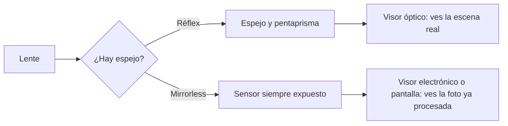

# Tipos de cámara (celular, compacta, mirrorless y réflex)

Parte de: [[30-Fotografia/01 Fundamentos de la cámara/_Índice Fundamentos de la cámara|Fundamentos de la cámara]]

> [!info] Cómo avanzar
> `progreso`: **pendiente** → **viendo** (estudiando) → **visto** (contestaste la autoevaluación sin abrir las respuestas) → **dominado** (hiciste el laboratorio o lo aplicaste de verdad).

## Contenido

### Qué es
Una cámara es, en el fondo, una caja oscura con tres piezas: un **lente** que forma la imagen, un **sensor** que la convierte en datos y un **procesador** que decide cómo se ve el archivo final. Lo que cambia entre un celular, una compacta, una mirrorless y una réflex (DSLR) es el tamaño de esas piezas, cuánto control te dan y cuánto "piensa" el software por ti.

- **Celular** (tu iPhone 15 Pro): sensores pequeños, varias cámaras fijas en lugar de un zoom y muchísimo procesamiento (fotografía computacional).
- **Compacta**: lente zoom integrado y sensor intermedio; hoy casi la reemplazó el celular, salvo modelos de sensor de 1" o con zoom muy largo.
- **Mirrorless** (tu Sony a6700): lente intercambiable, sensor grande (APS-C en tu caso) y visor electrónico.
- **Réflex (DSLR)**: lente intercambiable con un **espejo** que manda la luz a un visor óptico; al disparar, el espejo sube y la luz llega al sensor.

La DJI Osmo Pocket 4P es un caso especial: una cámara de video con estabilizador mecánico (gimbal) y sensor de 1" que también toma fotos. Ver [[DJI Osmo Pocket 4P]].

### Cómo funciona
La diferencia mirrorless vs réflex está en **cómo ves la escena antes de disparar**:

En la réflex ves la luz real, pero no ves la exposición ni el balance de blancos hasta revisar la foto. En la mirrorless el visor muestra **la foto tal como saldrá** (brillo, color, histograma, zebras), y el enfoque se calcula en el propio sensor, lo que permite detección de ojos y seguimiento en casi todo el cuadro. Por eso la industria migró a mirrorless: cuerpos más pequeños y enfoque más inteligente.

El celular va un paso más allá: dispara varios cuadros antes y después de que toques el botón y los combina (HDR, modo Noche, Deep Fusion). Eso compensa su sensor pequeño. Ver [[Fotografía computacional en celulares]].

### Ejemplo
Un domingo en un parque con las tres cámaras:
1. **iPhone 15 Pro**: foto de grupo a mediodía con sol duro. El HDR automático rescata cielo y sombras de un tiro; listo para compartir en segundos.
2. **Osmo Pocket 4P**: caminas grabando a tus sobrinos; el gimbal elimina la vibración y de ahí extraes una foto o tomas una con el teléfono conectado.
3. **Sony a6700**: al atardecer, retrato con un lente luminoso (por ejemplo un 50 mm f/1.8). Fondo realmente desenfocado, piel sin "acuarela" de procesamiento y un RAW con margen para editar.

Las tres sirven; la diferencia aparece en las condiciones límite.

### Cuándo usarlo y cuándo no
**El celular gana** en: llevarlo siempre, escenas con mucho contraste en luz de día (su HDR es excelente), compartir rápido y fotos casuales. "La mejor cámara es la que traes contigo".

**La a6700 gana** cuando:
- Hay **poca luz y movimiento** a la vez (un concierto, niños en interior): el sensor grande y el lente luminoso permiten velocidades rápidas con menos ruido.
- Quieres **desenfoque óptico real** y separación del sujeto.
- Necesitas **alcance** (telefoto largo para fauna o deporte) o **seguimiento de enfoque** de sujetos rápidos.
- Vas a **editar a fondo** o imprimir grande.

**La réflex** hoy solo tiene sentido si ya tienes lentes para ella o la consigues barata usada.

### Errores comunes
1. **Creer que la cámara cara hace la foto.** Composición, luz y momento pesan más que el sensor. Una buena foto con iPhone le gana a una foto mal pensada con cualquier cámara. Aprende fundamentos primero; el equipo amplía tus límites, no tu ojo.
2. **Comprar cuerpo caro y usar el lente del kit para todo.** El lente influye tanto como el cuerpo en nitidez y desenfoque. Ver [[Lentes para la Sony a6700]].
3. **Usar la a6700 siempre en Auto.** Así pierdes justo lo que la hace mejor: control de apertura y velocidad. Ver [[Modos de disparo (Auto, P, A, S y M)]].
4. **Comparar fotos sin editar.** El JPEG/HEIF del celular ya viene "maquillado"; el RAW de la Sony se ve plano hasta que lo revelas. Ver [[RAW vs JPEG y HEIF]].

### Para profundizar
- [Sony α6700 — lista de características (Sony)](https://www.sony.co.nz/interchangeable-lens-cameras/products/ilce-6700/feature-list)
- [iPhone 15 Pro — especificaciones técnicas (Apple)](https://support.apple.com/en-us/111829)
- [Compact vs. Digital SLR Cameras (Cambridge in Colour)](https://www.cambridgeincolour.com/tutorials/compact-vs-digital-slr-cameras.htm)

## Autoevaluación

Contesta primero en voz alta o en papel; luego despliega la respuesta.

> [!question]- ¿Qué diferencia a una mirrorless de una réflex (DSLR)?
> La **réflex** tiene un espejo que manda la imagen a un visor óptico; al disparar el espejo se levanta. La **mirrorless** no tiene espejo: el sensor manda la imagen a un visor electrónico o a la pantalla. Resultado: cuerpos más compactos y lo que ves ya muestra la exposición final.

> [!question]- ¿Qué ventaja real tiene un celular como el iPhone 15 Pro frente a una cámara dedicada?
> Siempre lo traes, y la **fotografía computacional** (fusión de varias tomas, modo Noche, HDR automático) compensa su sensor pequeño. Para aprender exposición y composición es suficiente. Ver [[iPhone 15 Pro para foto y video]].

> [!question]- ¿Cuándo sí notarás la diferencia al pasar a la Sony a6700?
> Con poca luz (sensor más grande = menos ruido), con desenfoque de fondo real (apertura variable y lentes luminosos), con sujetos rápidos (AF de seguimiento y ráfaga) y al cambiar de lente según la escena. Ver [[Sony a6700]].

> [!question]- Error común: "necesito una cámara cara para tomar buenas fotos". ¿Por qué no es cierto?
> La luz, la composición y el momento pesan más que el equipo. Una cámara mejor amplía lo que puedes hacer en situaciones difíciles, pero no arregla una foto mal pensada. Aprende primero con lo que tienes.

## Práctica

- [[Práctica Foto 01 - Las tres cámaras del iPhone y los formatos]]

