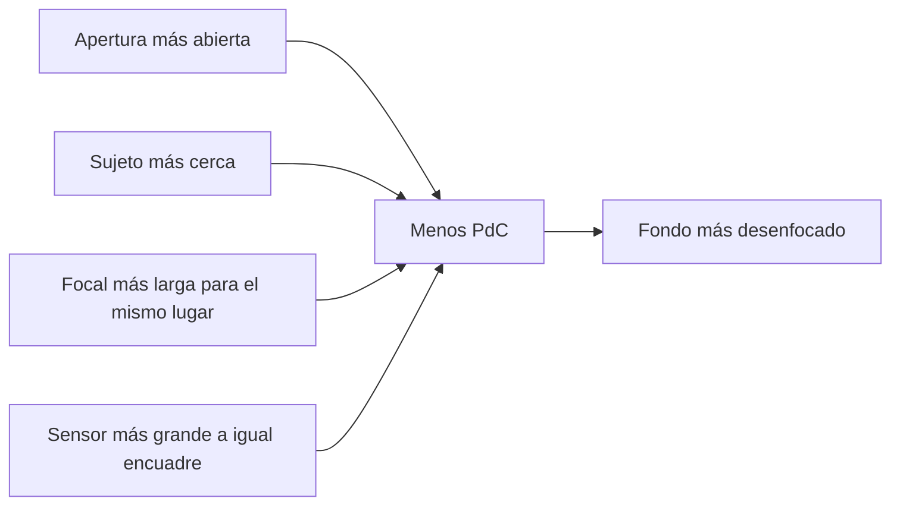

# Apertura y profundidad de campo

Parte de: [[30-Fotografia/02 Exposición/_Índice Exposición|Exposición]]

> [!info] Cómo avanzar
> `progreso`: **pendiente** → **viendo** (estudiando) → **visto** (contestaste la autoevaluación sin abrir las respuestas) → **dominado** (hiciste el laboratorio o lo aplicaste de verdad).

## Contenido

### Qué es
La **apertura** es el diafragma del lente: un agujero de tamaño ajustable, expresado como número f (f/1.8, f/4, f/11). La **profundidad de campo** (PdC) es la zona, delante y detrás del punto enfocado, que se ve aceptablemente nítida. Apertura grande (f/1.8) = PdC corta, fondo desenfocado. Apertura pequeña (f/11) = PdC amplia, casi todo enfocado.

### Cómo funciona
Cuatro factores mueven la PdC:



1. **Apertura**: cada paso de cierre amplía la PdC.
2. **Distancia al sujeto**: es el factor más fuerte. A la mitad de distancia, la PdC se reduce a casi una cuarta parte.
3. **Focal**: a igual distancia, una focal larga da menos PdC; a igual encuadre el efecto se iguala mucho, pero el telefoto **ve menos fondo**, y ese fondo se ve más borroso.
4. **Tamaño del sensor**: para el mismo encuadre, el sensor pequeño usa una focal real más corta y gana PdC. Por eso el iPhone casi siempre saca todo enfocado: su cámara principal (≈ 6.9 mm reales, f/1.78) se comporta como un 24 mm a ≈ f/6.3 en formato completo.

Números calculados con la fórmula de PdC (círculo de confusión c = 0.02 mm para APS-C):

```python
def hiper(f, N, c): return f * f / (N * c) + f
def pdc(f, N, c, s):
    H = hiper(f, N, c)
    cerca = s * (H - f) / (H + s - 2 * f)
    lejos = s * (H - f) / (H - s) if s < H else float("inf")
    return cerca, lejos
print(pdc(50, 1.8, 0.02, 2000))  # ≈ 1945–2058 mm: ≈ 11 cm de PdC
print(pdc(50, 8, 0.02, 2000))    # ≈ 1778–2285 mm: ≈ 51 cm
print(pdc(50, 1.8, 0.02, 1000))  # ≈ 987–1014 mm: ≈ 3 cm
```

Un 50 mm a f/1.8 a 2 m te da unos 11 cm nítidos: suficiente para una cara, con el fondo deshecho. A 1 m solo hay unos 3 cm: enfoca el ojo, no la nariz.

**Difracción**: al cerrar mucho, la luz se "abre" al pasar por el agujero pequeño y todo pierde nitidez. En la a6700 (píxeles de ≈ 3.8 µm) empieza a notarse desde f/8–f/11; a f/22 el disco de difracción mide ≈ 30 µm, unas 8 veces el píxel. Los lentes suelen ser más nítidos entre f/4 y f/8.

### Ejemplo
**Retrato con fondo desenfocado en la a6700**:
1. Usa la apertura más abierta del lente (f/1.8 en un 50 mm).
2. Acércate al sujeto (medio cuerpo o más cerrado).
3. Aleja al sujeto del fondo: 3–5 m de separación cambian todo.
Enfoca al ojo con detección de ojos y AF-C. Ver [[Modos de enfoque automático (AF-S, AF-C y seguimiento)]].

**Con el iPhone sin modo Retrato**: usa la telefoto 3x o la principal, acércate todo lo que permita el enfoque, y deja el fondo lejos. Con la principal a 50 cm la PdC es de unos 15 cm: un objeto pequeño sobre una mesa sí separa del fondo. El modo Retrato simula el desenfoque con un mapa de profundidad; útil, pero falla en cabello y bordes.

**Paisaje con flores en primer plano y montaña al fondo, a6700 con 16 mm**: f/8–f/11, enfocando cerca de la distancia hiperfocal (≈ 1.6 m a f/8): todo queda nítido desde ≈ 0.8 m hasta el infinito. Ver [[Distancia hiperfocal]].

### Cuándo usarlo y cuándo no
- **Abre (f/1.4–f/2.8)**: retrato, aislar un detalle, poca luz, fondos con luces para bokeh.
- **Medio (f/4–f/8)**: grupos (que todos los ojos estén nítidos), calle, producto, máxima nitidez del lente.
- **Cierra (f/8–f/11)**: paisaje y arquitectura. Más allá solo si necesitas una velocidad larga o PdC extrema y aceptas la difracción; si no, considera [[Focus stacking (apilado de enfoque)]].

### Errores comunes
1. **f/1.8 para un grupo en dos filas**: la segunda fila sale borrosa. Usa f/4–f/5.6 y aléjate un poco.
2. **Cerrar a f/22 "para que todo salga nítido"**: la difracción suaviza toda la imagen. Mejor f/8–f/11 y enfoque bien colocado.
3. **Culpar al lente del fondo poco desenfocado** cuando el problema es el fondo pegado al sujeto.
4. **Enfocar la punta de la nariz a f/1.8 a corta distancia**: el ojo queda fuera de la PdC.

### Para profundizar
- [Understanding Depth of Field (Cambridge in Colour)](https://www.cambridgeincolour.com/tutorials/depth-of-field.htm)
- [Understanding Camera Lenses: Focal Length & Aperture (Cambridge in Colour)](https://www.cambridgeincolour.com/tutorials/camera-lenses.htm)
- [Digital Camera Sensor Sizes (Cambridge in Colour)](https://www.cambridgeincolour.com/tutorials/digital-camera-sensor-size.htm)

## Ejercicios

Resuélvelos en papel o en la herramienta; la solución está plegada.

> [!question]- Con la a6700 quieres un retrato con fondo desenfocado. ¿Qué tres cosas haces?
> Abrir lo más posible (p. ej. f/1.8), acercarte al sujeto (o usar focal más larga) y **alejar al sujeto del fondo**.

> [!question]- Con el iPhone (apertura fija), ¿cómo logras más desenfoque de fondo real sin modo Retrato?
> Acercarte mucho al sujeto (o usar macro), y alejar el fondo lo más posible. Con la 3x también ayuda si el fondo queda lejos.

> [!question]- Paisaje con flores en primer plano y montaña al fondo en la a6700 con 16 mm. ¿Qué apertura aproximada eliges?
> Alrededor de **f/8**: buena profundidad sin difracción fuerte. Combínalo con [[Distancia hiperfocal]].

## Autoevaluación

Contesta primero en voz alta o en papel; luego despliega la respuesta.

> [!question]- ¿Qué es la profundidad de campo?
> La zona delante y detrás del punto de enfoque que se ve aceptablemente nítida. Puede ser "corta" (fondo muy desenfocado) o "amplia" (todo nítido).

> [!question]- Además de la apertura, ¿qué otros factores cambian la profundidad de campo?
> La **distancia al sujeto** (más cerca = menos profundidad), la **focal/encuadre** y el **tamaño del sensor** (con el mismo encuadre y apertura, un sensor más grande da menos profundidad).

> [!question]- ¿Por qué el iPhone casi siempre saca todo enfocado?
> Sensor pequeño y focales reales muy cortas dan mucha profundidad de campo aunque la apertura sea f/1.78. El modo Retrato **simula** el desenfoque con software y mapas de profundidad.

> [!question]- Error común: cerrar a f/22 "para que todo salga más nítido". ¿Qué problema aparece?
> La **difracción**: con aperturas muy cerradas la imagen pierde nitidez general. En APS-C la zona más nítida de la mayoría de los lentes suele estar alrededor de f/5.6–f/8.

## Práctica

- [[Práctica Foto 02 - Velocidad, ISO y profundidad de campo]]

