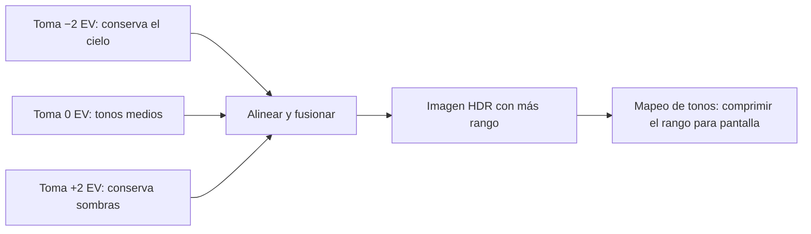

# Bracketing y HDR en fotografía

Parte de: [[30-Fotografia/02 Exposición/_Índice Exposición|Exposición]]

> [!info] Cómo avanzar
> `progreso`: **pendiente** → **viendo** (estudiando) → **visto** (contestaste la autoevaluación sin abrir las respuestas) → **dominado** (hiciste el laboratorio o lo aplicaste de verdad).

## Contenido

### Qué es
El **bracketing de exposición** (horquillado) es tomar varias fotos seguidas de la misma escena con exposiciones distintas: por ejemplo −2, 0 y +2 EV. **HDR** (alto rango dinámico) es combinar esas tomas en una sola imagen que conserva detalle tanto en altas luces como en sombras. Se necesita cuando la escena tiene **más rango dinámico** del que el sensor capta en una sola foto (ver [[Histograma y rango dinámico]]): interiores con ventanas, atardeceres con primer plano en sombra, calles con sol y sombra dura.

### Cómo funciona

1. **Captura**: cada toma cubre una parte del rango. Con tres tomas a ±2 EV amplías aproximadamente 4 pasos sobre una sola foto.
2. **Alineación y fusión**: el software alinea las tomas y elige o mezcla la información útil de cada una. Si algo se movió entre tomas (ramas, personas), aparecen "fantasmas"; los buenos programas tienen corrección de fantasmas.
3. **Mapeo de tonos**: una pantalla o impresión no muestra 18 pasos; hay que comprimir ese rango. Aquí se decide si se ve natural o "pintado".

En la a6700, el bracketing permite 3, 5, 7 o 9 cuadros con pasos de hasta 3 EV (según la ficha técnica). Úsalo en modo A (cambia la velocidad y mantiene la PdC) o en M con ISO fijo, y en ráfaga o con temporizador.

**El iPhone ya hace HDR automático** (Smart HDR): toma varios cuadros en cada foto y los fusiona en el momento. Funciona muy bien en escenas normales. El bracketing manual sigue siendo útil cuando:
- El contraste es extremo (sol dentro del cuadro, interior oscuro con ventana muy brillante).
- Quieres control total del resultado y archivos RAW de cada toma.
- Necesitas calidad para imprimir o para inmobiliaria/arquitectura.

### Ejemplo
**Interior con ventana con la a6700:**
1. Tripié, modo A a f/8, ISO 100, enfoque fijo (cámbialo a MF tras enfocar) y balance de blancos fijo.
2. Activa bracketing de 5 cuadros a 1 EV (o 3 a 2 EV) y temporizador de 2 s para no mover la cámara.
3. Dispara la serie y revisa: la toma más oscura debe tener la ventana sin quemar; la más clara, las sombras del cuarto con detalle.
4. Fusiona en un editor gratuito (por ejemplo darktable o la función de combinar HDR de Lightroom si la tienes) y ajusta tonos con moderación. Ver [[Unir HDR y panorámicas]].

**Con el iPhone**: toma la misma escena con la app nativa (HDR automático) y compárala con tu HDR de la a6700. Evalúa colores de la ventana, halos en los marcos y ruido en sombras.

### Cuándo usarlo y cuándo no
- **Sí**: paisaje con sol bajo, arquitectura e interiores, escenas estáticas.
- **No**: sujetos en movimiento rápido (deporte, niños), donde los fantasmas arruinan la fusión; mejor una sola toma RAW bien expuesta y recuperar sombras.
- **Alternativas**: un **filtro degradado** para cielos (ver [[Filtro degradado (GND)]]), agregar luz al interior con flash o esperar a que la luz se equilibre (hora azul).
- Si una sola toma RAW ya cubre el histograma sin quemar, no necesitas HDR.

### Errores comunes
1. **Halos alrededor de edificios o árboles**: vienen de un mapeo de tonos local muy agresivo (microcontraste exagerado). Baja la intensidad y la "claridad".
2. **Cielos grises y planos**: comprimiste demasiado el rango; las altas luces perdieron contraste. Deja que el cielo sea más brillante que el suelo, como en la realidad.
3. **Fantasmas**: algo se movió entre tomas. Usa corrección de fantasmas o elige escenas quietas.
4. **Tomas desalineadas o con enfoque distinto**: tripié, enfoque manual y balance de blancos fijo.
5. **Bracketing en modo S**: la apertura cambia entre tomas y la PdC no coincide; usa A o M.

### Para profundizar
- [Understanding Dynamic Range (Cambridge in Colour)](https://www.cambridgeincolour.com/tutorials/dynamic-range.htm)
- [High Dynamic Range (HDR) (Cambridge in Colour)](https://www.cambridgeincolour.com/tutorials/high-dynamic-range.htm)
- [darktable (editor RAW gratuito)](https://www.darktable.org/)

## Autoevaluación

Contesta primero en voz alta o en papel; luego despliega la respuesta.

> [!question]- ¿Qué es el bracketing de exposición?
> Tomar varias fotos de la misma escena con exposiciones distintas (p. ej. −2, 0, +2 EV) para luego elegir la mejor o combinarlas.

> [!question]- ¿Qué es una foto HDR y cuándo se necesita?
> La combinación de varias exposiciones para cubrir un rango dinámico mayor que el del sensor: interiores con ventana, contraluces fuertes, atardeceres.

> [!question]- El iPhone ya hace HDR automático. ¿Para qué hacer bracketing manual?
> Para controlar tú el resultado, evitar el "look" procesado y tener RAW que fusionar después (ver [[Unir HDR y panorámicas]]).

> [!question]- Error común en HDR: halos y cielos grises. ¿De qué vienen?
> Mapeo de tonos excesivo (demasiado contraste local). Usa ajustes suaves y deja que las sombras sigan siendo sombras.

## Práctica

- [[Práctica Foto 03 - Medición, compensación y bracketing]]

