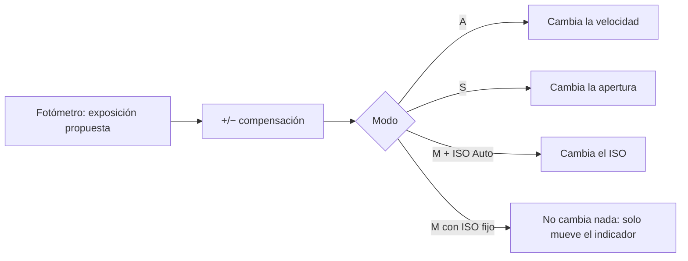

# Compensación de exposición

Parte de: [[30-Fotografia/02 Exposición/_Índice Exposición|Exposición]]

> [!info] Cómo avanzar
> `progreso`: **pendiente** → **viendo** (estudiando) → **visto** (contestaste la autoevaluación sin abrir las respuestas) → **dominado** (hiciste el laboratorio o lo aplicaste de verdad).

## Contenido

### Qué es
La **compensación de exposición** (EV ±) es la forma de decirle a la cámara: "tu medición está bien hecha, pero yo quiero la foto más clara (o más oscura)". Se expresa en pasos: +1 EV = el doble de luz, −1 EV = la mitad, normalmente en tercios (+0.3, +0.7). Funciona en los modos donde la cámara decide algo: P, A, S y **M con ISO automático**.

### Cómo funciona
El fotómetro intenta que todo salga gris medio (ver [[Medición de luz (matricial, ponderada y puntual)]]). La compensación mueve esa meta:

En **M con ISO fijo** la compensación no tiene efecto sobre la foto, porque tú fijaste los tres valores: la cámara no tiene nada que mover. En ese caso, en algunas cámaras solo desplaza la aguja del indicador.

Regla mental:
- **Escena más clara que gris medio** (nieve, playa, documento blanco, novia de blanco) → **compensa positivo** (+0.7 a +2).
- **Escena más oscura que gris medio** (fondo negro, traje oscuro, noche) → **compensa negativo** (−0.7 a −2).
- **Contraluz con el sujeto oscuro** → positivo, sabiendo que el fondo se aclarará.
- **Puesta de sol** → **negativo** (−0.7 a −1.3): conserva colores saturados en el cielo y deja siluetas; la cámara querría aclarar las sombras y lavaría el cielo.

### Ejemplo
**Persona a contraluz con el iPhone** y la cara oscura:
1. Toca la cara para que la cámara mida y enfoque ahí.
2. Arrastra el ícono del sol hacia arriba, o usa el control de exposición (abre la flecha de la parte superior y elige el botón ±; desliza a +0.7 o +1).
3. Si el fondo se quema demasiado, acerca a la persona a la sombra, usa un reflector o activa el flash como relleno. Ver [[Modificadores de luz (difusor, reflector y softbox)]].

**Documento blanco que sale gris**: compensa **positivo** (+1 aprox.) hasta que el papel se vea blanco sin perder el texto.

**En la a6700** puedes asignar la compensación a una de las ruedas y ver el efecto en vivo en el visor; vigila el histograma (ver [[Histograma y rango dinámico]]).

Ejercicio: en modo A, fotografía (1) una pared blanca, (2) una camiseta negra y (3) un atardecer, cada uno a −1, 0 y +1 EV. Elige cuál se ve más fiel en cada caso y anota cuánta compensación necesitó. Así entrenas a anticiparte.

### Cuándo usarlo y cuándo no
- **Úsala** en cualquier modo semiautomático cada vez que la escena no sea de tono medio, o cuando quieras un estilo (más luminoso y aireado, o más oscuro y dramático).
- **Combínala con el bloqueo de exposición** (AE-L) si mides un punto y luego reencuadras.
- **No la uses como sustituto del modo M** cuando la luz es constante y quieres consistencia en una serie: ahí fija todo a mano.
- Si disparas RAW, ±0.3 se corrige fácil después; ±2 ya no tanto en altas luces.

### Errores comunes
1. **Olvidar regresar a 0** después de una escena especial: las siguientes fotos salen todas claras u oscuras. Revisa el indicador al empezar.
2. **Compensar en M con ISO fijo y esperar un cambio**: no pasa nada.
3. **Compensar hacia el lado equivocado con la nieve**: la nieve pide más luz, no menos.
4. **Usar compensación para "arreglar" un fondo quemado sin pensar**: oscureces todo y la cara se va a sombras. A veces la solución es cambiar la luz, no la exposición.

### Para profundizar
- [Understanding Camera Metering (Cambridge in Colour)](https://www.cambridgeincolour.com/tutorials/camera-metering.htm)
- [Understanding Camera Exposure (Cambridge in Colour)](https://www.cambridgeincolour.com/tutorials/camera-exposure.htm)
- [Manual del usuario del iPhone (Apple)](https://support.apple.com/guide/iphone/welcome/ios)

## Ejercicios

Resuélvelos en papel o en la herramienta; la solución está plegada.

> [!question]- Tomas a una persona a contraluz con el iPhone y la cara sale oscura. ¿Qué haces?
> Toca la cara para medir ahí y sube la exposición (+). Revisa que el cielo no quede totalmente blanco o acepta perderlo; o usa un reflector.

> [!question]- Fotografías un documento blanco y sale gris. ¿Hacia dónde compensas?
> Hacia **+** (≈ +1 EV), porque el fotómetro lo oscureció hacia gris medio.

## Autoevaluación

Contesta primero en voz alta o en papel; luego despliega la respuesta.

> [!question]- ¿Qué es la compensación de exposición?
> Un ajuste (en pasos, ±EV) para pedirle a la cámara una exposición más clara o más oscura que la que calcula el fotómetro en modos automáticos o semiautomáticos.

> [!question]- ¿Funciona la compensación en modo M sin ISO automático?
> No: en M tú decides todo; la compensación solo mueve la indicación del exposímetro. Con ISO automático en M sí suele aplicarse.

> [!question]- ¿Cuándo bajas la compensación en una puesta de sol?
> Para proteger el cielo: −0.7 a −1.3 EV mantiene colores saturados y evita que el sol queme toda la zona.

## Práctica

- [[Práctica Foto 03 - Medición, compensación y bracketing]]

