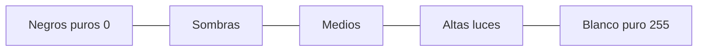

# Histograma y rango dinámico

Parte de: [[30-Fotografia/02 Exposición/_Índice Exposición|Exposición]]

> [!info] Cómo avanzar
> `progreso`: **pendiente** → **viendo** (estudiando) → **visto** (contestaste la autoevaluación sin abrir las respuestas) → **dominado** (hiciste el laboratorio o lo aplicaste de verdad).

## Contenido

### Qué es
El **histograma** es una gráfica de cuántos píxeles hay en cada nivel de brillo: a la izquierda los negros, al centro los tonos medios y a la derecha los blancos. La altura de cada barra es la cantidad de píxeles con ese brillo. No hay un histograma "correcto"; lo que importa es si la información toca o no las orillas.

El **rango dinámico** es la diferencia, en pasos, entre la luz más brillante y la sombra más oscura que el sensor puede registrar con detalle a la vez. Los sensores modernos de cámara rondan 12–14 pasos en RAW a ISO base; una escena con sol directo y sombras profundas puede superar eso.

### Cómo funciona

- **Picos pegados a la derecha** (un muro de barras en el borde): **altas luces quemadas**. Esos píxeles son blancos sin detalle y no se recuperan.
- **Picos pegados a la izquierda**: sombras empastadas (negro sin detalle). Se pueden aclarar algo, con ruido.
- Muchos visores muestran también histogramas por canal (R, G, B): un canal puede quemarse aunque el de luminancia parezca bien (por ejemplo, el rojo en una flor o en luces de escenario).

Las **zebras** de la a6700 (si las activas) y la alerta de altas luces en reproducción ("parpadeos") te dicen exactamente dónde se quema.

**Exponer a la derecha (ETTR)**: en RAW, el sensor registra la luz de forma lineal; el paso más brillante ocupa la mitad de todos los niveles disponibles. En un RAW de 14 bits (16,384 niveles), el último paso tiene 8,192 niveles; el siguiente, 4,096, y así. Si expones lo más claro posible **sin quemar**, las sombras quedan con más señal y menos ruido, y después bajas la exposición en el revelado. En JPEG no aplica igual: el archivo ya se procesó.

### Ejemplo
Ejercicio en la a6700: activa el histograma en el visor (botón DISP) y las zebras a un nivel alto.
1. Fotografía una ventana con sol desde dentro del cuarto. Observa el pico a la derecha (la ventana) y la masa a la izquierda (el cuarto). La escena **supera el rango dinámico**.
2. Baja la exposición hasta que las zebras desaparezcan de la ventana. Ahora el cuarto está oscuro.
3. En RAW, aclara sombras en el revelado; si el ruido es inaceptable, la solución es [[Bracketing y HDR en fotografía]] o agregar luz al interior.

En el iPhone, la app nativa no muestra histograma, pero el HDR automático ya combina cuadros para ampliar rango. Blackmagic Camera sí muestra histograma, zebras y falso color, pero es para video; en fotos lo revisas al editar (por ejemplo en [[Lightroom móvil (versión gratuita)]]).

### Cuándo usarlo y cuándo no
- **Revísalo** en escenas de alto contraste, nieve, playa, atardeceres y cualquier foto importante.
- **No persigas una "campana" centrada**: una foto de clave baja (nocturna, retrato oscuro) tendrá la masa a la izquierda y está perfecta.
- **Prioridad**: en casi toda foto, no quemar las altas luces importantes (piel, cielo con nubes, vestido blanco). Las fuentes de luz y los reflejos especulares sí pueden quemarse.
- La pantalla engaña con brillo alto o bajo; el histograma no.

### Errores comunes
1. **Juzgar la exposición solo por la pantalla** bajo el sol: se ve oscura y sobreexpones. Mira el histograma.
2. **Ver el histograma del JPEG y creer que es el RAW**: el del visor es del JPEG de vista previa; el RAW suele tener un poco más de margen en altas luces.
3. **ETTR exagerado**: quemar "solo un poco" y descubrir que la piel perdió el canal rojo.
4. **Ignorar los canales de color**: luces de escenario azules o rojas se queman en un canal mucho antes.

### Para profundizar
- [Understanding Histograms, Part 1 (Cambridge in Colour)](https://www.cambridgeincolour.com/tutorials/histograms1.htm)
- [Understanding Histograms, Part 2 (Cambridge in Colour)](https://www.cambridgeincolour.com/tutorials/histograms2.htm)
- [Understanding Dynamic Range (Cambridge in Colour)](https://www.cambridgeincolour.com/tutorials/dynamic-range.htm)
- [Digital Exposure Techniques: Expose to the Right (Cambridge in Colour)](https://www.cambridgeincolour.com/tutorials/digital-exposure-techniques.htm)

## Autoevaluación

Contesta primero en voz alta o en papel; luego despliega la respuesta.

> [!question]- ¿Qué muestra un histograma?
> Cuántos píxeles hay en cada nivel de luminosidad: izquierda = sombras, derecha = altas luces. No hay histograma "correcto"; depende de la escena.

> [!question]- ¿Cómo reconoces altas luces quemadas en el histograma?
> Un pico pegado al **borde derecho**: esos píxeles están en blanco puro sin detalle. Muchas apps también muestran parpadeo o **cebras** en esas zonas.

> [!question]- ¿Qué es el rango dinámico?
> La diferencia entre las zonas más oscuras y más claras que un sensor (o escena) puede registrar con detalle, medida en pasos.

> [!question]- ¿Por qué con RAW conviene "exponer a la derecha" sin quemar?
> Captas más luz y menos ruido en sombras; luego bajas en el revelado. El límite es no pegar las altas luces importantes al borde derecho.

## Práctica

- [[Práctica Foto 02 - Velocidad, ISO y profundidad de campo]]
- [[Práctica Foto 03 - Medición, compensación y bracketing]]

