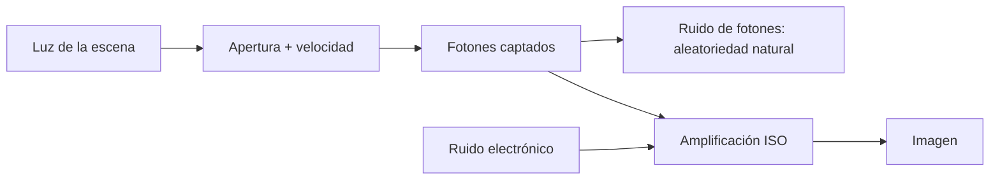

# ISO y ruido digital

Parte de: [[30-Fotografia/02 Exposición/_Índice Exposición|Exposición]]

> [!info] Cómo avanzar
> `progreso`: **pendiente** → **viendo** (estudiando) → **visto** (contestaste la autoevaluación sin abrir las respuestas) → **dominado** (hiciste el laboratorio o lo aplicaste de verdad).

## Contenido

### Qué es
El **ISO** indica cuánta **amplificación** se aplica a la señal del sensor. ISO 100 casi no amplifica; ISO 3200 amplifica 32 veces más (5 pasos). El **ruido** es la granulosidad y las manchas de color que aparecen cuando hay poca señal útil frente a la aleatoriedad propia de la luz y la electrónica. En la a6700 el rango estándar para fotos es ISO 100–32000.

### Cómo funciona
Punto clave: **el ISO no agrega luz**. El sensor capta los fotones que la apertura y la velocidad dejan pasar; el ISO solo decide qué tan brillante se muestra esa señal.



El ruido viene sobre todo de **pocos fotones**. Con poca luz, la diferencia aleatoria entre píxeles vecinos es grande comparada con la señal. Subir el ISO hace visible ese problema, pero el problema real es la poca luz. Por eso un sensor más grande (que capta más luz total para el mismo encuadre) muestra menos ruido. Ver [[Tamaño de sensor y factor de recorte]].

**Tipos de ruido**:
- **Luminancia**: grano gris, parecido a película. Se tolera bien.
- **Crominancia (color)**: manchas de colores, sobre todo en sombras. Se ve feo; la mayoría de editores lo eliminan fácil.
- **Patrón o bandas**: líneas horizontales o verticales al levantar mucho las sombras.
- **Píxeles calientes**: puntos brillantes en exposiciones largas.

**¿ISO alto bien expuesto o ISO bajo subexpuesto y aclarado después?** En general, es mejor **exponer bien con ISO alto**: aclarar mucho en edición amplifica igual el ruido y además puede revelar el ruido de lectura en sombras. En sensores modernos como el de la a6700 la diferencia es pequeña en algunos rangos (son casi "invariables al ISO"), pero exponer bien sigue siendo lo más seguro, siempre que no quemes altas luces.

**Pasos de ISO**: de 400 a 6400 hay 400 → 800 → 1600 → 3200 → 6400 = **4 pasos** de amplificación.

### Ejemplo
**Tripié y velocidad**: estás a ISO 3200 y 1/30 s en una escena quieta. Con tripié puedes ir a 1/8 s: son ≈ 2 pasos más de luz (log2(30/8) ≈ 1.9), así que bajas a **ISO 800**. Mucha menos granulosidad.

```python
import math
pasos = math.log2(30 / 8)          # ≈ 1.9 pasos más de tiempo
iso = 3200 / 2 ** pasos            # ≈ 853 → ISO 800
print(round(pasos, 2), round(iso), math.log2(6400 / 400))  # 1.91 853 4.0
```

**Modo Noche del iPhone**: en lugar de una toma a ISO altísimo, el iPhone captura varios cuadros (algunos largos) y los **promedia**. Al promediar N cuadros, el ruido aleatorio baja aproximadamente en √N mientras la señal se mantiene. Por eso se ve más limpio que una sola toma. Ver [[Fotografía computacional en celulares]].

Ejercicio con la a6700: en un cuarto con luz tenue, tripié, modo M a f/4. Toma la misma escena a ISO 100, 800, 3200, 12800 ajustando la velocidad para igualar exposición. Compara al 100 % en sombras: dónde empieza a molestarte el ruido. Ese es tu "ISO máximo cómodo".

### Cuándo usarlo y cuándo no
- **ISO bajo (100–400)**: luz de día, tripié, paisaje, producto.
- **ISO medio (800–3200)**: interiores, eventos, atardecer a pulso.
- **ISO alto (6400+)**: cuando la alternativa es una foto movida. Una foto con ruido se puede limpiar; una foto movida no. Ver [[Nitidez y reducción de ruido]].
- Configura **ISO Auto con un máximo** que hayas probado aceptable.

### Errores comunes
1. **Bajar el ISO a toda costa y salir con fotos movidas.** El ruido se corrige mejor que la trepidación.
2. **Subexponer "para no subir ISO" y aclarar después.** Suele dar más ruido que exponer bien.
3. **Juzgar el ruido al 200 % en pantalla.** Mira la foto al tamaño en que se va a ver (celular, impresión).
4. **Aplicar reducción de ruido extrema.** La piel queda de plástico; mejor un poco de grano.

### Para profundizar
- [Understanding Image Noise (Cambridge in Colour)](https://www.cambridgeincolour.com/tutorials/image-noise.htm)
- [Averaging Images to Reduce Noise (Cambridge in Colour)](https://www.cambridgeincolour.com/tutorials/image-averaging-noise.htm)
- [Digital Exposure Techniques (Cambridge in Colour)](https://www.cambridgeincolour.com/tutorials/digital-exposure-techniques.htm)

## Ejercicios

Resuélvelos en papel o en la herramienta; la solución está plegada.

> [!question]- Estás a ISO 3200 y 1/30 s. Si pudieras usar tripié y 1/8 s, ¿qué ISO usarías?
> 1/30 → 1/8 son ~2 pasos más de luz → ISO 3200 / 4 = **ISO 800**.

> [!question]- ¿Cuántos pasos de ruido "de más" tiene ISO 6400 frente a ISO 400?
> 400→800→1600→3200→6400 = **4 pasos** más de amplificación.

## Autoevaluación

Contesta primero en voz alta o en papel; luego despliega la respuesta.

> [!question]- ¿Qué hace realmente el ISO?
> Amplifica la señal del sensor (no lo vuelve "más sensible"). Subirlo aclara la imagen, pero también hace más visible el ruido.

> [!question]- ¿Qué es mejor con poca luz: ISO alto bien expuesto o ISO bajo subexpuesto y aclarado después?
> En general, **exponer bien con ISO más alto** da resultados similares o mejores que subexponer y aclarar en edición, porque lo que causa ruido es la poca luz captada.

> [!question]- ¿Qué tipos de ruido ves en una foto?
> **Luminancia** (granito gris) y **crominancia** (manchas de color). El de crominancia se quita fácilmente en edición; el de luminancia se reduce con cuidado para no borrar detalle.

> [!question]- ¿Por qué el modo Noche del iPhone tiene menos ruido que una sola toma a ISO alto?
> Combina varias tomas y las promedia: el ruido aleatorio se reduce al apilar. Ver [[Fotografía computacional en celulares]].

## Práctica

- [[Práctica Foto 02 - Velocidad, ISO y profundidad de campo]]

