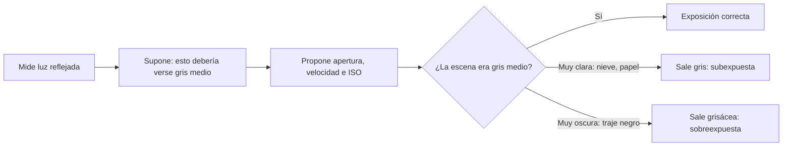

# Medición de luz (matricial, ponderada y puntual)

Parte de: [[30-Fotografia/02 Exposición/_Índice Exposición|Exposición]]

> [!info] Cómo avanzar
> `progreso`: **pendiente** → **viendo** (estudiando) → **visto** (contestaste la autoevaluación sin abrir las respuestas) → **dominado** (hiciste el laboratorio o lo aplicaste de verdad).

## Contenido

### Qué es
El **fotómetro** es el sistema que mide cuánta luz refleja la escena y propone una exposición. En las mirrorless y celulares la medición se hace con el propio sensor. El **modo de medición** decide **qué parte del cuadro** pesa más en esa decisión.

### Cómo funciona
El fotómetro tiene una suposición de fondo: que la escena, en promedio, es un **gris medio** (aproximadamente un 18 % de reflectancia). Mide la luz reflejada y ajusta la exposición para que lo medido salga gris medio.

Por eso la **nieve sale gris** y un **traje negro sale grisáceo** en automático: la cámara no sabe que debían ser blanco y negro, los "normaliza". La solución es la compensación (ver [[Compensación de exposición]]).

**Modos comunes** (en la a6700 se llaman Multi, Centro, Puntual, Promedio de toda la pantalla y Altas luces):
- **Matricial / evaluativa / multi**: divide el cuadro en muchas zonas (la a6700 usa 1200 zonas) y compara con patrones de escenas; da peso al punto de enfoque y a caras. Es la mejor opción general.
- **Ponderada al centro**: promedia todo, pero el centro pesa más. Predecible; útil para retratos centrados.
- **Puntual**: mide solo un círculo pequeño (pocos por ciento del cuadro). Para escenas de mucho contraste: un actor iluminado en un escenario oscuro, la Luna, un rostro a contraluz.
- **Altas luces** (Sony): prioriza que lo más brillante no se queme. Útil en escenarios y contraluces.

### Ejemplo
**En el iPhone** no eliges el modo, pero sí **dónde mide**: toca un punto de la pantalla y la cámara enfoca y mide ahí. Luego arrastra el ícono del sol hacia arriba o abajo para ajustar. Si mantienes presionado aparece **"Bloqueo AE/AF"**: la exposición y el enfoque quedan fijos aunque reencuadres. Practica: toma un atardecer tocando primero el cielo (sale el cielo bien, el suelo negro) y luego el suelo (suelo bien, cielo quemado).

**En la a6700**: concierto en un foro pequeño. En matricial, el fondo negro hace que la cámara sobreexponga y las caras salen blancas. Cambia a **puntual** (o Altas luces) y mide sobre la cara del cantante: la piel queda bien y el fondo negro se queda negro.

Ejercicio: pon una hoja blanca y luego una camiseta negra llenando el cuadro, en modo A sin compensación. Ambas saldrán casi del mismo gris. Luego coloca una tarjeta gris (o algo de tono medio, como jeans desgastados o pasto) y mide ahí; usa esa exposición en M para las tres.

### Cuándo usarlo y cuándo no
- **Matricial**: 80 % de las fotos. Combínala con compensación y el histograma.
- **Puntual**: sujetos pequeños con fondos muy distintos; usa siempre bloqueo de exposición o modo M para no perder la medición al reencuadrar.
- **Ponderada al centro**: si quieres un comportamiento simple y repetible.
- Con **mirrorless** puedes "ver" la exposición en pantalla antes de disparar; aprovecha el histograma y las zebras en lugar de confiar a ciegas en el fotómetro. Ver [[Histograma y rango dinámico]].

### Errores comunes
1. **Medir en puntual y reencuadrar sin bloquear**: la cámara vuelve a medir otra cosa.
2. **Medir puntual sobre algo que no es tono medio** (piel muy clara, cielo) sin compensar después.
3. **Culpar a la cámara por la nieve gris**: es el fotómetro haciendo exactamente lo que se le pide. Compensa +1 a +2.
4. **Usar puntual siempre "porque es más preciso"**: es más preciso para lo que mides, no para la escena completa.

### Para profundizar
- [Understanding Camera Metering (Cambridge in Colour)](https://www.cambridgeincolour.com/tutorials/camera-metering.htm)
- [Guía de ayuda α6700 (Sony)](https://helpguide.sony.net/ilc/2320/v1/en/)
- [Understanding Camera Exposure (Cambridge in Colour)](https://www.cambridgeincolour.com/tutorials/camera-exposure.htm)

## Autoevaluación

Contesta primero en voz alta o en papel; luego despliega la respuesta.

> [!question]- ¿Qué hace el fotómetro de la cámara?
> Mide la luz reflejada y calcula una exposición que deja la escena en un **gris medio** promedio.

> [!question]- ¿Qué diferencia hay entre medición matricial, ponderada al centro y puntual?
> **Matricial/multisegmento**: analiza toda la escena. **Ponderada al centro**: da más peso al centro. **Puntual**: mide una zona pequeña; útil para contraluces o un escenario iluminado sobre fondo negro.

> [!question]- ¿Por qué la nieve sale gris y un traje negro sale grisáceo en automático?
> El fotómetro intenta llevarlo todo a gris medio. Corrige con **compensación**: +1 a +2 en nieve, −1 en escenas oscuras.

> [!question]- ¿Cómo "mides" en el iPhone en un punto concreto?
> En la app nativa, toca la zona para enfocar y medir; mantén presionado para bloquear AE/AF y luego ajusta con el control de exposición.

## Práctica

- [[Práctica Foto 03 - Medición, compensación y bracketing]]

