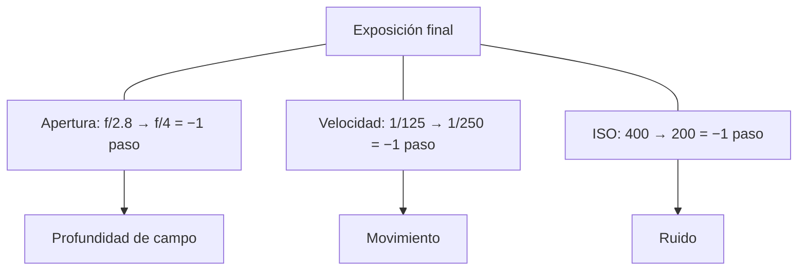

# Triángulo de exposición

Parte de: [[30-Fotografia/02 Exposición/_Índice Exposición|Exposición]]

> [!info] Cómo avanzar
> `progreso`: **pendiente** → **viendo** (estudiando) → **visto** (contestaste la autoevaluación sin abrir las respuestas) → **dominado** (hiciste el laboratorio o lo aplicaste de verdad).

## Contenido

### Qué es
La **exposición** es cuánta luz llega al sensor y cómo se traduce en brillo en la foto. El **triángulo de exposición** es el modelo que reúne los tres controles con que la ajustas:

- **Apertura** (número f): el tamaño del agujero del lente. Efecto secundario: **profundidad de campo**. Ver [[Apertura y profundidad de campo]].
- **Velocidad de obturación**: cuánto tiempo entra la luz. Efecto secundario: **movimiento** (congelado o con estela). Ver [[Velocidad de obturación y movimiento]].
- **ISO**: cuánto se amplifica la señal del sensor. Efecto secundario: **ruido**. Ver [[ISO y ruido digital]].

Los tres aclaran u oscurecen la foto; lo que eliges es **qué efecto secundario aceptas**.

### Cómo funciona
La unidad común es el **paso** (stop): duplicar o reducir a la mitad la luz.



- **Velocidad**: cada duplicación de tiempo es +1 paso (1/500 → 1/250 → 1/125).
- **ISO**: cada duplicación es +1 paso (100 → 200 → 400 → 800 → 1600; de 100 a 1600 hay **4 pasos**).
- **Apertura**: la serie es f/1.4, 2, 2.8, 4, 5.6, 8, 11, 16, 22. Cada número es el anterior × √2 (≈ 1.4) y cada salto es **un paso menos** de luz. Número f **pequeño** = apertura **grande** = más luz. De más luz a menos: f/1.8 > f/2.8 > f/5.6 > f/11.

La regla de oro es la **reciprocidad**: si quitas un paso de un lado, lo devuelves en otro y la exposición queda igual. Ejemplo: f/8, 1/125 s, ISO 100. Si abres a f/4 ganas 2 pasos (f/8 → 5.6 → 4), así que acortas la velocidad 2 pasos: 1/125 → 1/250 → **1/500 s**.

Cálculo en Python para no equivocarte:

```python
import math
pasos_apertura = 2 * math.log2(8 / 4)     # 2.0 pasos
pasos_velocidad = math.log2(250 / 60)      # ≈ 2.06 pasos de 1/60 a 1/250
iso_nuevo = 800 * (250 / 60)               # ≈ 3333 → ISO 3200
print(pasos_apertura, pasos_velocidad, iso_nuevo)
```

### Ejemplo
**En el iPhone 15 Pro** la apertura de cada cámara es fija (principal f/1.78, ultra gran angular f/2.2, telefoto f/2.8), así que con una app manual solo mueves **velocidad e ISO**. Supón 1/60 s e ISO 800 bien expuesto, pero tu sujeto se mueve y quieres 1/250 s: son ≈ 2 pasos menos de luz, así que ISO 800 × 4 ≈ **ISO 3200**. Más ruido; la alternativa es buscar más luz.

**En la a6700** con un 50 mm f/1.8, de día nublado: modo A, f/2.8 para retrato. La cámara propone 1/500 s a ISO 100. Si cierras a f/5.6 (2 pasos), en modo A la velocidad baja sola a 1/125 s.

Ejercicio: en modo M, fija ISO 400 y 1/125 s. Toma la misma escena a f/2.8, f/4, f/5.6 y f/8 sin tocar nada más. Verás cada foto con la mitad de luz que la anterior; luego compensa cada una con la velocidad y comprueba que el brillo se iguala.

### Cuándo usarlo y cuándo no
Piensa en orden de **prioridad creativa**:
1. ¿Qué necesita esta foto? Movimiento (velocidad) o fondo (apertura).
2. Fija ese lado primero.
3. Ajusta el segundo lado creativo si importa.
4. Deja el **ISO** como último recurso para completar.

El triángulo es un modelo simplificado: el **brillo final** también lo mueve la luz de la escena (flash, reflectores) y el procesamiento. No sirve para "arreglar" una escena con más rango dinámico del que el sensor capta; para eso ver [[Bracketing y HDR en fotografía]].

### Errores comunes
1. **Confundir número f grande con apertura grande.** f/16 es un agujero pequeño.
2. **Subir ISO primero.** Agotas velocidad y apertura antes; el ISO es el que más calidad cuesta.
3. **Contar mal los pasos de apertura.** De f/2 a f/4 son 2 pasos, no 1 (pasa por f/2.8).
4. **Pensar que ISO "agrega luz".** No: amplifica la señal ya capturada. Más luz real siempre da menos ruido.

### Para profundizar
- [Understanding Camera Exposure (Cambridge in Colour)](https://www.cambridgeincolour.com/tutorials/camera-exposure.htm)
- [Digital Exposure Techniques (Cambridge in Colour)](https://www.cambridgeincolour.com/tutorials/digital-exposure-techniques.htm)
- [iPhone 15 Pro — especificaciones técnicas (Apple)](https://support.apple.com/en-us/111829)

## Ejercicios

Resuélvelos en papel o en la herramienta; la solución está plegada.

> [!question]- Tienes f/8, 1/125 s, ISO 100. Pasas a f/4 sin cambiar el ISO. ¿Qué velocidad mantiene la exposición?
> f/8 → f/4 son **2 pasos** más de luz, así que la velocidad se acorta 2 pasos: 1/125 → 1/250 → **1/500 s**.

> [!question]- ¿Cuántos pasos hay de ISO 100 a ISO 1600?
> 100→200→400→800→1600 = **4 pasos**.

> [!question]- En la cámara Profesional de Lightroom móvil tienes 1/60 s e ISO 800 y la foto sale bien expuesta, pero el sujeto se mueve. Quieres 1/250 s. ¿Qué ISO necesitas?
> 1/60 → 1/250 son ~2 pasos menos de luz → ISO 800 × 4 = **ISO 3200** (más ruido; o busca más luz). Para fotos usa una app que sí dispare fotos fijas, como esta; Blackmagic Camera solo graba video.

> [!question]- Ordena de más luz a menos: f/2.8, f/11, f/1.8, f/5.6.
> **f/1.8 > f/2.8 > f/5.6 > f/11**. Número f más pequeño = apertura más grande = más luz.

## Autoevaluación

Contesta primero en voz alta o en papel; luego despliega la respuesta.

> [!question]- ¿Cuáles son los tres lados del triángulo de exposición y qué efecto secundario tiene cada uno?
> **Apertura** → profundidad de campo. **Velocidad de obturación** → congelar o mostrar movimiento. **ISO** → ruido. Los tres cambian la luminosidad de la foto.

> [!question]- ¿Qué es un "paso" (stop) de luz?
> Duplicar o reducir a la mitad la luz. Ejemplos: 1/250 → 1/125 s, ISO 100 → 200, f/4 → f/2.8 (cada uno = +1 paso).

> [!question]- Si cierras la apertura un paso, ¿cómo compensas para mantener la misma exposición?
> Abres otro lado un paso: velocidad el doble de larga (1/250 → 1/125) o ISO el doble (200 → 400).

> [!question]- En el iPhone 15 Pro, ¿cuáles lados del triángulo puedes mover a mano?
> Solo **velocidad** e **ISO** (con una app manual); la apertura de cada cámara es fija. Por eso los efectos de apertura en el iPhone se practican cambiando de cámara y de distancia, o con el modo Retrato (desenfoque simulado).

## Práctica

- [[Práctica Foto 02 - Velocidad, ISO y profundidad de campo]]

