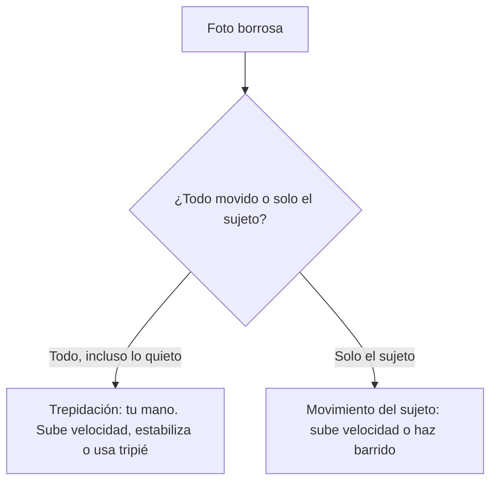

# Velocidad de obturación y movimiento

Parte de: [[30-Fotografia/02 Exposición/_Índice Exposición|Exposición]]

> [!info] Cómo avanzar
> `progreso`: **pendiente** → **viendo** (estudiando) → **visto** (contestaste la autoevaluación sin abrir las respuestas) → **dominado** (hiciste el laboratorio o lo aplicaste de verdad).

## Contenido

### Qué es
La **velocidad de obturación** es el tiempo que el sensor recibe luz: 1/1000 s, 1/60 s, 2 s. Además de la cantidad de luz, controla **cómo se ve el movimiento**: tiempos cortos lo congelan, tiempos largos lo convierten en estela. También decide si **tu propio pulso** mueve la foto.

### Cómo funciona
Durante la exposición, todo lo que se mueve en el cuadro (el sujeto o la cámara) "pinta" su recorrido. Dos fuentes de borrosidad distintas:

**Regla de 1/focal** (para fotos a pulso, sin estabilización): la velocidad mínima ≈ 1 / (focal **equivalente**).
- Telefoto 3x del iPhone (≈ 77 mm): ≈ **1/80 s** como mínimo (mejor 1/100–1/125).
- a6700 con un 50 mm: equivalente 50 × 1.5 = 75 mm → ≈ **1/80 s** sin estabilización.
La estabilización en cuerpo de la a6700 (Sony declara hasta 5 pasos) permite bajar bastante en sujetos quietos, pero **no congela al sujeto** que se mueve.

**Velocidades orientativas para congelar**:
- Personas caminando: ≈ 1/250 s.
- Niños corriendo, mascotas jugando: 1/500–1/1000 s.
- Aves en vuelo, deporte rápido: 1/1600–1/3200 s.

**Para mostrar movimiento**:
- Agua sedosa: 1/4 s a varios segundos, con tripié.
- Estelas de autos de noche: 5–30 s. Ver [[Larga exposición]].

**Barrido (panning)**: sigues al sujeto con la cámara durante una velocidad lenta (1/30–1/60 s para un ciclista). El sujeto queda relativamente nítido y el fondo se vuelve líneas de velocidad. Gira desde la cintura, dispara en ráfaga y continúa el movimiento después del clic.

### Ejemplo
**Fuente de día con el iPhone**: quieres agua sedosa (≈ 1/2 s), pero el iPhone tiene apertura fija y a pleno sol, incluso a su ISO mínimo, 1/2 s sobreexpone muchísimo. Opciones:
1. **Modo Live Photo + efecto "Exposición larga"** en la app Fotos: el iPhone mezcla los cuadros del Live Photo y simula la estela. Necesitas el teléfono muy quieto (apoyado o en tripié).
2. **Filtro ND** delante del lente para restar luz. Ver [[Filtro ND en fotografía]].
3. Ir en **hora azul** o a la sombra, donde hay menos luz. Ver [[Hora dorada y hora azul]].

**Mascota corriendo con la a6700**: modo S a 1/1000 s o M con ISO Auto, AF-C con seguimiento y ráfaga. Si el ISO sube demasiado, prueba 1/640 s.

Ejercicio: elige una calle con autos y toma la misma escena a 1/1000, 1/125, 1/30 y 1/8 s (en modo S o con app manual). Después intenta un barrido a 1/30 s siguiendo un auto o bici; necesitarás varios intentos.

### Cuándo usarlo y cuándo no
- **Prioriza velocidad** cuando el movimiento define la foto: deporte, niños, fauna, agua, luces.
- **No la subas sin razón**: cada paso más rápido cuesta un paso de apertura o ISO. Si el sujeto está quieto y tienes estabilización, una velocidad moderada con ISO bajo da mejor calidad.
- **En video** la regla es otra (180°: velocidad ≈ 1/(2 × fps)); no la mezcles con la foto.

### Errores comunes
1. **Usar la focal real y no la equivalente** en la regla 1/focal con la a6700: te quedas corto 1.5×.
2. **Confiar en el estabilizador para sujetos en movimiento**: estabiliza tu mano, no al niño.
3. **Presionar el botón "golpeando"**: sostén con ambas manos, codos pegados, exhala y presiona suave. En el iPhone, usa el botón de volumen o el temporizador.
4. **Barrido con velocidad demasiado rápida**: a 1/500 s el fondo no se mueve; baja a 1/30–1/60 s.

### Para profundizar
- [Using Camera Shutter Speed Creatively (Cambridge in Colour)](https://www.cambridgeincolour.com/tutorials/camera-shutter-speed.htm)
- [Reducing Camera Shake with Hand-Held Photos (Cambridge in Colour)](https://www.cambridgeincolour.com/tutorials/camera-shake.htm)
- [Sony α6700 — lista de características (Sony)](https://www.sony.co.nz/interchangeable-lens-cameras/products/ilce-6700/feature-list)

## Ejercicios

Resuélvelos en papel o en la herramienta; la solución está plegada.

> [!question]- Usas la telefoto 3x (≈77 mm) a pulso. ¿Cuál es la velocidad mínima sugerida por la regla 1/focal?
> ≈ **1/80 s** (redondeando 1/77).

> [!question]- En la a6700 con un 50 mm (factor 1.5), ¿qué velocidad mínima a pulso sin estabilización?
> 50 × 1.5 = 75 mm eq → ≈ **1/80 s**. Con estabilización puedes bajar algo, si el sujeto está quieto.

> [!question]- Quieres agua de fuente "sedosa" de día con el iPhone. ¿Qué te limita y qué opciones tienes?
> Demasiada luz para velocidades lentas (no hay apertura que cerrar). Opciones: efecto **Exposición larga** de Live Photo, un filtro ND, o hacerlo al atardecer.

## Autoevaluación

Contesta primero en voz alta o en papel; luego despliega la respuesta.

> [!question]- ¿Qué controla la velocidad de obturación además de la luz?
> El **movimiento**: rápida (1/1000 s) congela; lenta (1/15 s o más) muestra estelas, agua sedosa o barridos.

> [!question]- ¿Qué es la regla de 1/focal para fotos a pulso?
> Una guía: usar una velocidad al menos de 1/(focal equivalente) para evitar trepidación. Con 77 mm ≈ 1/80 s. La estabilización ayuda contra tu temblor, **no** contra el movimiento del sujeto.

> [!question]- ¿Qué es un barrido (panning)?
> Seguir con la cámara a un sujeto que se mueve usando velocidad lenta (p. ej. 1/30 s): el sujeto queda relativamente nítido y el fondo se ve en líneas de movimiento.

> [!question]- ¿Qué velocidades típicas sirven para congelar personas caminando, niños corriendo y aves en vuelo?
> Aproximadamente **1/250 s** caminando, **1/500–1/1000 s** niños o deporte, **1/2000 s o más** aves en vuelo. Son puntos de partida, no reglas.

## Práctica

- [[Práctica Foto 02 - Velocidad, ISO y profundidad de campo]]
- [[Práctica Foto 08 - Larga exposición nocturna con el iPhone]]

