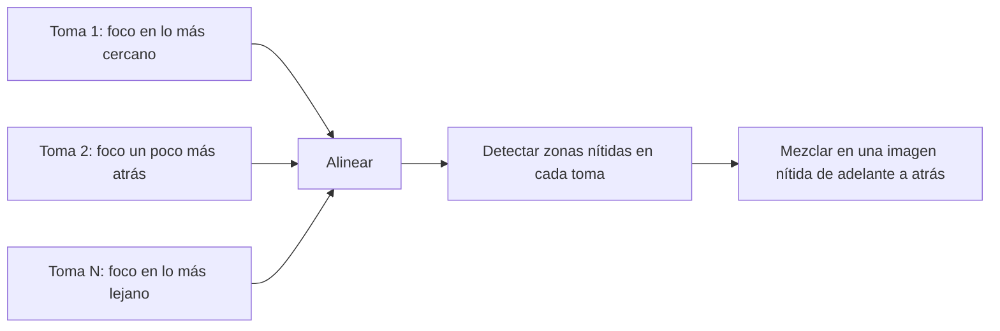

# Focus stacking (apilado de enfoque)

Parte de: [[30-Fotografia/03 Enfoque/_Índice Enfoque|Enfoque]]

> [!info] Cómo avanzar
> `progreso`: **pendiente** → **viendo** (estudiando) → **visto** (contestaste la autoevaluación sin abrir las respuestas) → **dominado** (hiciste el laboratorio o lo aplicaste de verdad).

## Contenido

### Qué es
El **focus stacking** (apilado de enfoque) consiste en tomar varias fotos idénticas de una escena cambiando solo el **punto de enfoque** entre cada una, y luego combinarlas con software para quedarte con la parte nítida de cada toma. El resultado tiene una profundidad de campo imposible de lograr en una sola foto sin sufrir difracción.

### Cómo funciona


1. **Captura**: tripié, exposición manual fija, balance de blancos fijo y enfoque manual. Avanzas el foco en pequeños pasos de modo que la zona nítida de una toma **se traslape** con la siguiente.
2. **Alineación**: al cambiar el foco, muchos lentes cambian levemente el encuadre (*focus breathing*); el software corrige la escala.
3. **Mezcla**: el programa calcula qué píxeles tienen más contraste local en cada toma y los combina.

**¿Cuántas tomas?** Depende de la PdC de cada una. En macro a f/5.6 puede haber milímetros de PdC: 15–50 tomas. En paisaje con primer plano a 30 cm: 3–5 tomas bastan (una al primer plano, una a media distancia, una a la hiperfocal o infinito).

**Herramientas**:
- La a6700 incluye **horquillado de enfoque** (focus bracketing) de hasta 299 imágenes según Sony: la cámara mueve el foco sola en pasos que tú defines. Necesitas lente con AF.
- Software gratuito para unir: por ejemplo **enfuse** del proyecto Hugin (alineación con `align_image_stack` y mezcla de enfoque). También lo hacen editores de pago como Photoshop.
- En el iPhone no hay apilado nativo; puedes tomar varias fotos tocando distintos puntos (con el teléfono en tripié) y unirlas en la PC.

### Ejemplo
**Producto: un reloj sobre una mesa con la a6700 y un 50 mm**:
1. Tripié, modo M, f/5.6 (zona más nítida del lente), ISO 100, velocidad para exponer bien; balance de blancos fijo; temporizador o disparador remoto.
2. Activa el horquillado de enfoque: elige el punto de partida en lo más cercano (la corona del reloj), un paso pequeño y suficientes tomas para llegar a la parte trasera.
3. Revisa que la última toma ya tenga el fondo o la parte posterior nítida.
4. En la PC alinea y mezcla; revisa los bordes del reloj al 100 % por si aparecen halos.

Ejercicio de paisaje: una flor a 30 cm y montañas al fondo con 16 mm a f/8. Toma 3 fotos: foco en la flor, en 1.5 m y en infinito. Combínalas y compáralas con una sola toma a f/22.

Comandos típicos (en Windows desde la carpeta de Hugin, ajusta rutas):

```bash
# Alinear las tomas (genera archivos alineados con prefijo "al_")
align_image_stack -m -a al_ toma_*.tif
# Mezclar por nitidez
enfuse --exposure-weight=0 --saturation-weight=0 --contrast-weight=1 --hard-mask -o apilado.tif al_*.tif
```

### Cuándo usarlo y cuándo no
- **Sí**: macro, producto, comida, paisaje con primer plano muy cercano, arquitectura interior con detalles cercanos. Ver [[Fotografía macro]] y [[Fotografía de producto y comida]].
- **No**: sujetos que se mueven (insectos vivos, flores con viento, personas): aparecen fantasmas o zonas dobles. Ahí usa una sola toma con la mejor apertura o la hiperfocal (ver [[Distancia hiperfocal]]).
- Si una sola toma a f/8–f/11 ya cubre lo que necesitas, no compliques.

### Errores comunes
1. **Mover la cámara o el sujeto entre tomas**: el software no alinea bien y aparecen bordes dobles. Tripié firme, disparador remoto y sin viento.
2. **Pasos de enfoque muy grandes**: quedan bandas borrosas entre zonas nítidas. Haz pasos más cortos y que se traslapen.
3. **Cambiar exposición o balance entre tomas**: parpadeo y manchas. Todo en manual.
4. **Halos en bordes de alto contraste** (contorno del objeto contra el fondo): retócalos con la toma que tenga mejor borde o usa máscaras duras.
5. **Cerrar mucho para "usar menos tomas"**: regresa la difracción que intentabas evitar.

### Para profundizar
- [Extending Depth of Field Using Focus Stacking (Cambridge in Colour)](https://www.cambridgeincolour.com/tutorials/focus-stacking.htm)
- [Hugin — Panorama photo stitcher (incluye enfuse)](https://hugin.sourceforge.io/)
- [Sony α6700 — lista de características (Sony)](https://www.sony.co.nz/interchangeable-lens-cameras/products/ilce-6700/feature-list)

## Autoevaluación

Contesta primero en voz alta o en papel; luego despliega la respuesta.

> [!question]- ¿Qué es el focus stacking?
> Tomar varias fotos idénticas moviendo el punto de enfoque poco a poco y combinarlas en una sola donde todo está nítido.

> [!question]- ¿Cuándo se usa?
> Macro (la profundidad de campo es de milímetros), producto y paisaje con primer plano muy cercano.

> [!question]- ¿Qué errores arruinan un apilado?
> Mover la cámara entre tomas, cambiar la exposición, sujeto que se mueve (viento) y saltos de enfoque demasiado grandes que dejan franjas borrosas.

## Práctica

- [[Práctica Foto 04 - Enfoque manual, macro y apilado]]

