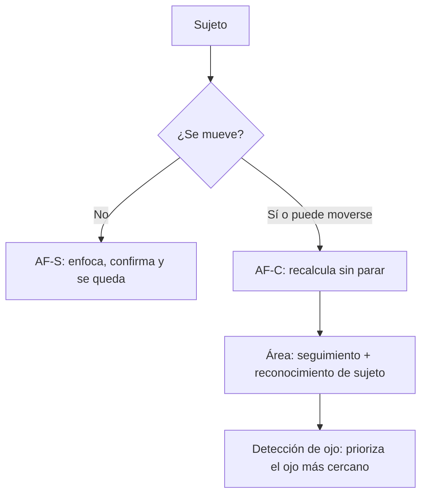

# Modos de enfoque automático (AF-S, AF-C y seguimiento)

Parte de: [[30-Fotografia/03 Enfoque/_Índice Enfoque|Enfoque]]

> [!info] Cómo avanzar
> `progreso`: **pendiente** → **viendo** (estudiando) → **visto** (contestaste la autoevaluación sin abrir las respuestas) → **dominado** (hiciste el laboratorio o lo aplicaste de verdad).

## Contenido

### Qué es
El **enfoque automático** (AF) mueve los elementos del lente hasta que el sujeto queda nítido. Hay dos decisiones independientes:
- **Modo de enfoque**: *cuándo* enfoca. **AF-S** (sencillo) enfoca una vez y se queda fijo; **AF-C** (continuo) sigue corrigiendo mientras mantienes el botón a medias. Muchas cámaras tienen **AF-A** (decide sola) y **DMF** (AF y luego retoque manual).
- **Área de enfoque**: *dónde* enfoca. Amplia, zona, punto (fijo o expandido) y **seguimiento** (tracking), que persigue al sujeto por el cuadro.

Encima de eso está el **reconocimiento de sujetos**: la a6700 detecta personas, animales, aves, insectos, autos/trenes y aviones, y en personas, animales y aves reconoce cabeza, cuerpo y **ojos**.

### Cómo funciona
La a6700 enfoca con **detección de fase en el sensor** (hasta 759 puntos que cubren casi todo el cuadro en foto). Sabe no solo si está desenfocado, sino hacia dónde y cuánto mover el lente, por eso es rápida.

- **AF-S**: ideal para paisaje, producto, arquitectura, retrato posado. Con el botón a medias enfocas y puedes reencuadrar (enfocar y recomponer).
- **AF-C**: personas caminando, niños, mascotas, deporte. Cuidado: si reencuadras, vuelve a enfocar lo que quede en el área.
- **Seguimiento con detección de ojos**: tocas o eliges al sujeto y la cámara mantiene el enfoque sobre su ojo aunque se mueva por el cuadro. En retrato a f/1.8 es lo que hace la diferencia entre ojo nítido y oreja nítida.

**En el iPhone** (app nativa) el enfoque es automático y continuo; tú solo indicas dónde. Toca la pantalla para enfocar y medir en ese punto. Mantén presionado hasta que aparezca **"Bloqueo AE/AF"**: enfoque y exposición quedan fijos aunque reencuadres o el sujeto cambie. Toca otra vez para liberar. Ver [[Medición de luz (matricial, ponderada y puntual)]].

### Ejemplo
**Configuración de partida en la a6700** (los nombres exactos de menú pueden variar según el idioma y firmware):
1. **Retrato posado**: AF-S, área punto expandido o amplia con reconocimiento de **Humano** y prioridad a ojos.
2. **Niños o perro corriendo**: AF-C, área **seguimiento** (amplia), reconocimiento Humano o Animal, ráfaga, 1/1000 s.
3. **Aves**: AF-C, seguimiento, reconocimiento **Ave**; empieza con una zona amplia y deja que la cámara encuentre el ojo.
4. **Paisaje en tripié**: AF-S en punto sobre el elemento clave, luego cambia a MF para que no se mueva entre tomas.

Ejercicio: pide a alguien que camine hacia ti desde 10 m. Haz una ráfaga en AF-S y otra en AF-C con seguimiento. En AF-S las fotos finales saldrán desenfocadas (el enfoque se quedó en la primera distancia); en AF-C deberían mantenerse nítidas.

En el iPhone: fotografía una flor cercana con fondo lejano, toca la flor, bloquea AE/AF y reencuadra; luego toca el fondo y compara.

### Cuándo usarlo y cuándo no
- **AF-S + punto**: sujetos quietos y cuando quieres control exacto del plano de foco.
- **AF-C + seguimiento**: todo lo que se mueve o puede moverse. Muchos fotógrafos dejan AF-C como predeterminado con mirrorless modernas.
- **Enfoque manual**: macro, noche, a través de vidrio o ramas, video con cambios de foco planeados. Ver [[Enfoque manual y focus peaking]].
- **Botón trasero de enfoque** (back-button focus): separa enfocar de disparar; útil cuando alternas entre seguir y bloquear.

### Errores comunes
1. **AF-S con sujetos en movimiento**: la foto se toma con el enfoque de hace medio segundo.
2. **Área amplia sin reconocimiento de sujeto**: la cámara enfoca lo más cercano o lo más contrastado (una rama, un letrero).
3. **Enfocar y recomponer a f/1.4 muy cerca**: al girar la cámara el plano de foco se desplaza; mejor mueve el punto de enfoque o usa detección de ojos.
4. **Reconocimiento en "Animal" cuando fotografías personas** (o viceversa): revisa el sujeto seleccionado.

### Para profundizar
- [Understanding Camera Autofocus (Cambridge in Colour)](https://www.cambridgeincolour.com/tutorials/camera-autofocus.htm)
- [Sony α6700 — lista de características (Sony)](https://www.sony.co.nz/interchangeable-lens-cameras/products/ilce-6700/feature-list)
- [Guía de ayuda α6700 (Sony)](https://helpguide.sony.net/ilc/2320/v1/en/)

## Autoevaluación

Contesta primero en voz alta o en papel; luego despliega la respuesta.

> [!question]- ¿Qué diferencia hay entre AF-S y AF-C?
> **AF-S**: enfoca una vez y bloquea mientras mantienes medio presionado (sujetos quietos). **AF-C**: sigue ajustando mientras el sujeto se mueve.

> [!question]- ¿Qué hace el AF de seguimiento con detección de ojos?
> La cámara reconoce un sujeto (ojo humano, animal, vehículo) y lo sigue por el encuadre. En la a6700 es una de sus fortalezas; detalles en [[Sony a6700]].

> [!question]- ¿Cómo bloqueas enfoque y exposición en la cámara nativa del iPhone?
> Mantén presionado sobre el sujeto hasta ver **Bloqueo AE/AF**; luego recompón sin que cambie.

## Práctica

- [[Práctica Foto 04 - Enfoque manual, macro y apilado]]

